# 分部素描与排线：当前进度（Astra ultra）

**状态：完整台灯软件切片与多种局部编辑已实现；完整 P1 尚未通过，整体视觉 NO_GO 保留。**

当前使用参数化台灯、人工/GT网格、GT部件与人工方向。没有真实 RaDe-GS 灯具训练/重建结果，也没有自动分部或 H2–H5 成功证据。局部编辑/有限有效子集的 GO 不能替代完整视觉与时序验收。

- 发布前科研提交：`6d1746a38d726c9d37731ee7d282038c95de6e74`。本发布提交只整理已有证据和未完成代码，不启动新实验。
- 10 个已封存单元（unit_001–010）；unit_011 代码与部分输出未封存，明确按 WIP 保存。
- 监督器实际于 2026-10-21 19:46 JST 停在 unit_011 工程/交接失败（缺 NEXT，原调用及同session恢复均返回1），并未继续到22点。独立定时监控及22点验收后来也因模型账户额度失败；本次发布没有补写科学封存或追认通过。
- [执行状态与错误](artifacts/partwise_sketch_hatching_v02_publication/runtime_snapshot/FINAL_SUMMARY.json) · [unit_011 原始引擎错误摘录](artifacts/partwise_sketch_hatching_v02_publication/runtime_snapshot/UNIT011_ENGINE_FAILURES.json)
- 所有先前密度 NO_GO、可见性/时序覆盖不足、原143及子退出码未知等记录均保留。

## 最新已封存整灯资产：unit_010

组合：灯罩0°260条、疏化支杆24条、底座75对/150条，整灯434条；底座请求长度0.18→0.12。15°灯罩另存，不冒充已组合。
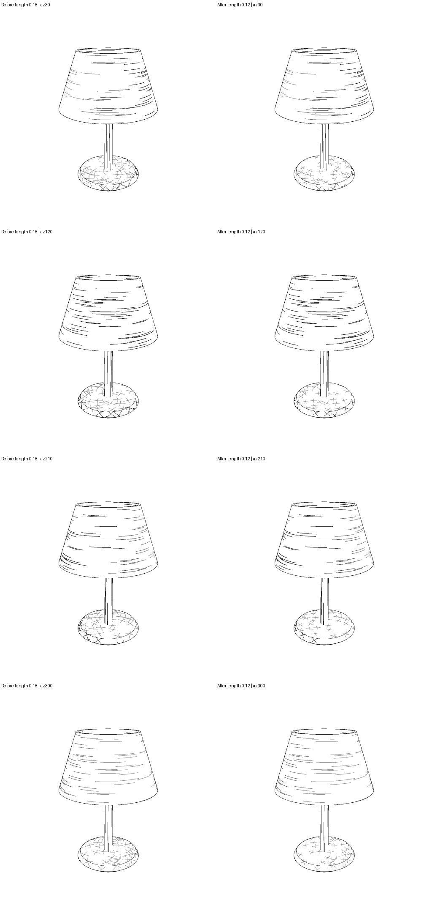

图为同视角前后对照；底座长交叉减少，但灯罩叠线、边缘堆墨与不均匀间距仍可见。
- [转台 MP4（显示转码）](artifacts/partwise_sketch_hatching_v02_publication/unit_010/videos/orbit.mp4)
- [缩放 MP4（显示转码）](artifacts/partwise_sketch_hatching_v02_publication/unit_010/videos/zoom.mp4)
- [固定相机局部编辑 MP4（显示转码）](artifacts/partwise_sketch_hatching_v02_publication/unit_010/videos/edit.mp4)
- [原始无损视频与解码收据](artifacts/partwise_sketch_hatching_v02_publication/unit_010/VIDEO_VALIDATION.json)
- [最新GT资产、路径、种子配方与配置](artifacts/partwise_sketch_hatching_v02_publication/unit_010/outputs/edited/asset.json)
- [详细报告](artifacts/partwise_sketch_hatching_v02_publication/unit_010/REPORT_ZH.md) · [复现说明（包含服务器路径）](artifacts/partwise_sketch_hatching_v02_publication/unit_010/REPRODUCE.md)

## 已执行单元导航

### unit_001（已封存）

整灯608路径接回新渲染；软件切片GO、视觉NO_GO。
原状态：`WHOLE_LAMP_SOFTWARE_SLICE_GO_VISUAL_NO_GO`。

[原报告](artifacts/partwise_sketch_hatching_v02_publication/unit_001/REPORT_ZH.md) · [STATUS](artifacts/partwise_sketch_hatching_v02_publication/unit_001/STATUS.json) · [原封存](artifacts/partwise_sketch_hatching_v02_publication/unit_001/SEAL.json)

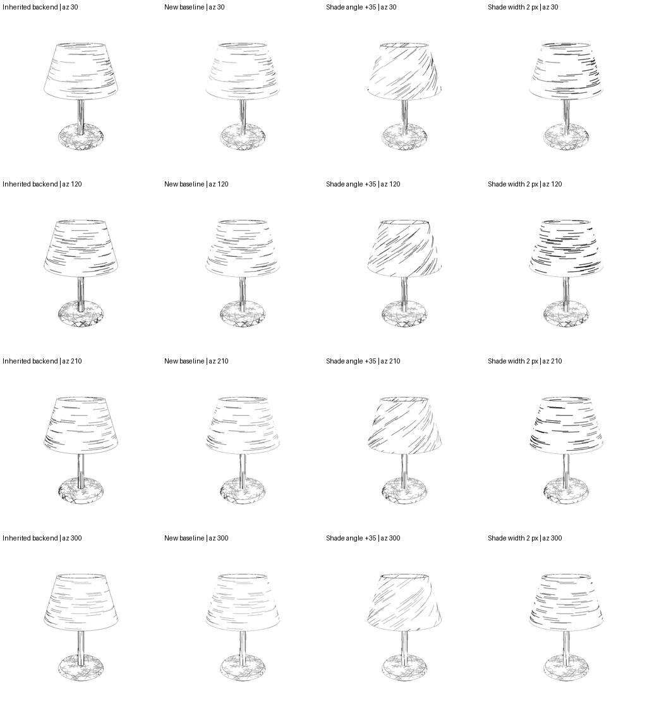

### unit_002（已封存）

修复整灯外轮廓连续性；完整视觉与隐藏支持仍未通过。
原状态：`WHOLE_LAMP_CONTOUR_REPAIR_GO_FULL_VISUAL_NO_GO`。

[原报告](artifacts/partwise_sketch_hatching_v02_publication/unit_002/REPORT_ZH.md) · [STATUS](artifacts/partwise_sketch_hatching_v02_publication/unit_002/STATUS.json) · [原封存](artifacts/partwise_sketch_hatching_v02_publication/unit_002/SEAL.json)

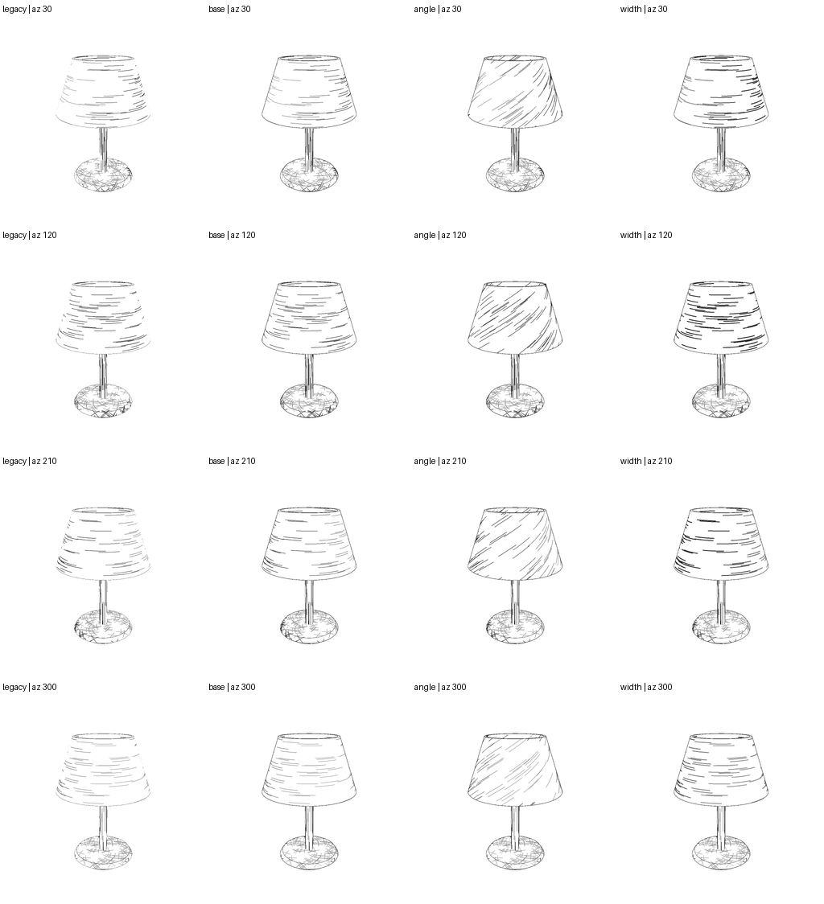

### unit_003（已封存）

底座300→150条，保留双方向；更干净但完整视觉NO_GO。
原状态：`BASE_DENSITY_CLEANUP_GO_FULL_VISUAL_NO_GO`。

[原报告](artifacts/partwise_sketch_hatching_v02_publication/unit_003/REPORT_ZH.md) · [STATUS](artifacts/partwise_sketch_hatching_v02_publication/unit_003/STATUS.json) · [原封存](artifacts/partwise_sketch_hatching_v02_publication/unit_003/SEAL.json)

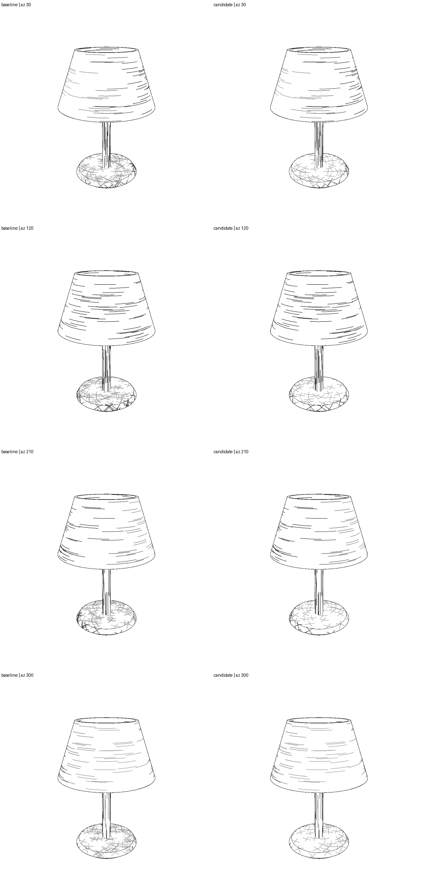

### unit_004（已封存）

支杆48短线→8长线，418路径诊断预览；密度0.752146超过冻结0.75门，NO_GO保留。
原状态：`STEM_VISUAL_GO_FROZEN_DENSITY_NO_GO`。

[原报告](artifacts/partwise_sketch_hatching_v02_publication/unit_004/REPORT_ZH.md) · [STATUS](artifacts/partwise_sketch_hatching_v02_publication/unit_004/STATUS.json) · [原封存](artifacts/partwise_sketch_hatching_v02_publication/unit_004/SEAL.json)

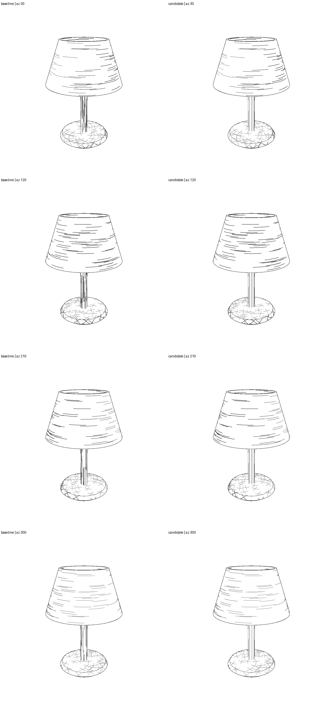

### unit_005（已封存）

显式选资产/部件改线宽1.0→1.5px，冷重放；沿用unit004诊断资产，不解除旧NO_GO。
原状态：`EXPLICIT_ASSET_WIDTH_EDIT_GO_INHERITED_DENSITY_NO_GO`。

[原报告](artifacts/partwise_sketch_hatching_v02_publication/unit_005/REPORT_ZH.md) · [STATUS](artifacts/partwise_sketch_hatching_v02_publication/unit_005/STATUS.json) · [原封存](artifacts/partwise_sketch_hatching_v02_publication/unit_005/SEAL.json)

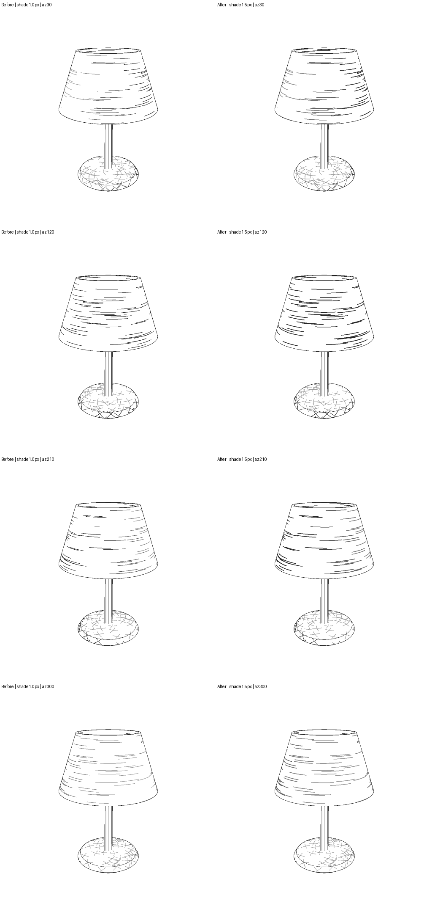

### unit_006（已封存）

36训练/12开发/72测试RGB＋相机及uint8读取适配；输入就绪，不是重建完成。
原状态：`SYNTHETIC_INPUT_READY_WITH_LOCAL_ADAPTER_RECONSTRUCTION_BLOCKED`。

[原报告](artifacts/partwise_sketch_hatching_v02_publication/unit_006/REPORT_ZH.md) · [STATUS](artifacts/partwise_sketch_hatching_v02_publication/unit_006/STATUS.json) · [原封存](artifacts/partwise_sketch_hatching_v02_publication/unit_006/SEAL.json)

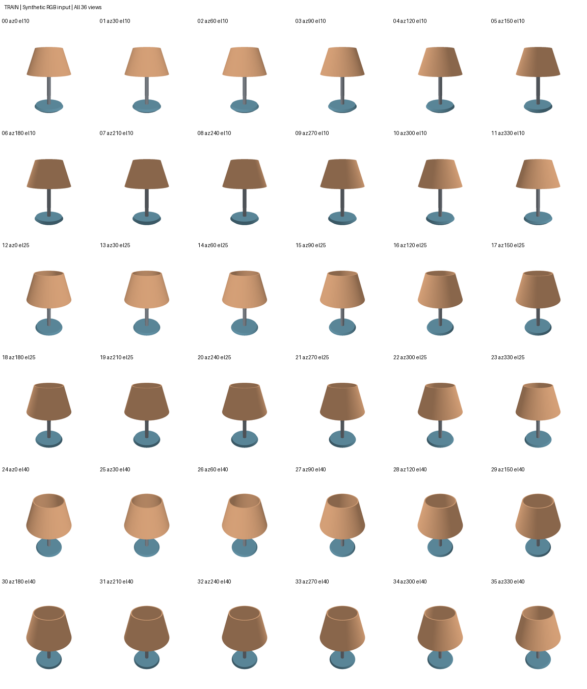

### unit_007（已封存）

458路径资产上的有限时序测量；仅18条抽样且10条完全未测，长度覆盖14.32%，不能称全灯无闪烁。
原状态：`BOUNDED_VISIBLE_SUBSET_TEMPORAL_GO_FULL_P1_PARTIAL`。

[原报告](artifacts/partwise_sketch_hatching_v02_publication/unit_007/REPORT_ZH.md) · [STATUS](artifacts/partwise_sketch_hatching_v02_publication/unit_007/STATUS.json) · [原封存](artifacts/partwise_sketch_hatching_v02_publication/unit_007/SEAL.json)

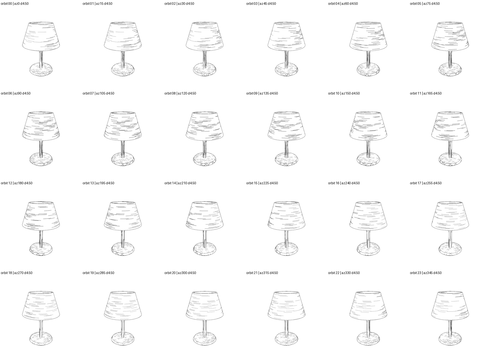

### unit_008（已封存）

灯罩0→15°方向编辑，260目标路径变化、198非目标不变；完整P1仍部分。
原状态：`SHADE_DIRECTION_EDIT_GO_FULL_P1_PARTIAL`。

[原报告](artifacts/partwise_sketch_hatching_v02_publication/unit_008/REPORT_ZH.md) · [STATUS](artifacts/partwise_sketch_hatching_v02_publication/unit_008/STATUS.json) · [原封存](artifacts/partwise_sketch_hatching_v02_publication/unit_008/SEAL.json)

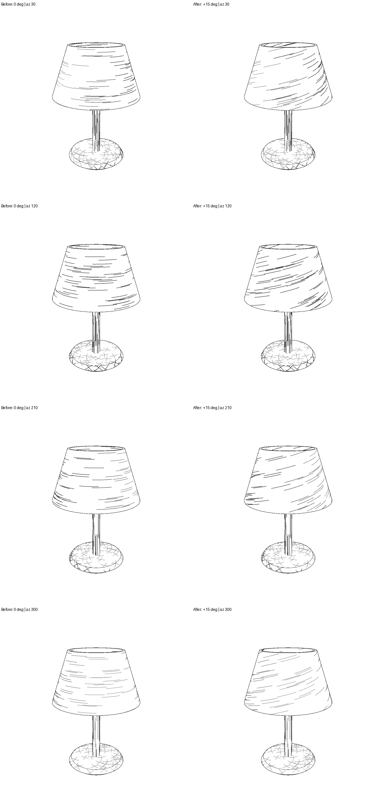

### unit_009（已封存）

确定性支杆48→24条，434路径；不能等同真实均匀几何间距。
原状态：`STEM_DENSITY_EDIT_GO_FULL_P1_PARTIAL`。

[原报告](artifacts/partwise_sketch_hatching_v02_publication/unit_009/REPORT_ZH.md) · [STATUS](artifacts/partwise_sketch_hatching_v02_publication/unit_009/STATUS.json) · [原封存](artifacts/partwise_sketch_hatching_v02_publication/unit_009/SEAL.json)

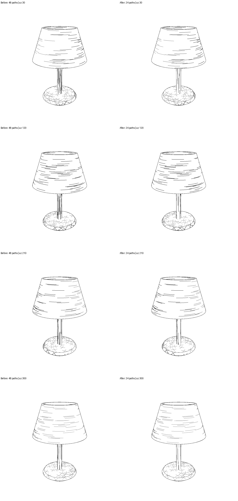

### unit_010（已封存）

底座长度0.18→0.12、434路径，补齐该资产三类演示；新的全灯时序验收未完成。
原状态：`BASE_LENGTH_EDIT_GO_FULL_P1_PARTIAL`。

[原报告](artifacts/partwise_sketch_hatching_v02_publication/unit_010/REPORT_ZH.md) · [STATUS](artifacts/partwise_sketch_hatching_v02_publication/unit_010/STATUS.json) · [原封存](artifacts/partwise_sketch_hatching_v02_publication/unit_010/SEAL.json)

### unit_011（WIP，未封存）

灯罩分带种子分布代码和部分输出；额度/工程中断，缺最终NEXT/SEAL，未验收。
原状态：`PENDING`。

[STATUS](artifacts/partwise_sketch_hatching_v02_publication/unit_011/STATUS.json)

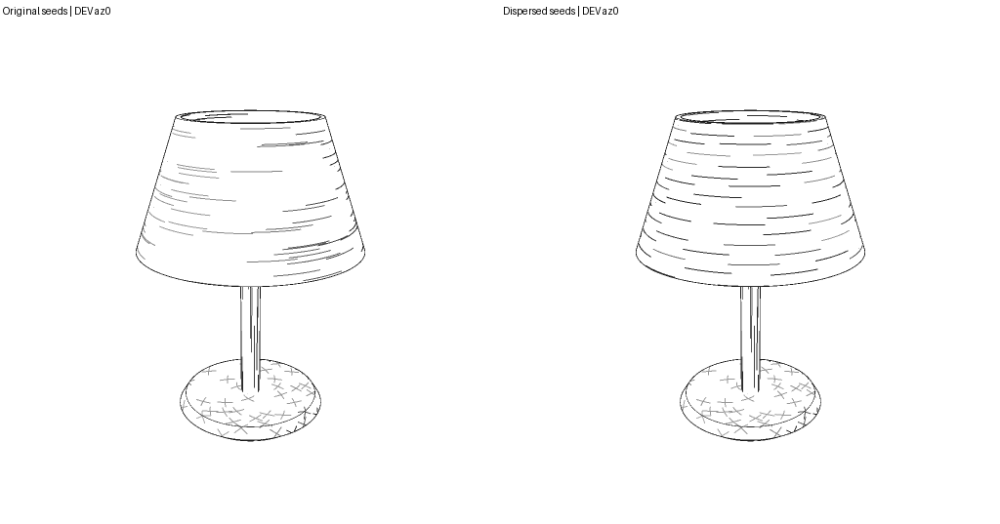

## 复现、证据与未发布内容

- [用户完整实验大纲](docs/partwise_sketch_hatching/experiment_outline_v1.md)
- [P1路线图](docs/partwise_sketch_hatching_v02/P1_ROADMAP_ZH.md)
- [显式资产线宽接口](docs/partwise_sketch_hatching_v02/ASSET_CLI_ZH.md) · [方向](docs/partwise_sketch_hatching_v02/DIRECTION_CLI_ZH.md) · [疏密](docs/partwise_sketch_hatching_v02/DENSITY_CLI_ZH.md) · [长度](docs/partwise_sketch_hatching_v02/LENGTH_CLI_ZH.md)
- [科研源码](experiments/partwise_sketch_hatching_v02/common.py)
- [合成输入数据清单](artifacts/partwise_sketch_hatching_v02_publication/unit_006/dataset/DATASET.json)（GT oracle与训练输入角色必须区分）
- [本次完整性核对](artifacts/partwise_sketch_hatching_v02_publication/PUBLICATION_AUDIT.json) · [发布文件来源/SHA](artifacts/partwise_sketch_hatching_v02_publication/EXPORT_MANIFEST.json) · [unit011未完成说明](artifacts/partwise_sketch_hatching_v02_publication/UNSEALED_UNIT011.json)
- 本次逐项核对10份原封存清单的文件SHA、大小、数量与总字节数，并核对发布拷贝。后续单元合法修改过的工作树源码，使用该轮不可变source_snapshot或封存source_commit的Git blob核对，不把当前HEAD误当旧轮源码。完整性核对不把生产者评价提升为新独立科学验证；没有重跑科研渲染、训练或全历史测试。
- 已发布每轮原图/无损视频/状态/报告与指标、最新GT显式资产和合成RGB相机输入。全部逐帧raw数组、隔离笔触大批样本、运行环境留在服务器；每轮原SHA清单记录其原路径，不宣称GitHub包包含全部raw或可无环境即运行。
- 继承的P0原型与16轮报告/代码保存在同分支历史与docs/partwise_sketch_hatching/；本发布不重写其封存。
