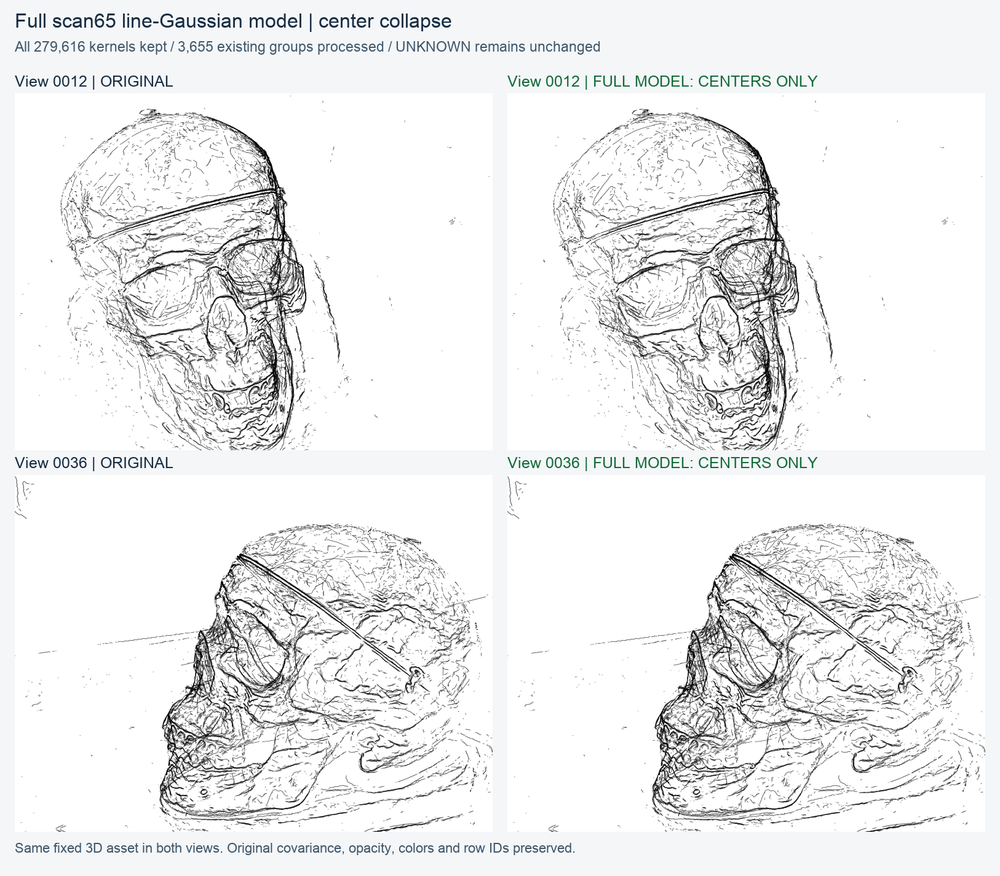
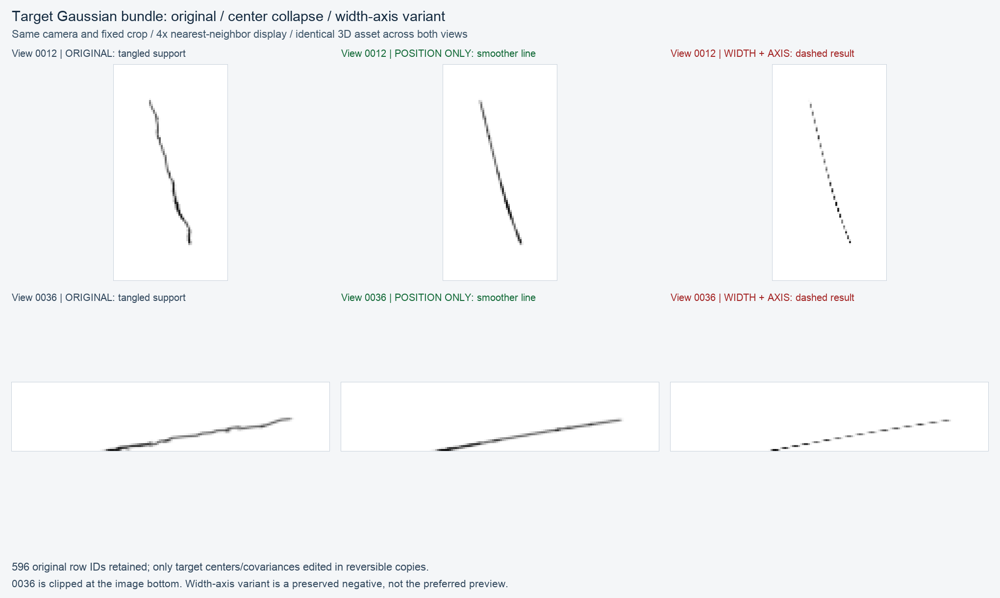

# 线高斯归组与合束：截至 v12 的进度快照

这是 **2026-11-03 当前课题的保存分支**。只归档已有代码、报告、真实图片、可恢复资产和失败记录，**没有运行新的研究实验**。旧工作树、已封存结果、主分支及历史远端分支不覆盖。

## 最新结果：完整 scan65 模型已应用中心收拢，但全景收益有限



- 完整模型 **279,616核**保留；按完整 MEMBERSHIP 枚举的 **3,655个现有边组全部处理**，不是仅处理GROUPS/MODELS中13个跟踪复合组。
- 127,152个已归属核参与，126,477个中心实际改变；675个重算后与原值一致。
- 152,464个UNKNOWN核原样保留；协方差、opacity、颜色、原行序、来源ID和完整成员映射全部冻结。
- 采用前次较连续的 **POSITION_ONLY**：每组一个共享低复杂度3D载体，只移动中心。没有采用v11出现串珠的协方差/横宽规整。
- 实际Gaussian CPU EWA渲染，同一份固定3D资产用于两个相机；没有辅助线描画、逐相机修形或删除UNKNOWN。
- **整体视觉改善有限**：局部更顺，重复线、碎线和交叉仍在；多数中心投影位移不足一像素。不同edge_id之间没有在本轮重新归并。
- 最大位移风险组238627的局部弯折被平滑；几何规整不等于恢复物理真边。没有宣称held-out、时间稳定性或全模型干净单线成功。

### 获取完整模型与回退

1. [完整模型ZIP](docs/line_kernel_progress_v12/deliveries/v12/scan65_full_position_collapse_model.zip)：可独立加载，包含完整派生/原版资产、映射、全部组账本、原生图、源码和验收。
2. [全部事务检查点ZIP](docs/line_kernel_progress_v12/deliveries/v12/scan65_full_position_collapse_checkpoints.zip)：需要全部恢复证据时，将两个独立ZIP解压到同一目录；**不要二进制拼接**。

```bash
unzip scan65_full_position_collapse_model.zip -d scan65_v12
unzip scan65_full_position_collapse_checkpoints.zip -d scan65_v12
```

处理后模型：`scan65_v12/unit/FULL_POSITION_ONLY_GAUSSIANS.npz`。回退：`scan65_v12/unit/ORIGINAL_GAUSSIANS.npz`。完整身份映射：`scan65_v12/unit/MEMBERSHIP.npz`。

```python
import numpy as np
with np.load('scan65_v12/unit/FULL_POSITION_ONLY_GAUSSIANS.npz', allow_pickle=False) as z:
    model = {k: z[k] for k in z.files}
with np.load('scan65_v12/unit/MEMBERSHIP.npz', allow_pickle=False) as z:
    membership = {k: z[k] for k in z.files}
# model: means, covariance, opacity, colors, primitive_id, internal_piece_id, arc_t
# membership['line_kernel_id'] 是原行ID；membership['edge_id'] 是原归属。
```

NPZ跨平台读取只需NumPy。真实生产CLI/CPU EWA仍依赖记录的服务器Linux环境和冻结helper绝对路径；**不把这次保存冒称为已验证的跨平台渲染器安装包**。`arc_t`及旧controls是来源信息，不是派生中心仍由旧controls生成的证明。

### 原始图与独立验收

- [视角0012全部四分区，2倍显示](docs/line_kernel_progress_v12/deliveries/v12/VIEW_0012_ALL_QUADRANTS_2X.png)
- [视角0036全部四分区，2倍显示](docs/line_kernel_progress_v12/deliveries/v12/VIEW_0036_ALL_QUADRANTS_2X.png)
- [v12原始最终报告](docs/line_kernel_progress_v12/deliveries/v12/FINAL_REPORT_ZH.md)
- [v12父级验收目录](docs/line_kernel_progress_v12/deliveries/v12/acceptance/)
- [实际交付ZIP冷载/并集验证](docs/line_kernel_progress_v12/deliveries/v12/DELIVERY_PACKAGE_VERIFICATION.json)

已有独立验收逐组重放全部3,655组数学、逐像素重放16张原生Gaussian图、核对16个固定裁剪；两个交付ZIP包含全部166项unit封存成员。新保存分支的代码测试、冷载和Git-blob核对记录在 [PUBLICATION_VALIDATION.json](docs/line_kernel_progress_v12/PUBLICATION_VALIDATION.json)。执行成功与视觉成功分开记录。

## 方向演进及负结果

- **v06 全局关联**：[报告](docs/line_kernel_progress_v12/deliveries/v06/README_PARENT_ZH.md) · [源码](reproduction/line_kernel_global_association_v06/)。端点路径、弃权、有限重叠等已运行；保留真实接口失败及修复。没有证明joint优于greedy或恢复完整曲边。
- **v07 自由重归属**：[报告](docs/line_kernel_progress_v12/deliveries/v07/README_PARENT_ZH.md) · [源码](reproduction/line_kernel_free_reassignment_v07/)。允许撤回/拆组；Ficus覆盖损失和无额外增益的终态如实保留，不把新标签数当准确率。
- **v08 frontier先验**：[源码](reproduction/line_kernel_frontier_growth_v08/) · [保存记录](docs/line_kernel_progress_v12/evidence/v08/)。保留11个已执行单元以及第12单元BUILD额度中断；第12单元无数值结果，完整独立最终验收未完成。不为此次保存重启旧窗口。
- **v09 整组最佳片段生长**：[父级报告](docs/line_kernel_progress_v12/deliveries/v09/README_PARENT_ZH.md) · [源码](reproduction/line_kernel_best_fragment_growth_v09/) · [三份可恢复资产及原图报告](docs/line_kernel_progress_v12/deliveries/v09/attachments/)。持续成员union、重新拟合与择优搜索可运行；硬拒绝、预算和工程停止不等于物理边穷尽。
- **v10 解除硬规则2/4/6**：[18页原报告](docs/line_kernel_progress_v12/deliveries/v10/REPORT_ZH.pdf) · [中文Markdown](docs/line_kernel_progress_v12/deliveries/v10/REPORT_ZH.md) · [源码](reproduction/line_kernel_relaxed_guards_v10/)。11单元、15执行臂、234接受事务；完整8份资产ZIP和原图报告均保留。错向、自接触、纯池化和时间预算截断也保留；归组增加不认证同边正确。
- **30579逐渐合并实例**：[99→248→596真实保存图](docs/line_kernel_progress_v12/deliveries/merge_example/30579_progressive_merge.png) · [16步轨迹](docs/line_kernel_progress_v12/deliveries/merge_example/group_30579_merges.csv)。MID是该组第7次合并，不是所有全局事务的一半。
- **v11 单组派生几何合束**：[说明](docs/line_kernel_progress_v12/deliveries/v11/README_ZH.md) · [源码](reproduction/line_kernel_bundle_collapse_v11/) · [完整资产ZIP](docs/line_kernel_progress_v12/deliveries/v11/30579_gaussian_bundle_demo.zip)。596核POSITION_ONLY较连续；进一步宽度/方向规整产生串珠虚线，保留为失败变体，没有偷偷替换结论。
- **v12 完整模型逐组合束**：[说明](docs/line_kernel_progress_v12/deliveries/v12/README_ZH.md) · [源码](reproduction/line_kernel_full_bundle_collapse_v12/)。只扩处理范围，继承v11中心收拢数学；当前全模型结果见本页开头。
- **方法调查**：[原始报告](docs/line_kernel_progress_v12/deliveries/survey/METHOD_SURVEY_ZH.md)。调研建议与已经执行的实验分开保存。



## 保存范围、可追溯性与未入Git数据

- 本分支以已有已提交v07代码 `6eb3d6d9ecd74d8aef9ffdecea15bcfe84f1b90b` 为基底，继承v03–v07代码；另精确导入v08–v12当前物化源码，以及v06–v12逐单元冻结源码/配置/退出/报告。**各阶段隔离命名空间，没有把互不兼容实现混成一个新算法。**
- [本地交付导入清单](docs/line_kernel_progress_v12/LOCAL_IMPORT_MANIFEST.json) 逐项列出原路径、字节数和SHA256；[服务器源码/冻结证据清单](docs/line_kernel_progress_v12/REMOTE_IMPORT_MANIFEST.json) 保存旧工作树版本和单元来源。
- v09三份最终资产包、v10完整8份资产包及报告、v11三个完整Gaussian变体、v12完整模型与检查点均作为实际资产保留，不只保存路径。
- 为避免把多GB重复缓存当进度，v06/v07大体积历史variant归档、v09冗余解包副本/全中间银行，以及未选的完整候选库仍保留在原服务器/本地交付目录；具体排除项在清单中。**不宣称Git包含每一项历史候选或训练输入。** 原始大数据没有删除。
- v08额度中断、v11协方差失败、v12整体收益有限均保留；保存不是把PARTIAL改成成功。
- 继承的旧入口另存为 [INHERITED_README.md](docs/line_kernel_progress_v12/INHERITED_README.md)。历史分支仍按各自原合同解释。

## 最小验证入口

在原服务器已有CPU环境中运行（临时文件必须指向新目录，不写旧unit）：

```bash
export TMPDIR=/path/to/new-scratch
python3 -B reproduction/line_kernel_full_bundle_collapse_v12/test_batch.py
python3 docs/line_kernel_progress_v12/deliveries/v12/parent_scripts/verify_full_model_zip.py   docs/line_kernel_progress_v12/deliveries/v12/scan65_full_position_collapse_model.zip
```

此测试需要原记录的NumPy/Pillow及Linux CPU renderer helper，不应当在缺依赖的新机器上被描述为已经端到端验证。真实原数据重跑需先核对对应冻结CONFIG与依赖清单；本次发布没有训练、GPU实验或重新调参。
