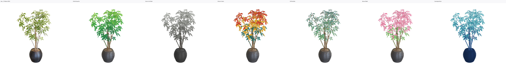
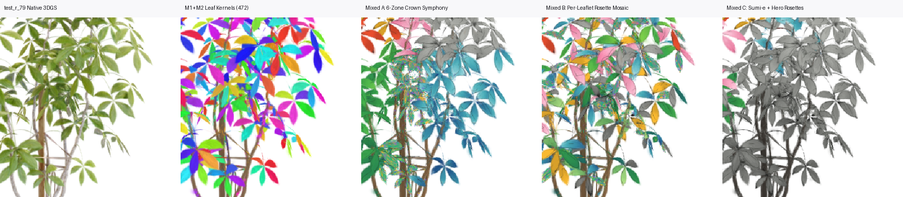
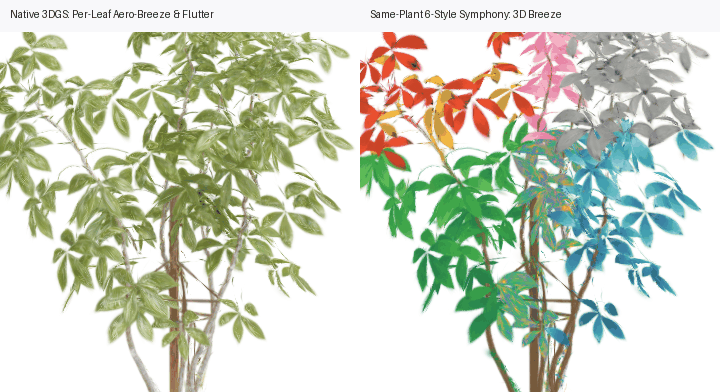
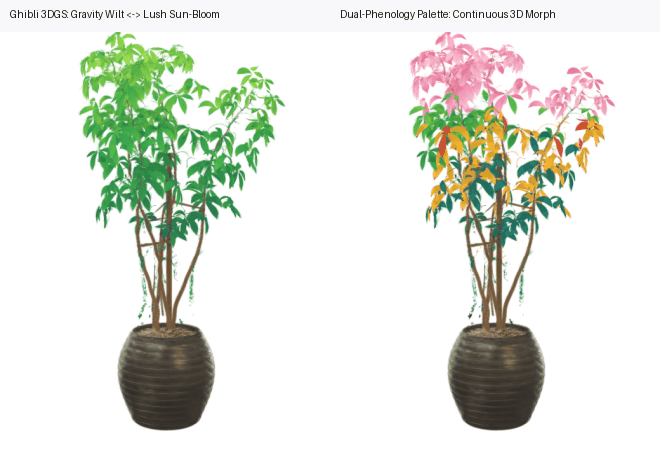
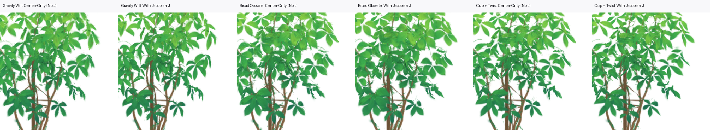

# `ficus_leaf_kernels`（v01 → v04）：Ficus 封闭叶片空间区域检测、`M1+M2` 单叶高斯核划分、同株多风格预设与叶柄铰接三维几何形变

本目录收录针对 Ficus 3DGS（`284,835` 个原始三维高斯核）从封闭叶片检测、单叶高斯核精修分离、多套艺术风格同株混排到单叶三维几何形变的完整演进管线（`v01 → v04`）源码、留出测试视角定量评测 JSON、阶段实验报告与代表性实拍对比图/动态 GIF。

- **完整源码目录**：[`../../experiments/ficus_leaf_kernels_v04/`](../../experiments/ficus_leaf_kernels_v04/)
- **四阶段详细实验报告**：
  - [`v01` 封闭叶片空间划定与高斯核初分报告](reports/v01_leaf_partition_walkthrough.md)
  - [`v02` `M1` / `M2` / `M3` 五臂受控消融评测报告](reports/v02_m1_m2_m3_ablation_report.md)
  - [`v03` `M1+M2` 六套艺术风格预设与同株异叶混排报告](reports/v03_multistyle_leaves_report.md)
  - [`v04` 叶柄铰接单叶三维几何形变与雅可比协方差传输报告](reports/v04_leaf_deformation_report.md)
- **定量结果 JSON**：[`results/`](results/)（`LEAF_PARTITION_REPORT.json`、`ABLATION_V02_REPORT.json`、`MULTISTYLE_V03_REPORT.json`、`DEFORM_V04_REPORT.json`、`leaf_instances.json`）
- **服务器大型三维资产 SHA256 索引（`.npz` / `.obj`）**：[`ASSETS_SERVER_ONLY.json`](ASSETS_SERVER_ONLY.json)

---

## 一、四阶段技术演进与核心结论

1. **`v01`（多视角封闭叶片区域分水岭 + 遮挡门控三维薄片图划分）**：
   - 在 `32` 个构建视角上联合 C2L50 多尺度边缘闭合距离场与深度不连续梯度提取二维封闭叶片区域，反投影构建遮挡门控三维薄片亲和图，将全株 `284,835` 个高斯核无遗漏划分为 **`472` 片独立三维叶片实例**（`OUTER_ENCLOSED: 264`、`MID_PARTIAL_OCCLUDED: 195`、`DEEP_OCCLUDED: 13`）以及花盆底座（`-1`）与木质枝干（`-2`）。
2. **`v02`（解决 3DGS 半透明雾边与跨缝宽核串色的五臂消融）**：
   - 对比 `M1`（Beer-Lambert 薄片不透明度锐化 + 离面残影核抑制）、`M2`（双遍跨缝宽核分裂与重归属）与 `M3`（叶柄→叶尖解剖 UV 纹理细分）：证明 **`M1` 是最有效单项算子**（5 个留出测试视角单叶纯度 `+14.04 pp`、轮廓 IoU `+5.26 pp`），且 **`M1 + M2` 具备显著超加性接缝锐化协同效应**。
3. **`v03`（精简紧凑 `M1+M2` 单叶核基底 + 6 套三维艺术风格 + 同株多风格混排）**：
   - 弃用高膨胀的 `M3` 核细分，保留极度紧凑的 `M1+M2` 基底（仅 `297,343` 核，较原始仅 `+4.39%`，轮廓 IoU 高达 **`96.81%`**、未见视角二维叶内纯度 **`90.02%`**）；
   - 构建 6 套纯三维单叶艺术预设（`吉卜力水粉`、`东方水墨写意`、`浮世绘套色剪纸`、`修拉点彩派`、`樱粉水彩植物图谱`、`青花冷瓷蓝晒`）及 3 种同株异叶混排模式（六区树冠交响、单叶簇马赛克、水墨底株+重点花束点亮）。
4. **`v04`（叶柄钳制单叶三维大变形引擎 + 雅可比协方差传输 $\boldsymbol{\Sigma}' = \mathbf{J}\boldsymbol{\Sigma}\mathbf{J}^\top$）**：
   - 为全部 `472` 片树叶建立叶柄铰接锚点 $\mathbf{p}_{\text{base}}$，在枝干与花盆零漂移（**`0.0000 mm`**）前提下支持重力萎蔫、螺旋卷曲扭转、定向劲风、柳叶窄化/阔卵圆化及同株枯荣对比等 7 种三维几何形变，中脉弧长保持误差仅 **`0.002%–0.017%`**，雅可比协方差传输消除大曲率扭转下的刺猬状破面伪影（投影光滑度提升 `+5.13%`）。

---

## 二、留出测试视角代表性视觉展示

### 1. `v03` 六套单叶艺术风格预设与同株异叶混排（未见测试视角 `test_r_79`）



### 2. `v04` 单叶三维几何形变、雅可比消融与动态三维微风/枯荣 GIF




---

## 三、复现与单元测试命令

```bash
PY=/mnt/hdd1/u00134/radegs_paper_reproduction_v01/official_code_fix_v01/env/bin/python
cd experiments/ficus_leaf_kernels_v04

# 1. 运行隔离性、闭合轮廓、M1/M2、多风格与三维形变不变量单元测试
CUDA_VISIBLE_DEVICES=1 $PY -m unittest discover -s tests -v

# 2. 按阶段复现实验
CUDA_VISIBLE_DEVICES=1 $PY scripts/run_ficus_leaf_partition.py   # v01: 472 叶片空间划分基线
CUDA_VISIBLE_DEVICES=1 $PY scripts/run_ficus_v02_ablation.py     # v02: M1/M2/M3 五臂受控消融
CUDA_VISIBLE_DEVICES=1 $PY scripts/run_ficus_v03_multistyle.py   # v03: M1+M2 六套预设与同株多风格
CUDA_VISIBLE_DEVICES=1 $PY scripts/run_ficus_v04_deformation.py  # v04: 叶柄铰接三维形变与动态 GIF
```
