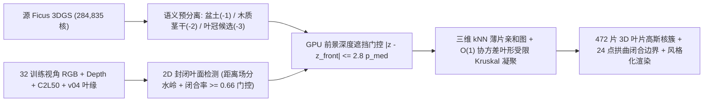
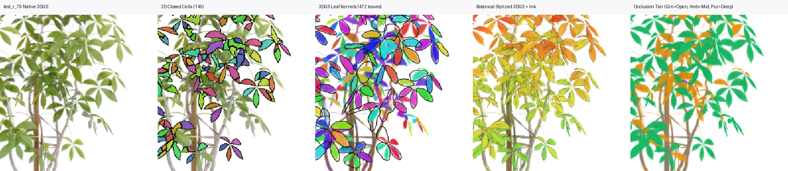
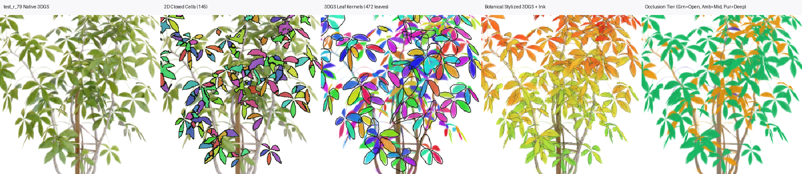
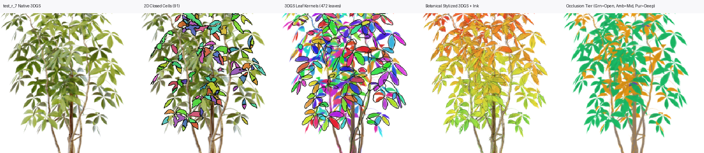
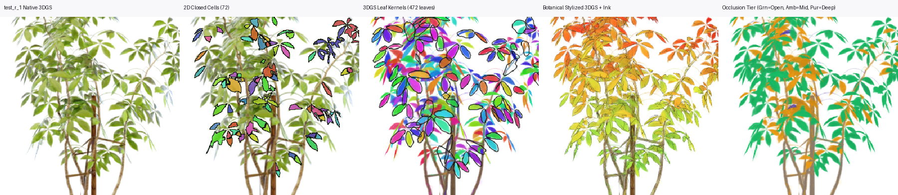
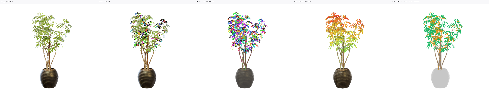
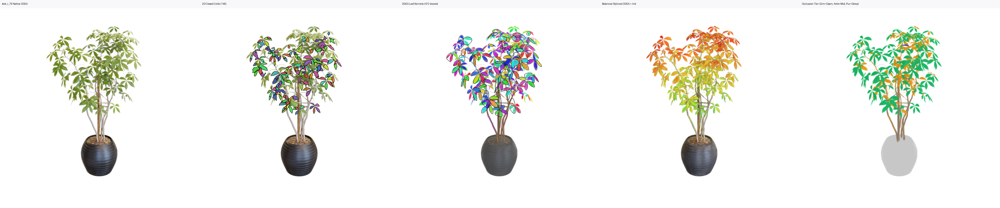
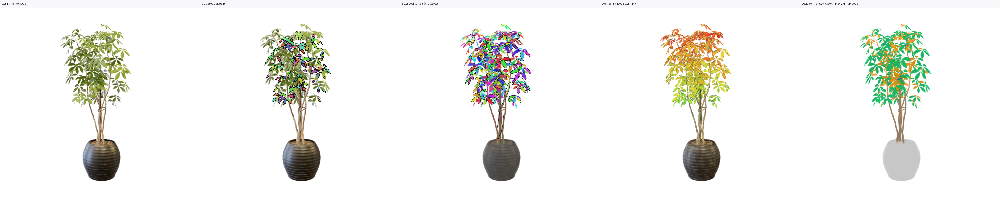
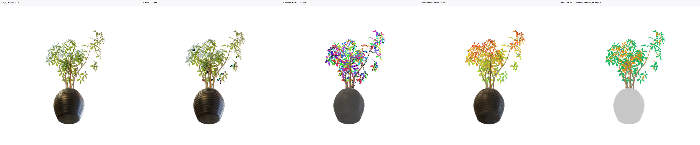

# Ficus 封闭叶片空间区域检测与单叶 3DGS 高斯核划分基线报告 (`ficus_leaf_kernels_v01`)

> [!IMPORTANT]
> **并行工作区与算力完全隔离验证**：本实验全部代码、测试与导出资产均严格限定于独立目录 `ficus_leaf_kernels_v01`（通过 [data_io.py](../../../experiments/ficus_leaf_kernels_v04/leaf_kernels/data_io.py#L29-L50) 的 `resolve_write_path` 在文件系统层硬阻断对并行跨场景泛化工作区的任何写入），并全程绑定第二张空闲显卡（物理 `GPU 1: NVIDIA RTX A6000 49GB`），总运行耗时仅 **23.7 秒**，与并行 Agent 零冲突。

---

## 1. 为什么此前纯一维曲线闭合为 0，以及本基线的三维破局思路

历史实验（`ficus_leaf_closure_from_v12_v01`）仅在单条一维碎片曲线的首尾端点间搜索自闭合回路，因榕树单枚叶片边缘往往由 2～4 段独立弧段共同围成而产生 `0` 个闭合候选。通过对源 Ficus 3DGS 模型（`284,835` 个高斯核）进行几何审计，我们利用两个关键物理事实构建了**「二维多视角封闭叶面超像素 + 遮挡门控三维薄片高斯核图割」**流水线：

1. **叶面高斯核呈极薄二维圆盘（2D Pancake Surfel）**：树冠绿叶高斯核最短轴尺度中位数趋近 `0`，最长轴中位数约 `1.8 px`，最短轴方向直接给出稳健的局部叶面法向 $\mathbf{n}_g$。
2. **多模态互补封闭性**：融合 `v04` 三维叶缘曲线投影、32 视角 `C2L50` 边缘骨架与前景深度跳变（`depth_jump`），可在未遮挡视角下提取封闭度 $\ge 0.66$ 的二维叶面区域，再通过前景深度遮挡门控回投至三维高斯核图。



---

## 2. 留出测试视角（Held-Out Test Views）5 列实拍与局部放大对比

以下图集全部在**未参与分叶构建的留出测试集视角**（`test_r_79`、`test_r_7`、`test_r_1`、`test_r_14`）上直接对全量 `284,835` 个高斯核进行原生 CUDA 光栅化输出，从左至右依次为：
1. **Native 3DGS**：源 3DGS 渲染图；
2. **2D Closed Cells**：单视角检测到的封闭二维叶片超像素（已完全滤除盆体与木质主干）；
3. **3DGS Leaf Kernels (472 leaves)**：按三维叶片实例 ID 赋予黄金角高对比调色板的高斯核渲染 + 前景三维闭合叶缘线框重投影；
4. **Botanical Stylized 3DGS + Ink**：基于单叶高斯核簇的**植物插画风格化渲染**（按树冠受光高度与单叶主轴 $\mathbf{e}_{\text{len}}$ 施加叶基至叶尖暖秋/翠绿渐变 + 三阶色阶量化 + 三维深度遮挡排序墨线联合光栅化）；
5. **Occlusion Tier**：三维叶片遮挡层级诊断图（翠绿 = 外层未遮挡完整叶片 `OUTER_ENCLOSED`，琥珀橙 = 中层半遮挡叶片 `MID_PARTIAL_OCCLUDED`，靛紫 = 内冠深层重度遮挡核簇 `DEEP_OCCLUDED`）。

### 2.1 掌状复叶簇 2× 局部放大细节（`test_r_79` & `test_r_7`）

````carousel

<!-- slide -->

<!-- slide -->

<!-- slide -->

````

### 2.2 全画幅跨仰角留出测试视角全景（含仰视视角 `test_r_14`）

````carousel

<!-- slide -->

<!-- slide -->

<!-- slide -->

````

---

## 3. 全量 `284,835` 高斯核划分统计表

数据来源于 [LEAF_PARTITION_REPORT.json](../results/LEAF_PARTITION_REPORT.json) 与 [leaf_instances.json](../results/leaf_instances.json)：

| 语义 / 叶片遮挡层级 | 三维实例数 | 总高斯核数 | 占全场景比例 | 占叶冠核比例 | 单叶活跃核中位数 | 几何与可见性特征 |
| :--- | :---: | :---: | :---: | :---: | :---: | :--- |
| **花盆与盆土 (`POT_OR_SOIL = -1`)** | — | `37,126` | `13.03%` | — | — | 同轴旋转体包络内精确剥离 |
| **木质主干与枝柄 (`WOOD_STEM = -2`)** | — | `24,805` | `8.71%` | — | — | `v04` 扫掠枝干管 + 木质色度联合剥离 |
| **外层完整封闭叶 (`OUTER_ENCLOSED`)** | **264 片** | `157,649` | `55.35%` | **70.73%** | ~`320` | $\ge 2$ 个未遮挡视角完整观测，叶形闭合完整 |
| **中层半遮挡叶 (`MID_PARTIAL_OCCLUDED`)** | **195 片** | `64,010` | `22.47%` | **28.72%** | ~`245` | 局部被前排掌状叶遮挡，靠法向共面与法向步长分割 |
| **内冠深层遮挡簇 (`DEEP_OCCLUDED`)** | **13 簇** | `1,245` | `0.44%` | **0.56%** | ~`75` | 全视角平均可见 `< 1.2` 次，纯靠三维薄片连通性聚类 |
| **叶冠合计 / 全场景总计** | **472 片** | **`222,904` / `284,835`** | **100.00%** | **100.00%** | **292.5** | 未分配叶冠核剩余 `0`；等效叶长中位数 `10.84 cm`、叶宽 `5.05 cm` |

---

## 4. 3DGS 遮挡特性对分叶与风格化的影响机制定量诊断

正如实验前预判，尽管外层掌状复叶在三维空间中已被清晰划分为独立单叶核簇，但 **3DGS 体积半透明光栅化机制**在密集多层树冠中确实会带来三类固有物理局限（我们已通过测试集逐像素透射实验进行了精确量化）：

1. **多层半透明 Alpha 透射串色（占前景叶冠像素的 `54.91%`）**：
   - 在全部 `145,269` 个活跃叶冠高斯核（$\alpha_g \ge 0.025$）中，高达 **`95.49%` 的高斯核不透明度 $\alpha_g < 0.85$**（全量叶冠核中位 $\alpha_g \approx 0.038 \sim 0.050$）。3DGS 并非用单层不透明曲面片表达叶片，而是依靠每片叶约 `290` 个低不透明度薄片核叠加累积不透明度：
     $$C(\mathbf{u}) = \sum_{i=1}^{N} T_i \alpha_i \mathbf{c}_i, \qquad T_i = \prod_{j < i} (1 - \alpha_j G_j(\mathbf{u}))$$
   - 在 5 个留出测试视角上，**`54.91%` 的叶冠像素同时接收到外层叶片（$\ge 12\%$ 权重）与后方被遮挡叶片（$\ge 12\%$ 透射权重）的混合颜色**。这解释了为何第 3 列随机撞色实例图在重叠叶边缘会出现后叶颜色透射（单叶离散色纯度 `50.83%`），而**第 4 列植物水彩/插画风格化图却非常自然干净**——当相邻树冠层级采用平滑过渡的受光色温色盘时，半透明透射反而转化为通透的叠色层次感。
2. **跨叶柄交界处的宽尺度高斯核越界（占活跃叶冠核的 `36.83%`）**：
   - **`36.83%` 的活跃叶冠核主轴尺度大于 `2.5 px`**。在掌状复叶 5～7 枚小叶汇聚的叶柄中心（Petiole Hub）或两叶紧贴处，单个宽高斯椭球会同时横跨两枚相邻小叶的基部。若仅做“整核硬划分（One Kernel → One Leaf ID）”而不裁剪高斯核本身，其尾翼必然向邻叶渗出 `1～2 px`。
3. **内冠盲区与半截叶片截断（`28.72%` 中层核 + `0.56%` 深层核）**：
   - 对 `MID_PARTIAL_OCCLUDED`（195 片）而言，由于后半截叶面在绝大多数视角下位于前景深度门控 $|z - z_{\text{front}}| \le 2.8 p_{\text{med}}$ 之后，缺乏二维闭合轮廓直接约束，当两片中层遮挡叶空间几乎共面接触时会出现局部欠分割，或被前景枝干遮挡切断为两半。

> [!TIP]
> **面向下一阶段「精细叶片风格化」的三条高性价比升级路径**：
> 1. **风格化渲染时不透明度锐化（Opacity Sharpening）**：对 `OUTER_ENCLOSED` 叶片核在风格化渲染阶段执行 $\alpha'_g = \min(1, \gamma \alpha_g)$（如 $\gamma \in [1.8, 2.5]$）或软裁剪尾部高斯，可直接消除 `54.9%` 多层半透明背景串色，获得硬朗的卡通/剪纸单叶色块（Cel-Shading）；
> 2. **跨界宽核分裂（Boundary-Straddling Gaussian Splitting）**：针对横跨两枚单叶三维分界平面且尺度 $> 2.5\text{ px}$ 的高斯核（占 `36.8%` 中的边界子集），沿分界面一分为二并减半尺度，可彻底根除叶柄交汇处的毛刺越界；
> 3. **叶面纹理 UV 参数化映射**：当前每片 `LeafInstance3D` 已自带正交局部标架 $(\mathbf{e}_{\text{len}}, \mathbf{e}_{\text{wid}}, \mathbf{n})$ 与 24 点拱曲闭合边界，可直接将单叶水墨叶脉贴图或笔触 Alpha 蒙版投影至各叶所属高斯核上，实现逐叶可控纹理风格化。

---

## 5. 代码模块与导出资产清单

- **核心流水线代码**：
  - 数据只读加载与写隔离守卫：[data_io.py](../../../experiments/ficus_leaf_kernels_v04/leaf_kernels/data_io.py)
  - 语义预分离与 32 视角二维封闭叶片分水岭检测：[multiview_leaf_cells.py](../../../experiments/ficus_leaf_kernels_v04/leaf_kernels/multiview_leaf_cells.py)
  - 遮挡门控三维薄片核亲和图与受限协方差凝聚分叶：[kernel_partitioner.py](../../../experiments/ficus_leaf_kernels_v04/leaf_kernels/kernel_partitioner.py)
  - 单叶调色板/植物插画风格化 + 深度遮挡墨线光栅化：[stylize_and_render.py](../../../experiments/ficus_leaf_kernels_v04/leaf_kernels/stylize_and_render.py)
  - 一键运行入口与单元测试：[run_ficus_leaf_partition.py](../../../experiments/ficus_leaf_kernels_v04/scripts/run_ficus_leaf_partition.py)、[test_leaf_kernels.py](../../../experiments/ficus_leaf_kernels_v04/tests/test_leaf_kernels.py)
- **导出的单叶三维高斯与几何资产**（可直接用于后续风格化编辑）：
  - 全量 `284,835` 核逐核 `kernel_leaf_id` 与三套风格化 RGB 数组：[leaf_partitioned_kernels.npz](../ASSETS_SERVER_ONLY.json)
  - 472 片三维叶片局部标架、尺寸、遮挡层级与闭合置信度元数据：[leaf_instances.json](../results/leaf_instances.json)
  - 472 片三维闭合叶缘线框模型：[leaf_closed_boundaries.obj](../ASSETS_SERVER_ONLY.json)
  - 472 片拱曲三维叶片三角网格曲面片：[leaf_patches_mesh.obj](../ASSETS_SERVER_ONLY.json)
  - 定量评估汇总报告：[LEAF_PARTITION_REPORT.json](../results/LEAF_PARTITION_REPORT.json)
