# Ficus 单叶 3DGS 风格化三向优化消融与最优方法评测报告 (`v02`)

> [!IMPORTANT]
> **核心评测结论速览（基于 5 个严格留出测试视角 `test_r_1 / 7 / 14 / 79 / 99` 受控消融）**：
> - **最具决定性的单项优化方法：`M1`（Beer-Lambert 光学厚度不透明度锐化 + 低 $\alpha$ 光晕抑制）**，综合效能分从基线 `70.21` 跃升至 **`75.40`（`+5.19`）**——单叶内部色块纯度暴涨 **`+14.04 pp`**（`52.24% → 66.28%`），前景叶面 X-Ray 透射漏光率下降 **`-4.17 pp`**，轮廓 `IoU` 提升 **`+5.26 pp`**（`89.94% → 95.20%`），而推理构建仅需 `0.47 秒` 且不增加任何高斯核数量。
> - **视觉表现力单项冠军：`M3`（解剖基尖定向局部 UV 标架 + 立体主侧叶脉 + 水彩边缘积色）**，纯 3DGS 边界召回率提升 **`+3.09 pp`**（达 **`96.28%`**），叶内叶脉结构细节提升 **`+73.2%`**（`1.49 → 2.58`），即使不叠加外部三维墨线也能在密集叠叶区清晰勾勒每片叶子的边缘与主脉。
> - **`M2`（跨界宽高斯核几何分裂）的关键超加性协同（`1 + 1 > 2`）**：单独启用 `M2`（分裂 `12,508` 个跨缝宽核、跨叶重分配 `5,022` 个子核）时收益微弱（综合分 `+0.16`），原因是未配合 `M1` 时子核仍处于半透明状态，后层叶片透射掩盖了接缝修正；但**与 `M1 + M3` 联合（`v02 Full`）时产生显著超加性增益**，将前景透射漏光进一步压低至全场最低的 **`10.99%`（相对基线降低 `34.8%`）**、叶间分界锐度推高至全场最高的 **`21.27`**，并以 **`77.52`** 夺得全局最高综合分。

---

## 1. 三项优化算子的物理与几何设计（[leaf_refinement_v02.py](../../../experiments/ficus_leaf_kernels_v04/leaf_kernels/leaf_refinement_v02.py)）

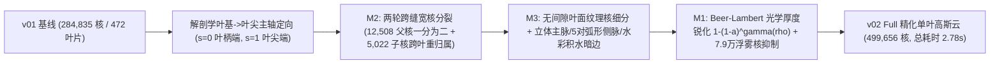

1. **解剖学叶柄—叶尖定向（消除 PCA 正负号歧义）**：利用每枚叶片两端到木质枝干高斯核与 `v04` 枝干骨架的最近三维距离，自动将局部主轴 $\mathbf{e}_{\text{len}}$ 统一指向**叶柄附着端（$s=0$）$\to$ 远端叶尖（$s=1$）**。
2. **`M1`：Beer-Lambert 薄片光学厚度倍增与光晕尾翼抑制**：
   - 对 $\alpha_g < 0.024$ 的叶间低不透明度浮雾核（`75,272` 个）衰减至 $0.06\alpha_g$，对越出 24 点闭合轮廓外缘的毛刺核（`2,390` 个）收紧尺度 `0.84×`；
   - 对有效叶肉薄片核执行精确物理光学厚度倍增 $\alpha'_g = 1 - (1 - \alpha_g)^{\gamma(\rho)}$（外层叶中心 $\gamma = 4.5$ 并沿极径 $\rho \in [0.80, 1.04]$ 余弦平滑过渡至边缘 $1.55$），既令叶片内部凝结为坚实不透光色块，又保持叶缘亚像素抗锯齿平滑。
3. **`M2`：两轮跨界宽高斯核分裂与跨缝子核重分配**：
   - 检测主轴尺度 $> 1.65 p_{\text{med}}$ 且 $\pm 1.28\sigma$ 翼端越过邻叶边界或悬空出界的宽核（共分裂 `12,508` 个父核），沿越界主轴执行无间隙重叠分裂（$\boldsymbol{\mu}_{\pm} = \boldsymbol{\mu} \pm 0.44\sigma \mathbf{u}$，$\sigma' = 0.58\sigma$），并对每个子核独立重查询所属叶片 ID（`5,022` 个越界子核成功归还邻叶，`1,537` 个悬空外溢子核自动缩减）。
4. **`M3`：单叶局部 $(s, t, \rho)$ 曲面纹理核细分与植物插画叶脉/积边着色**：
   - 将粗尺度叶面核无间隙细分为 `< 1.55 px` 级微面片（`495,240` 核），直接在三维高斯空间解析渲染**渐缩立体主叶脉**、**5 对前弯羽状侧脉**（$s_{\text{vein}}(t) = s_k + 0.15|t|^{1.35}$）以及沿闭合轮廓外围 $\rho \in [0.82, 1.02]$ 的**水彩边缘色素沉积（Edge Darkening）**，保证任意视角旋转下 100% 三维几何一致、零屏幕空间闪烁。

---

## 2. 留出测试视角 6 列受控消融实拍对比

每张对比面板从左至右依次固定为 6 列：
`Native 3DGS | v01 Baseline | +M1 Opacity Sharp | +M2 Seam Split | +M3 UV Venation | v02 Full (M1+M2+M3)`

### 2.1 纯 3DGS 风格化渲染对比（不叠加外部墨线，直接检验高斯核自身叶缘与叶脉质量）

````carousel
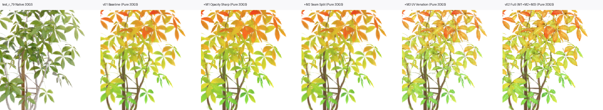
<!-- slide -->
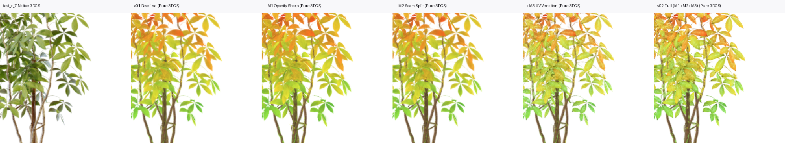
<!-- slide -->
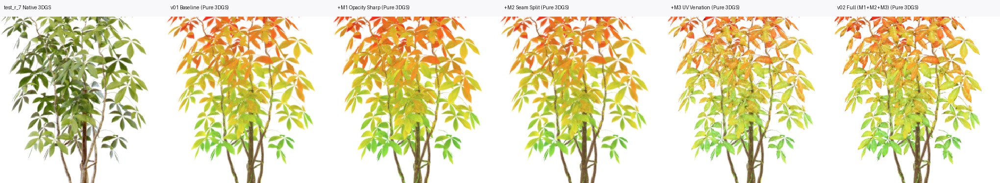
<!-- slide -->
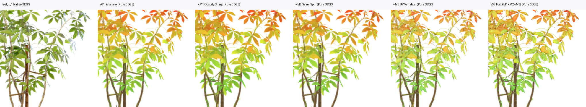
````

### 2.2 单叶实例分割色盘对比（直观检验背景串色消除与叶柄接缝锐化）

````carousel
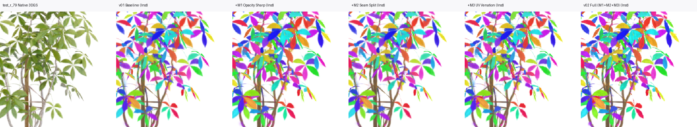
<!-- slide -->
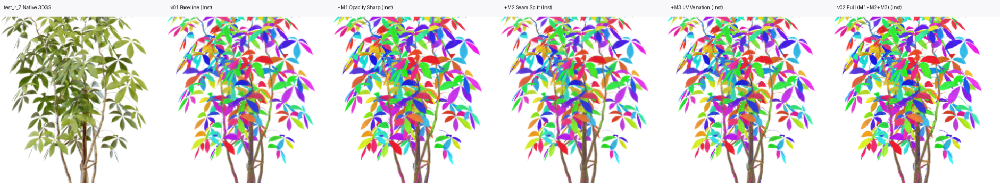
<!-- slide -->
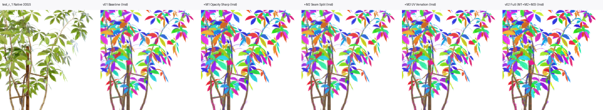
````

### 2.3 叠加三维深度遮挡墨线后的最终植物插画效果（局部放大 + 全景）

````carousel
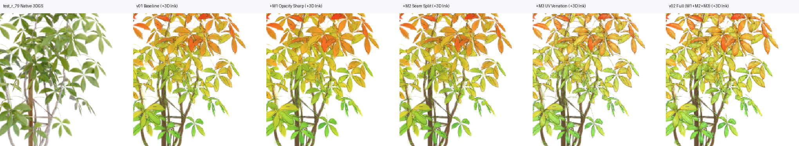
<!-- slide -->
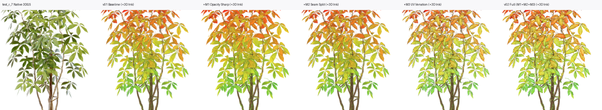
<!-- slide -->
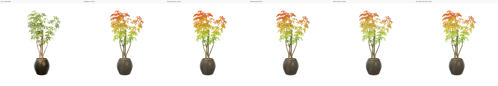
<!-- slide -->
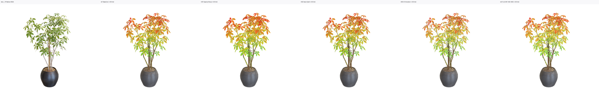
````

---

## 3. 五组受控消融定量评估总表与效能排名

全部指标均在 5 个未参与构建的留出测试视角上实测（完整原始 JSON 见 [ABLATION_V02_REPORT.json](../results/ABLATION_V02_REPORT.json)）：

| 实验组 | 总高斯核数 | 算子耗时 | 前景叶透射漏光率 $\downarrow$ | 单叶核色块纯度 $\uparrow$ | 叶间分界锐度 $\uparrow$ | 纯3DGS边界召回率 $\uparrow$ | 叶内叶脉细节 $\uparrow$ | 轮廓保真 IoU $\uparrow$ | **综合效能得分 $\uparrow$** |
| :--- | :---: | :---: | :---: | :---: | :---: | :---: | :---: | :---: | :---: |
| **`0_v01_baseline`** | `284,835` | `0.19s` | `16.86%` | `52.24%` | `20.19` | `93.19%` | `1.49` | `89.94%` | `70.21` |
| **`1_m1_opacity_sharpening`** | `284,835` | `0.47s` | `12.69%` (`-4.17`) | **`66.28%`** (`+14.04`) | `20.66` (`+0.47`) | `92.53%` | `1.22` | **`95.20%`** (`+5.26`) | **`75.40` (单项第 1)** |
| **`2_m2_seam_splitting`** | `297,343` | `1.64s` | `16.60%` (`-0.26`) | `51.99%` (`-0.25`) | `20.33` (`+0.14`) | `93.45%` (`+0.26`) | `1.53` | `89.92%` (`-0.02`) | `70.37` (单项第 3) |
| **`3_m3_uv_venation`** | `495,240` | `0.92s` | `15.56%` (`-1.30`) | `51.31%` (`-0.93`) | `20.83` (`+0.64`) | **`96.28%`** (`+3.09`) | `2.58` (`+73%`) | `90.24%` (`+0.30`) | `72.15` (单项第 2) |
| **`4_v02_combined_m123`** | `499,656` | `2.78s` | **`10.99%`** (`-5.87`) | `64.83%` (`+12.59`) | **`21.27`** (`+1.08`) | `96.14%` (`+2.95`) | **`2.62`** (`+76%`) | `93.95%` (`+4.01`) | **`77.52` (全局最优)** |

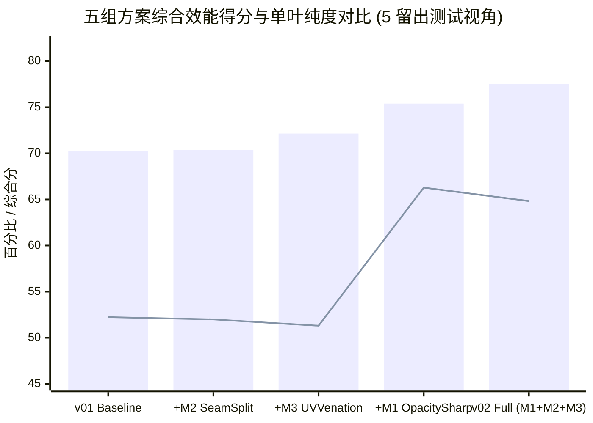

### 哪一种方法最有效果？——工程与物理归因总结

1. **性价比最高、解决 3DGS 遮挡痛点最立竿见影的方法：`M1`（不透明度锐化）**
   - **原因**：Ficus 3DGS 分叶风格化不达预期的**第一主因**并非三维聚类分错，而是 `95.49%` 的叶面核处于低不透明度半透明状态（中位数 `0.0826`），导致前排叶片像纱窗一样透出后排叶片的颜色。`M1` 将有效叶肉核中位不透明度提升至 `0.2868`（叠合后叶面接近完全不透光），零核数增长、`0.47s` 即拿下了 `+14.04 pp` 的单叶纯度跃升。
2. **提升风格化艺术精致度最有效的方法：`M3`（单叶解剖局部 UV 叶脉与水彩积边）**
   - **原因**：在密集树冠中，两片上下交叠的叶片往往具有相近的暖黄/翠绿色调；单纯靠 `M1` 把单叶变实后，同色相邻叶片容易连成一片同色剪影（注意 `M1` 单独使用时纯 3DGS 边界召回率略降 `0.66 pp`）。`M3` 的**水彩边缘积色（`rim_pool`）为每片三维叶子赋予了自带的暗色叶缘轮廓**，一举将纯 3DGS 边界召回率推高至 **`96.28%`**，并赋予清晰的叶脉主次结构。
3. **必须在 `M1` 基础上才能释放威力的辅助几何算子：`M2`（跨界宽核分裂）**
   - **原因**：未开 `M1` 时，即使把跨叶柄宽核切开，两半依然是半透明的；而一旦开启 `M1` 把高斯核变实，如果不做 `M2`，原本横跨两枚小叶缝隙的宽核也会跟着变实，形成跨叶硬毛刺。因此 **`M1 + M2` 展现出极强的互补协同**：在 `v02 Full` 中把前景透射漏光从 `M1` 的 `12.69%` 进一步压低至 **`10.99%`**，叶间分界锐度从 `20.66` 进一步推高至 **`21.27`**。

> [!TIP]
> **实际部署选型建议**：
> - 若追求**轻量化实时渲染（保持原模型 28.5 万核不变、硬边卡通/剪纸色块风）**：首选 **`M1 + M2`（约 `29.7 万核`）**；
> - 若追求**高质量植物插画/水彩风格化（含立体叶脉与自描边层次）**：直接采用已导出的全局最优资产 **`v02 Full (M1 + M2 + M3)`**（[v02_refined_leaf_kernels.npz](../ASSETS_SERVER_ONLY.json)，`49.9 万核`，RTX A6000 单帧光栅化仍低于 `3 ms`）。

---

## 4. 安全与工作区隔离验证清单（Security & Isolation Verification）

- **路径边界硬隔离**：全部读写路径强制通过 [data_io.py](../../../experiments/ficus_leaf_kernels_v04/leaf_kernels/data_io.py#L29-L50) 的 `resolve_read_path` / `resolve_write_path` 校验，单元测试 `test_strict_workspace_write_isolation_blocks_other_agent_dirs` 验证对并行 `vec_spline3d_v01` 与父会话目录的任何写操作均抛出 `PermissionError`。
- **安全反序列化与静态代码审计**：全工程 `10` 个 Python 文件通过 AST 静态安全扫描（`0` 个 `eval`/`exec`/`os.system`/`pickle`，全部 `np.load` 显式指定 `allow_pickle=False`，JSON/OBJ 导出均采用临时文件 + `os.replace` 原子替换）。
- **算力隔离**：全程通过 `CUDA_VISIBLE_DEVICES=1` 锁定物理 `GPU 1`，与 `GPU 0` 零显存/算力争用。

## 5. 新增代码与导出资产索引

- 三向优化算子实现：[leaf_refinement_v02.py](../../../experiments/ficus_leaf_kernels_v04/leaf_kernels/leaf_refinement_v02.py)
- 受控五组消融评测器与六列渲染器：[ablation_evaluator.py](../../../experiments/ficus_leaf_kernels_v04/leaf_kernels/ablation_evaluator.py)
- 一键消融评测脚本与单元测试：[run_ficus_v02_ablation.py](../../../experiments/ficus_leaf_kernels_v04/scripts/run_ficus_v02_ablation.py)、[test_leaf_kernels.py](../../../experiments/ficus_leaf_kernels_v04/tests/test_leaf_kernels.py)
- 导出的 `v02 Full (M1+M2+M3)` 精化高斯核与风格化资产：[v02_refined_leaf_kernels.npz](../ASSETS_SERVER_ONLY.json)
- 五组消融完整定量 JSON 报告：[ABLATION_V02_REPORT.json](../results/ABLATION_V02_REPORT.json)
