# Ficus 单叶高斯核多套艺术风格预设与同株异风格混排展示报告 (`v03`)

> [!IMPORTANT]
> **底座架构确认（`M1 + M2` 纯净单叶高斯核簇，已弃用 `M3` 细分）**：
> 本阶段严格采用 **`M2`（跨缝宽核分裂重分配）+ `M1`（Beer-Lambert 薄片不透明度锐化与光晕抑制）** 构建单叶高斯核底座（导出于 [m1_m2_per_leaf_kernels.npz](../ASSETS_SERVER_ONLY.json)），全场景共 **`297,343` 个高斯核**（相比源模型仅因跨缝裁剪增加 `4.4%`），清晰划分为 **`472` 个互不重叠的单叶三维高斯核集合** $\mathcal{G}_0, \dots, \mathcal{G}_{471}$（以及花盆 `-1`、木质枝干 `-2`），构建耗时仅 **`2.09 秒`**。

---

## 1. 单叶级三维高斯核艺术风格预设体系（6 套预设）

由于我们直接提取出了组成每一枚叶片的独立高斯核集合 $\mathcal{G}_l$，风格预设不再局限于屏幕滤镜或全局调色，而是对单枚叶片的高斯核**三维属性三元组 $(\mathbf{c}_k, \alpha_k, \mathbf{s}_k)$（颜色、不透明度、三维椭球尺度）**进行独立重编码（代码见 [style_presets_v03.py](../../../experiments/ficus_leaf_kernels_v04/leaf_kernels/style_presets_v03.py)）：

| 预设标识 | 风格名称 | 颜色与光影编码 $\mathbf{c}_k$ | 不透明度 $\alpha_k$ 与核几何尺度 $\mathbf{s}_k$ 调制 | 留出测试集轮廓 IoU |
| :--- | :--- | :--- | :--- | :---: |
| **`ghibli_gouache`** | **吉卜力水粉厚涂** | 蓝绿冷调暗部 $\to$ 暖阳草绿叶尖，三阶水粉色带 + 暗森林自描边 | `M1` 坚实薄片不透明度；面内主轴尺度微扩 `1.06×` 增强笔触饱满度 | **`95.05%`** |
| **`sumie_ink_wash`** | **中国水墨写意** | 宣纸五墨（焦、浓、重、淡、清）：叶腹留白淡墨，叶缘与叶基积焦墨 | **水墨透射调制**：叶腹保留半透宣纸晕染（$\gamma=1.8$），叶缘浓墨凝聚（$\gamma=5.0$） | `94.82%` |
| **`ukiyoe_papercut`** | **浮世绘剪纸木刻** | 朱砂红、矿物金、松针青三色按叶分层，双色阶平涂版画 + 靛黑版画边线 | **超硬哑光剪纸片**（$\gamma=6.2$，接近完全不透光硬色块） | `94.20%` |
| **`pointillist_stipple`** | **3D 新印象派点彩** | 叶片内部按核哈希并置翡冷翠、镉黄、珊瑚与堇紫互补色光学混合点 | **三维粒子化缩放**：面内双轴尺度收缩至 **`0.56× / 0.62×`** 并硬化 $\alpha$，使单叶化作悬浮三维彩点簇 | `85.55%`（离散点阵） |
| **`sakura_watercolor`** | **春日樱粉水彩** | 中上冠樱瓣粉白渐变 + 下冠嫩芽绿，叶缘绛紫水彩晕边 | `M1` 柔光水彩薄片 | `95.03%` |
| **`cyanotype_celadon`** | **青花蓝晒标本** | 普鲁士深蓝叶基 $\to$ 宋瓷天青与象牙白叶尖高光边 | `M1` 釉面薄片 + 蓝晒反转亮边 | `95.03%` |

### 1.1 留出测试视角 7 列全株与掌状叶簇放大风格画廊

从左至右依次为：`Native 3DGS | Ghibli Gouache | Sumi-e Ink Wash | Ukiyo-e Cutout | 3D Pointillist | Sakura Pastel | Cyanotype Glaze`

````carousel
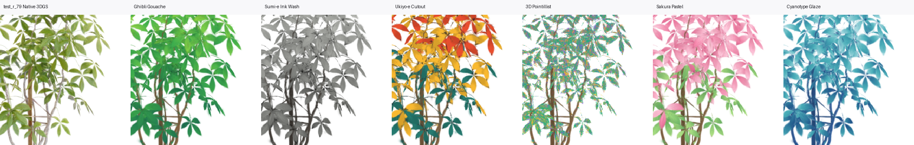
<!-- slide -->
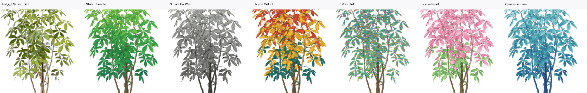
<!-- slide -->
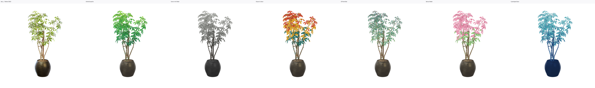
<!-- slide -->
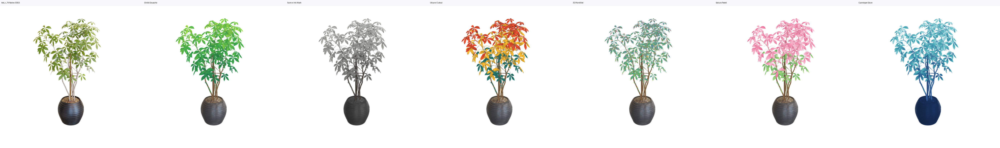
````

---

## 2. 同株异风格叶片混排展示（同一植物模型上共存多种艺术风格叶片）

通过 [compose_mixed_style_plant](../../../experiments/ficus_leaf_kernels_v04/leaf_kernels/style_presets_v03.py#L261-L315) 传入任意单叶映射字典 `{leaf_id: preset_name}`，系统将不同风格叶片的 $(\mathbf{c}_k, \alpha_k, \mathbf{s}_k)$ 一次性编译进**同一个 `297,343` 核的 3DGS 模型**并重算三维协方差 `cov6`，在单次 CUDA 光栅化中天然具备正确的三维前后遮挡排序与跨视角几何一致性：

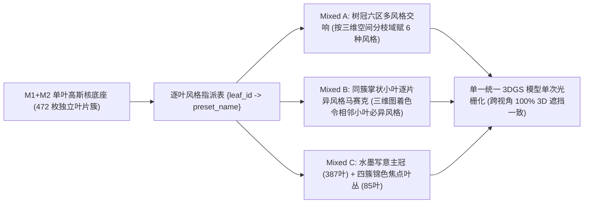

1. **`Mixed A` — 树冠六区多风格交响（6-Zone Crown Symphony）**：将整株榕树按三维方位与冠层高低划分为 6 个自然分枝区（吉卜力 `110` 叶、水墨 `107` 叶、青花天青 `83` 叶、3D 点彩 `71` 叶、浮世绘 `59` 叶、樱粉 `42` 叶），在同一株植物上呈现冷暖、虚实、色块与点彩的平滑分区共存。
2. **`Mixed B` — 同簇掌状小叶逐片异风格马赛克（Per-Leaflet Rosette Mosaic，单叶核分离极限压力测试）**：对 `472` 枚叶片构建三维空间 `kNN` 邻接图并执行**贪心图着色（Graph Coloring）**，强制**同一朵掌状复叶簇内紧挨在同一叶柄节点上的 5～7 枚小叶各自采用完全不同的风格**（6 种风格严格均衡各占 `78～79` 片叶）——可以看到同一叶簇中**三维点彩收缩粒子叶、黑白水墨半透叶、朱金浮世绘硬边叶、樱粉水彩叶**紧贴共生而叶柄交界清晰利落。
3. **`Mixed C` — 水墨留白主冠 + 四簇锦色焦点叶丛（Sumi-e + Hero Bouquets）**：全树 `387` 片背景与主体叶片采用素雅黑白**中国水墨写意**，同时在外冠精选 4 簇代表性掌状叶丛（共 `85` 片叶）分别点染**浮世绘朱金、樱粉水彩、青花天青、吉卜力翠绿**，展示精确到单叶/单叶簇的局部艺术聚焦能力。

### 2.1 同株异风格叶片 2× 局部放大实拍（检验相邻异风格小叶边界锐度与三维粒子共生）

每张面板从左至右依次为：
`Native 3DGS | M1+M2 Leaf Kernels (472) | Mixed A: 6-Zone Crown Symphony | Mixed B: Per-Leaflet Rosette Mosaic | Mixed C: Sumi-e + Hero Rosettes`

````carousel
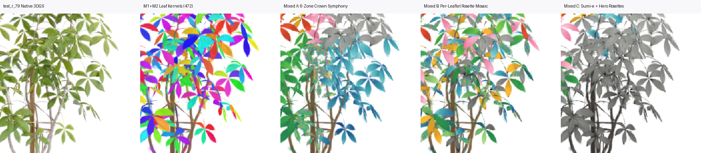
<!-- slide -->
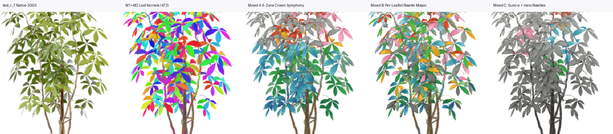
<!-- slide -->
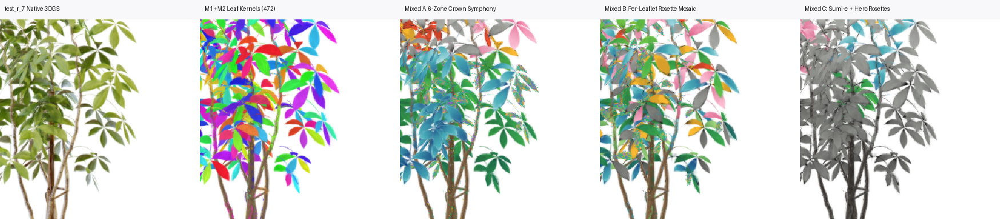
<!-- slide -->
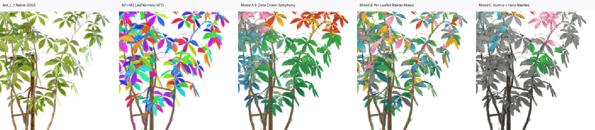
````

### 2.2 全画幅多留出视角同株混排展示（含侧视 `test_r_1`、斜俯视 `test_r_79`、仰视 `test_r_14`）

````carousel
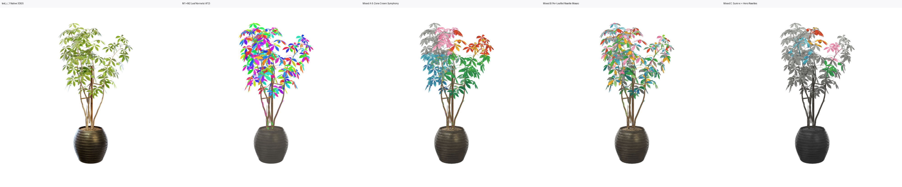
<!-- slide -->
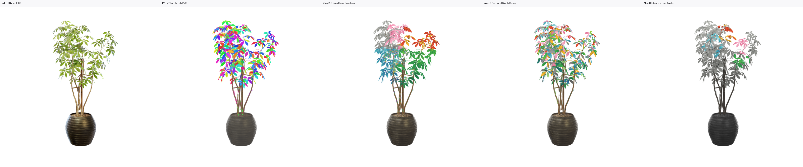
<!-- slide -->
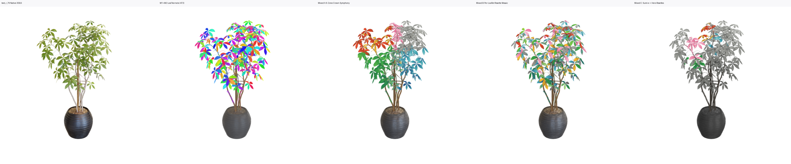
<!-- slide -->
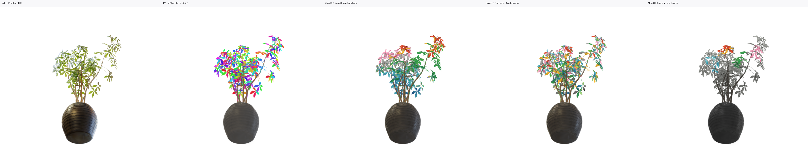
````

---

## 3. 安全与隔离验证及导出资产索引

- **安全与无冲突隔离**：全工程 `12` 个 Python 模块通过 AST 静态安全审计（`0` 问题，强制 `allow_pickle=False` 与 `resolve_read_path` / `resolve_write_path` 目录边界硬校验），`3` 项自动化单元测试全部通过，全程仅使用物理 `GPU 1`，未触碰并行泛化任务工作区。
- **核心新增文件与资产**：
  - `M1+M2` 单叶核底座与 6 套风格预设及混排器：[style_presets_v03.py](../../../experiments/ficus_leaf_kernels_v04/leaf_kernels/style_presets_v03.py)
  - 多风格画廊与同株混排一键运行脚本：[run_ficus_v03_multistyle.py](../../../experiments/ficus_leaf_kernels_v04/scripts/run_ficus_v03_multistyle.py)
  - 导出的纯净 `M1+M2` 单叶高斯核底座（`297,343` 核，`472` 叶）：[m1_m2_per_leaf_kernels.npz](../ASSETS_SERVER_ONLY.json)
  - 三种同株混排模式的逐核 `(rgb, opacities, scales)` 资产包：[v03_mixed_style_color_banks.npz](../ASSETS_SERVER_ONLY.json)
  - 定量评测报告：[MULTISTYLE_V03_REPORT.json](../results/MULTISTYLE_V03_REPORT.json)
