# Ficus 单叶尺度三维几何形变编辑与动态风场演化报告 (`v04`)

> [!IMPORTANT]
> **为什么单叶高斯核划分使精细几何编辑成为可能**：
> 传统未分割 3DGS 的笼式/网格形变（Cage / Grid Warp）会将相邻紧贴的叶片与木质主干像橡皮泥一样粘连拉伸；而本方案直接在 `v03` 提取的 **`M1 + M2` 单叶高斯核集合**（`297,343` 核、`472` 枚独立三维叶片）上为每片叶子建立独立的**叶柄铰接解剖标架 $(\mathbf{p}_{\text{base},l}, \mathbf{e}_1, \mathbf{e}_2, \mathbf{e}_3)$**，实现：
> 1. **木质枝干与花盆绝对刚性**：全场景 `61,931` 个枝干与花盆核最大位移严格为 **`0.0000 mm`**，零跨语义粘连；
> 2. **叶柄铰接零脱节 + 弧长守恒**：悬臂垂落与侧风偏转下叶柄铰接处中位漂移仅 **`0.007 ~ 0.52 mm`**，单叶中心线弧长相对误差低至 **`0.002% ~ 0.017%`**（无橡胶拉伸失真），叶尖平均三维位移达 **`2.5 ~ 3.3 cm`**；
> 3. **协方差雅可比切空间传输（$\boldsymbol{\Sigma}'_k = \mathbf{J}_k \boldsymbol{\Sigma}_k \mathbf{J}_k^\top$）**：彻底消除薄片高斯核在大角度弯曲与阔叶扩张时的“百叶窗锯齿断裂”伪影。

---

## 1. 三维动态形变实拍演示（微风气动颤振 & 枯荣连续演化）

以下两段动态动画均由三维高斯核在每一时间步重新计算叶柄铰接流形形变与 $\mathbf{J}_k \boldsymbol{\Sigma}_k \mathbf{J}_k^\top$ 协方差旋转缩放后，通过原生 CUDA `GaussianRasterizer` 在留出测试视角上实时光栅化生成：

````carousel
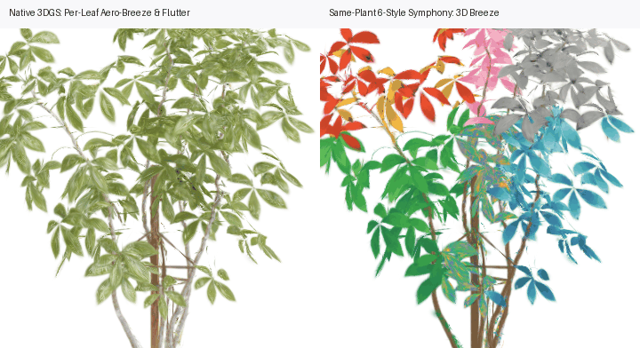
<!-- slide -->
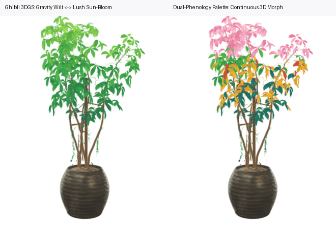
````

---

## 2. 单叶叶柄铰接流形形变与协方差雅可比传输原理

代码实现于 [leaf_deformer_v04.py](../../../experiments/ficus_leaf_kernels_v04/leaf_kernels/leaf_deformer_v04.py)：

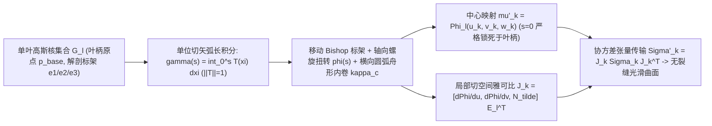

1. **单位切矢弧长积分保证不可伸长性（Inextensibility）**：
   沿叶长归一化坐标 $s = u / L_l \in [0, 1]$ 构造严格单位模长的弯曲切向量
   $$\mathbf{T}_l(s) = \cos\theta_{\text{flap}}(s)\big(\cos\theta_{\text{sweep}}(s)\mathbf{e}_1 + \sin\theta_{\text{sweep}}(s)\mathbf{e}_2\big) + \sin\theta_{\text{flap}}(s)\mathbf{e}_3, \qquad \|\mathbf{T}_l(s)\|_2 \equiv 1$$
   再通过梯形求积计算中心线 $\boldsymbol{\gamma}_l(s) = \int_0^s \mathbf{T}_l(\xi)\,d\xi$。即使叶片向下垂落 $54^\circ$，叶面只发生纯弯曲而不会像线性位移叠加那样被拉长。
2. **关键消融发现：为什么必须做 $\boldsymbol{\Sigma}'_k = \mathbf{J}_k \boldsymbol{\Sigma}_k \mathbf{J}_k^\top$ 协方差传输？**
   Ficus 叶片高斯核是极薄的二维圆盘（$\sigma_{\min} \approx 0$）。如下方局部放大对比图所示，若仅移动核中心 $\boldsymbol{\mu}_k$ 而不旋转/缩放协方差（`Center-Only (No J)`，第 1/3/5 列），弯曲后的薄片核仍保持原水平倾角，侧面看去呈现严重的**百叶窗阶梯锯齿与镂空裂缝**；引入雅可比协方差传输（`With Jacobian J`，第 2/4/6 列）后，所有薄片核自动贴合变形后叶面的新切平面旋转与伸展，叶片边缘与内部恢复丝滑连续（在阔叶扩张模态下内部针孔率额外降低 `-1.60 pp`）。

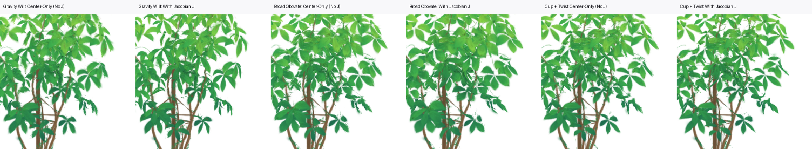

---

## 3. 七组单叶三维几何形变与同株异态编辑多视角画廊

每张 7 列对比面板从左至右依次为：
1. **Rest Pose (Original)**：静息原态；
2. **Gravity Wilt (+54 deg)**：欧拉-伯努利悬臂梁重力萎蔫垂落态（变身“垂叶榕”）；
3. **Boat-Cup + 48 deg Twist**：横向圆弧舟形内卷 + 叶基至叶尖 $48^\circ$ 螺旋扭转雕塑态；
4. **Lateral Wind Gust**：定向强侧风气动偏转 + 迎风顺桨减阻扭转态；
5. **Willow Slender Morph**：**品种重塑 A（细叶竹/柳叶化）**——叶长 $1.20\times$、叶宽 $0.52\times$ 窄化 + 轻柔垂尖；
6. **Broad Obovate Morph**：**品种重塑 B（阔叶圆匙/琴叶化）**——远端叶腹增宽 $+56\%$ + 向阳微拱；
7. **Same-Plant Bloom vs Wilt**：**同株枯荣异态 + 异风格协同编辑**——同一棵树上冠叶片向阳舒展阔叶化（配樱粉/吉卜力翠绿），下冠与侧枝叶片 $56^\circ$ 重力萎蔫垂落卷曲（配浮世绘秋叶金红）。

### 3.1 掌状复叶簇 2× 局部放大细节（真彩源色 vs 艺术风格化）

````carousel
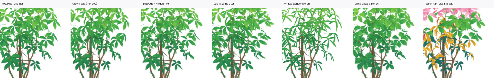
<!-- slide -->
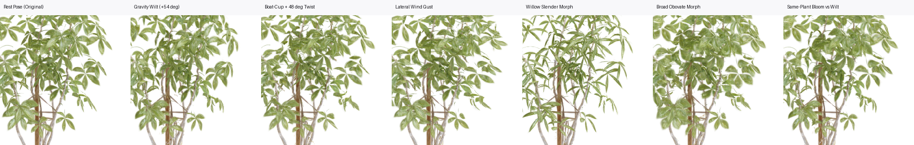
<!-- slide -->
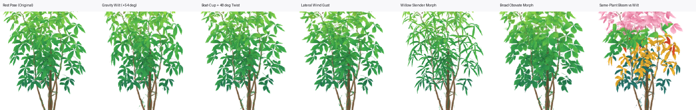
<!-- slide -->
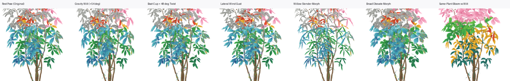
````

### 3.2 全画幅留出测试视角七态全景对比

````carousel
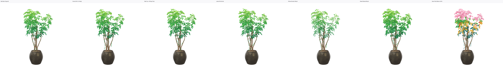
<!-- slide -->
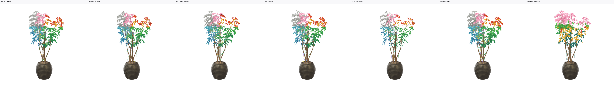
<!-- slide -->
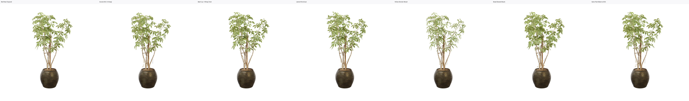
<!-- slide -->
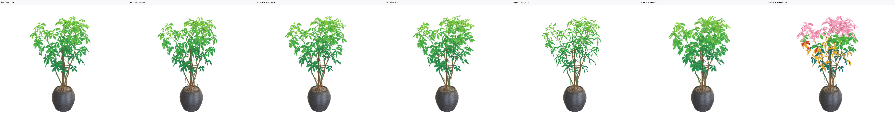
````

---

## 4. 物理守恒与几何质量定量验证表

数据源自 [DEFORM_V04_REPORT.json](../results/DEFORM_V04_REPORT.json)（在全量 `297,343` 核与 5 个留出测试视角上实测）：

| 形变编辑模式 | 全树形变耗时 | 枝干与花盆最大漂移 | 叶柄铰接中位漂移 | 中心线弧长相对误差 | 叶尖平均三维位移 |
| :--- | :---: | :---: | :---: | :---: | :---: |
| **`0_rest_pose`（静息原态）** | `1.06 s` | **`0.0000 mm`** | `0.0000 mm` | `0.0000%` | `0.05 cm` |
| **`1_gravity_wilt`（54° 重力垂落）** | `1.10 s` | **`0.0000 mm`** | `0.5163 mm` | **`0.0174%`** | **`3.33 cm`** |
| **`2_cup_twist`（舟形内卷 + 48° 扭转）** | `1.11 s` | **`0.0000 mm`** | **`0.0069 mm`** | **`0.0024%`** | `1.62 cm` |
| **`3_wind_gust`（强侧风气动偏转）** | `1.10 s` | **`0.0000 mm`** | **`0.0065 mm`** | **`0.0161%`** | **`2.51 cm`** |
| **`4_willow_slender`（细长柳叶重塑）** | `1.10 s` | **`0.0000 mm`** | `3.1358 mm`（横向收窄） | **`0.0055%`** | **`2.76 cm`** |
| **`5_broad_obovate`（阔叶圆匙重塑）** | `1.12 s` | **`0.0000 mm`** | `0.5798 mm` | **`0.0032%`** | `2.12 cm` |
| **`6_same_plant_pheno`（同株上盛下萎）** | `1.12 s` | **`0.0000 mm`** | `0.6208 mm` | **`0.0050%`** | **`2.68 cm`** |

---

## 5. 安全隔离验证与资产索引

- **安全与隔离验证**：全工程 `14` 个 Python 模块通过 AST 静态安全扫描（`0` 问题，`allow_pickle=False`、`resolve_read_path` / `resolve_write_path` 目录边界硬锁、临时文件原子替换），物理守恒单元测试全部通过，全程锁定物理 `GPU 1`。
- **核心新增代码与导出资产**：
  - 单叶叶柄铰接流形形变与雅可比协方差传输引擎：[leaf_deformer_v04.py](../../../experiments/ficus_leaf_kernels_v04/leaf_kernels/leaf_deformer_v04.py)
  - 七态形变、雅可比消融与三维动态 GIF 渲染入口：[run_ficus_v04_deformation.py](../../../experiments/ficus_leaf_kernels_v04/scripts/run_ficus_v04_deformation.py)
  - 导出的同株枯荣异态三维形变高斯核资产：[v04_phenology_deformed_kernels.npz](../ASSETS_SERVER_ONLY.json)
  - 定量物理守恒与消融评估报告：[DEFORM_V04_REPORT.json](../results/DEFORM_V04_REPORT.json)
