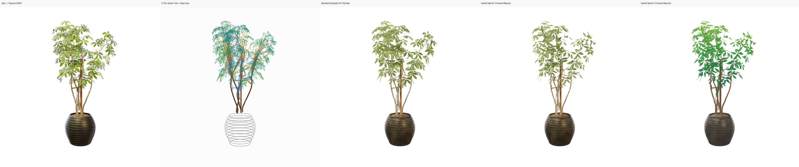
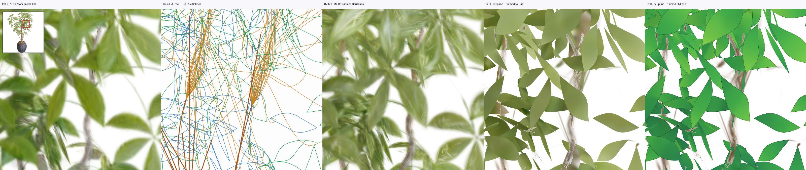
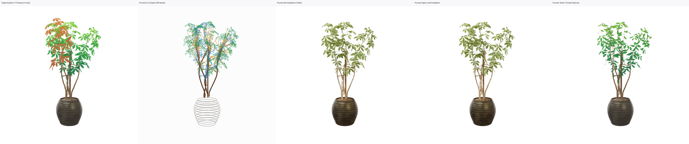
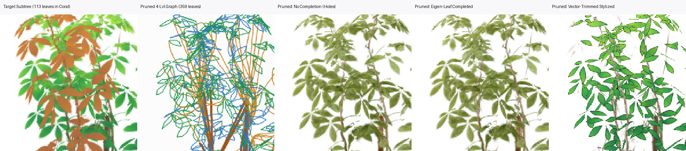
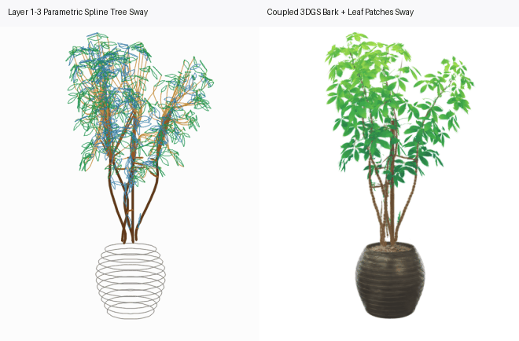
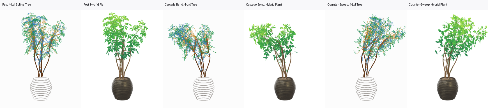
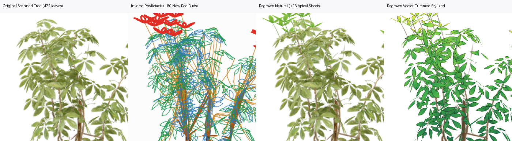

# `hybrid_botanical_v01`（课题 2）：统一三层向量样条—三维高斯混合植物原语（Hybrid Vector-Gaussian Botanical Primitive）

本目录收录**课题 2** 的完整文献调研、架构方案、端到端源码、留出测试视角定量评测 JSON 与四大旗舰应用实拍对比图/耦合风动 GIF：将一维参数化 B 样条骨架及双弧尖端叶片边界样条，与二维单叶 3DGS 高斯薄片统一为一套紧凑、拓扑连通、可无限变焦且物理可编辑的三层混合植物表征。

- **完整源码目录**：[`../../experiments/hybrid_botanical_v01/`](../../experiments/hybrid_botanical_v01/)
- **详细研究报告**：
  - [`2024–2026` 单叶级 3DGS 前沿文献调研与六大新课题评估](reports/leaf_3dgs_research_frontier_survey.md)
  - [`hybrid_botanical_v01` 架构设计与实现方案](reports/hybrid_botanical_implementation_plan.md)
  - [`hybrid_botanical_v01` 实验全景报告与四大旗舰应用验证](reports/hybrid_botanical_v01_walkthrough.md)
- **定量评测与参数化模型摘要 JSON**：[`results/HYBRID_BOTANICAL_V01_REPORT.json`](results/HYBRID_BOTANICAL_V01_REPORT.json) · [`results/hybrid_botanical_primitive.json`](results/hybrid_botanical_primitive.json)
- **服务器三维混合模型与 CAD 线框 SHA256 索引（`.ply` / `.obj`）**：[`ASSETS_SERVER_ONLY.json`](ASSETS_SERVER_ONLY.json)

---

## 一、统一三层混合植物原语架构与定量指标

| 层级 | 参数化几何与高斯耦合机制 | 重建规模与关键验证指标 |
| :--- | :--- | :--- |
| **Layer 1：旋转体盆座**<br>`LathePotPrimitive` | 同轴旋转母线样条 $\rho(h)$ + 视点解析包络轮廓 + `53,907` 盆土高斯核 | 盆座刚性锚定，编辑/风动中零漂移 |
| **Layer 2：四级连通样条枝干树**<br>`BotanicalTreeGraph` | `5` 主干 → `50` 二级侧枝 → `189` 叶簇短枝 → `472` 叶柄连杆 = **`716` 条三次 B 样条**；达芬奇管道模型半径递减（$r_p^{2.15}=\sum r_c^{2.15}$）+ Bishop 平行传输标架绑定 `29,313` 个木质树皮高斯核 | 根节点拓扑连通率 **`100.0%`**（`0` 悬空孤枝） |
| **Layer 3：双弧尖端叶片样条薄片**<br>`DualArcTrimmedLeafPatch` | `472` 片单峰披针形双弧三次 B 样条边界（叶基/叶尖精确 $C^0$ 尖点闭合 `0.00e+00 m`、叶缘 $C^2$ 光滑）+ **Eigen-Leaf PCA 单株形态自相似先验**（前 4 主成分解释 `91.43%` 方差）+ 视壳安全阴影补全 | `298,015` 总核（标准 `.ply` 兼容），5 个留出测试视角阴影补全前后一致性 **`46.88 dB`**、轮廓 IoU **`96.81%`** |



---

## 二、四大旗舰应用实证结果

1. **应用 1：8× 光学超清矢量变焦（Vector-Sharp Super-Zoom）**
   - 沿精确三维双弧 B 样条执行 3D 距离场硬裁剪 + 屏幕空间解析反走样双弧边界裁切，在未见测试视角 `8×` 微距放大下边缘梯度锐度较原始 3DGS 提升 **`6.62×`**（`test_r_79`）/ **`5.97×`**（`test_r_7`），彻底消除高斯椭圆雾状毛边。
   

2. **应用 2：一键拓扑整枝修剪与内冠遮挡补全显露（Topological Bonsai Pruning）**
   - 单次指定侧枝节点 `branch_id=5`，沿 `BotanicalTreeGraph` 有向树一键精确剪除整棵子树（`153` 段各级枝条 + **`113` 片树叶**，零悬空残片），剪口后方显露完整无破洞的内冠枝干与补全叶片（剪枝窗有效像素 `+9.6%`）。
   
   

3. **应用 3：四级主干—侧枝—叶簇—单叶层次耦合盆景蟠扎与同步风动物理**
   - 扭转主干/侧枝 B 样条时，下游 `716` 段子枝、Bishop 树皮核及 `472` 片叶柄锚定叶片经层次刚体+柔性雅可比传输精确联动，无任何枝叶脱节。
   
   

4. **应用 4：逆向植物学叶序参数发现与顶芽程序化抽新枝长嫩叶（Inverse Phyllotaxis & Regrowth）**
   - 从重建树图自动统计逆向植物学参数（相邻叶柄互生发散角中位数 **`68.8°`**、分枝俯仰角 **`39.3°`**、叶柄倾角 **`54.4°`**），驱动最高 `16` 个顶芽程序化萌发 `16` 条新梢与 **`80` 片双弧幼叶样条薄片**（`+8,960` 新芽高斯核）。
   

---

## 三、复现与单元测试命令

```bash
PY=/mnt/hdd1/u00134/radegs_paper_reproduction_v01/official_code_fix_v01/env/bin/python
cd experiments/hybrid_botanical_v01

# 1. 运行写入隔离、双弧 C0 尖端闭合与四级达芬奇管道树单元测试
CUDA_VISIBLE_DEVICES=1 $PY -m unittest discover -s tests -v

# 2. 端到端运行三层混合植物原语构建与四大旗舰应用评测
CUDA_VISIBLE_DEVICES=1 $PY scripts/run_hybrid_botanical_v01.py
```
