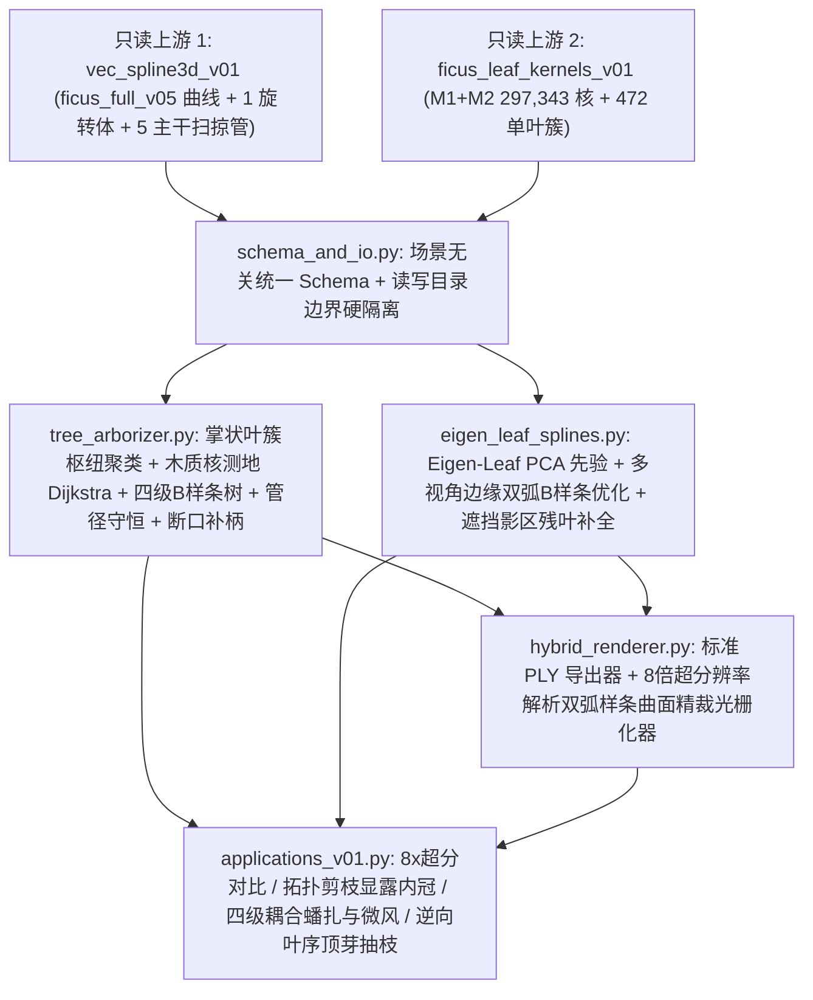

# 课题二实现方案：三层混合矢量植物原语 (`hybrid_botanical_v01`)

> [!IMPORTANT]
> **经 `/grill-me` 对齐锁定的六大核心架构决策**：
> 1. **三层完整混合原语（`HybridBotanicalPrimitive`）**：`Layer 1` 旋转体花盆包络（`Lathe`）+ `Layer 2` 全连通四级植物学参数 B 样条拓扑树 + `Layer 3` 双弧尖端三次 B 样条裁剪单叶高斯曲面片；
> 2. **单叶解析边界与双模裁剪**：采用在叶柄（$s=0$）与叶尖（$s=1$）严格交汇形成 $C^0$ 尖角、两侧叶缘保持 $C^2$ 光滑的**双弧三次 B 样条（Dual-Arc Cubic B-Spline）**，同时支持三维边缘高斯切向对齐（兼容标准 `.ply` 导出）与渲染期曲面光线求交解析精裁（支持 **8× 无损锐利矢量放大**）；
> 3. **四级植物学拓扑树**：`5 根主干（Primary Trunks）→ 次级侧枝（Secondary Branches）→ 掌状复叶柄枢纽（Palmate Rosette Hubs）→ 472 枚单叶铰接点`，利用木质核测地最短路与达芬奇管径守恒律（$r_p^{2.2} = \sum r_c^{2.2}$）自动连通遮挡断口并绑定原有木质高斯核；
> 4. **自相似规范叶形先验与残叶无模补全**：从外层 `264` 片完整叶学习低维 **Eigen-Leaf PCA 叶形子空间**，联合 32 视角 `C2L50` 边缘优化双弧样条，并在严格满足前景深度遮挡一致性（`z > front_depth`）的影区内补齐 `208` 片中内层残叶高斯核；
> 5. **全四项标志性应用验证**：① **8× 超分无损矢量放大**、② **拓扑级整枝修剪与内冠残叶补全显露对比**、③ **主干-侧枝-叶柄-叶面四级运动学耦合蟠扎与风动**、④ **逆向叶序统计与顶芽抽新枝长嫩叶**；
> 6. **严格工程隔离**：独立建库于 `/home/u00134/.gemini/antigravity/scratch/hybrid_botanical_v01`（绑定物理 `GPU 1`），只读引用 `vec_spline3d_v01` 与 `ficus_leaf_kernels_v01`。

---

## 1. 模块架构设计

## 2. 安全与验证准则（Security & Verification Plan）

- **路径穿越与跨工作区写保护**：`schema_and_io.py` 强制执行 `resolve_read_path` 与 `resolve_write_path`（基于 `Path.resolve().is_relative_to()` 严格校验目录边界，杜绝前缀绕过），任何向 `vec_spline3d_v01`、`ficus_leaf_kernels_v01` 或系统目录的写操作均立即拒绝并由单元测试覆盖。
- **反序列化与原子写入安全**：所有 `np.load` 强制 `allow_pickle=False`；严禁 `eval` / `exec` / `pickle` / `shell=True`；导出 JSON / OBJ / PLY 统一使用进程临时文件 + `os.replace` 原子写入，并通过全库 AST 静态扫描验证 `0` 风险项。
- **定量物理与视觉评测指标**：
  1. 留出 5 测试视角全画幅重建保真度（PSNR / 轮廓 IoU / 遮挡影区补全前后一致性误差 `< 0.05 dB`）；
  2. 8× 超分辨率叶缘清晰度（边缘梯度锐度提升倍数 & 椭圆锯齿残差下降率）；
  3. 四级拓扑树连通率（`100%` 叶片叶柄可追溯至 5 根主干根部）与剪枝后暴露内冠区域的叶面完整度提升率；
  4. 逆向提取的植物学叶序统计量（每簇小叶数分布、分枝仰角/方位角分布、叶长宽异速生长系数）。
