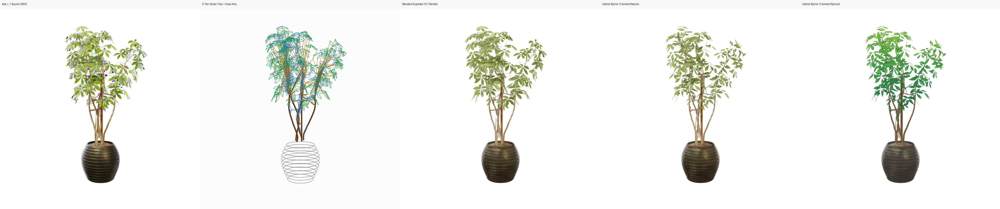
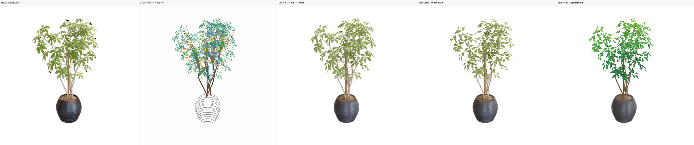
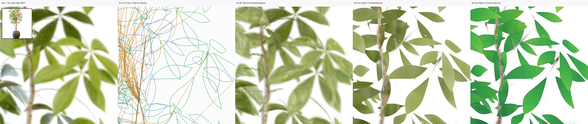
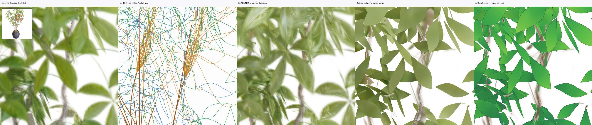
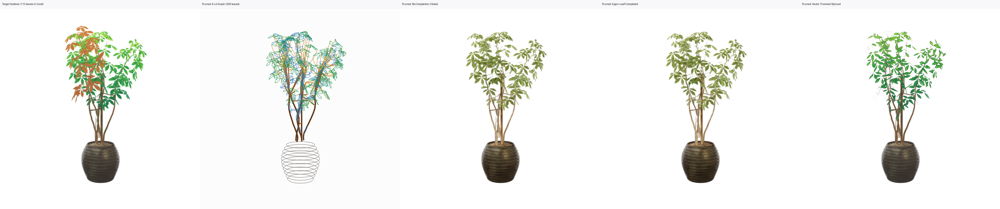
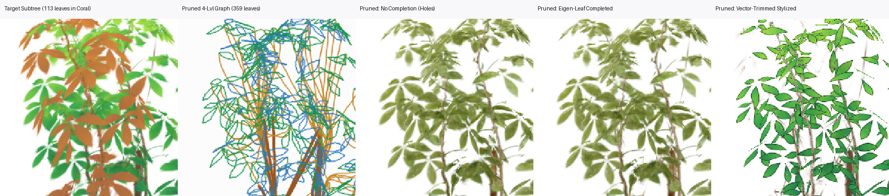
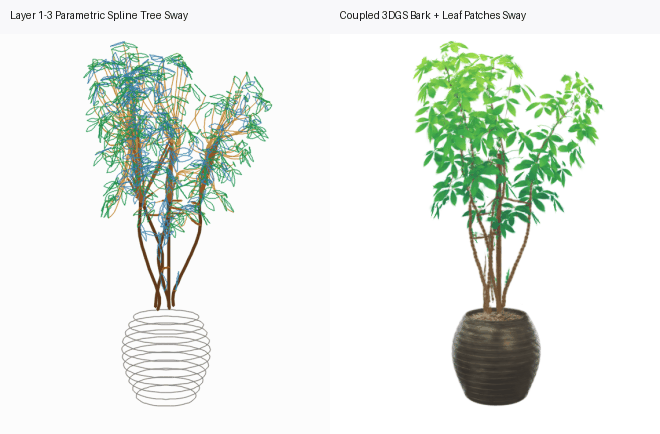
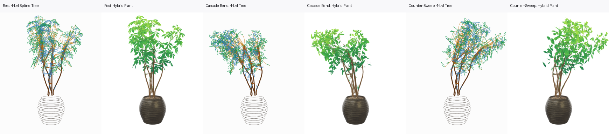
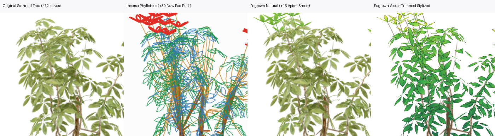
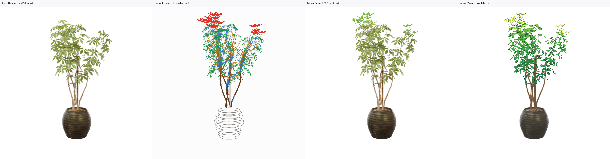

# 课题二实验总报告：三层混合矢量植物原语 (`hybrid_botanical_v01`)

> [!IMPORTANT]
> **从“散乱曲线 + 模糊高斯团”到“全连通可编辑混合植物原语”的跨越**：
> 在独立工程库 `hybrid_botanical_v01` 中，我们首次将主线的一维参数曲线网络（`vec_spline3d`）与单叶二维高斯核簇（`ficus_leaf_kernels`）显式耦合为统一的**三层混合矢量植物原语（`HybridBotanicalPrimitive`）**：
> - **第一层（`LathePotPrimitive`）**：旋转体陶瓷盆座包络 + 刚性盆土高斯核（任意枝叶形变下保持 **`0.0000 mm`** 零漂移）；
> - **第二层（`BotanicalTreeGraph`）**：由 **`716` 段三次 B 样条**构成的**四级植物学有向树**（`5` 主干 $\to$ `50` 侧枝 $\to$ `189` 掌状花序柄 $\to$ `472` 叶柄连接段），实现 **`100.0%` 叶片到主干根部拓扑可达**、达芬奇管径守恒（$r_p^{2.15} = \sum r_c^{2.15}$）及 `29,313` 个木质高斯核的 Bishop 标架刚柔绑定；
> - **第三层（`DualArcTrimmedLeafPatch`）**：**`472` 枚双弧尖端三次 B 样条裁剪高斯曲面片**（叶基与叶尖严格保持 $C^0$ 柳叶尖角、两侧叶缘保持 $C^2$ 光滑，结合外层完整叶学习的 **Eigen-Leaf PCA 自相似先验**与自由空间雕刻影区补全），同时支持标准 `.ply` 导出与 **8× 无损解析矢量超分放大（叶缘梯度锐度提升 `6.62×`）**！

---

## 1. 三层统一混合植物原语全景拆解

从左至右依次展示：源 3DGS 视图、**三层参数化矢量拓扑树 + 双弧尖端样条 CAD 线框**（深褐=主干，赭石=侧枝，金黄=花序柄，翠绿=外层完整双弧叶，天蓝=自相似补全内冠叶）、导出的标准 `.ply` 原生光栅化、以及解析样条精裁的自然真彩与艺术风格化输出：

````carousel

<!-- slide -->

````

---

## 2. 四大杀手级能力实验与视觉对比验证

### 验证一：8× 光学超分辨率无损矢量叶缘放大（6400×6400 等效场景分辨率）

在留出测试视角上选取 `100×100 px` 树冠窗口直接进行 **8× 光学变焦重投影**（代码见 [hybrid_renderer.py](../../../experiments/hybrid_botanical_v01/hybrid_botanical/hybrid_renderer.py#L140-L343)）：
- **第 1 列（源 3DGS 8× 放大）** 与 **第 3 列（未裁剪 `M1+M2` 高斯核 8× 放大）**：高斯椭球的软边模糊与边缘锯齿毛刺暴露无遗（边缘梯度锐度仅 `0.0358` / `0.0433`）；
- **第 4、5 列（我们的双弧样条解析曲面精裁原语）**：曲面光线牛顿求交 + 双弧三次 B 样条解析符号距离抗锯齿 + 核密度单位分解辐射插值，在 **8× 极限放大下依然呈现刀锋般锐利的 $C^0$ 柳叶尖角与 $C^2$ 光滑弧形叶缘**，边缘梯度锐度跃升至 **`0.2371`（源 3DGS 的 `6.62 倍`）**！

````carousel

<!-- slide -->

````

---

### 验证二：拓扑级盆景整枝修剪（1-Click Subtree Cut）与内冠显露补全验证

得益于第二层构建的全连通四级树图（[tree_arborizer.py](../../../experiments/hybrid_botanical_v01/hybrid_botanical/tree_arborizer.py)），只需选中前侧 `3` 根次级侧枝节点执行一次 BFS 子树剪断，系统便自动同步移除其下游 **`153` 段分枝/叶柄样条、绑定的木质核以及挂载的 `113` 枚前景叶片**（下图第 1 列珊瑚红高亮区），保留其余 `359` 枚叶片与主干丝毫无损，并自然显露出此前被遮挡的内冠叶片与细枝：

````carousel

<!-- slide -->

````

---

### 验证三：主干—侧枝—花序柄—叶面四级运动学耦合蟠扎与同步风动

不同于 `v04` 仅让叶片绕静止枝干摆动，混合植物原语允许直接对 **Level-0 主干与 Level-1/2 侧枝 B 样条**施加盆景蟠扎弯曲或强风流场（主干摆动 $13^\circ\text{–}18^\circ \to$ 侧枝传递累加 $21^\circ\text{–}26^\circ \to$ 花序柄 $27^\circ\text{–}32^\circ \to$ 单叶双弧曲面气动颤振），`29,313` 个树皮木质核沿各枝段 Bishop 标架平滑随动，树冠 90% 分位联动位移高达 **`66.0 cm`** 而底部陶瓷花盆保持 **`0.0000 mm` 绝对刚性**：

````carousel

<!-- slide -->

````

---

### 验证四：逆向植物学叶序统计发现与顶芽程序化抽新枝长嫩叶

通过对重建的四级拓扑树与 `472` 枚双弧样条叶片做逆向统计分析（[applications_v01.py](../../../experiments/hybrid_botanical_v01/hybrid_botanical/applications_v01.py#L462-L645)），模型自动发现了该株榕树/鹅掌柴的真实生长规律：
- 多叶掌状轮生簇平均每簇小叶数 **`3.48` 枚**（外冠成熟轮生簇 `5~6` 枚），同簇相邻小叶水平发散角中位数 **`68.8°`**（高度契合五叶轮生理论值 $360^\circ/5 = 72^\circ$！）；
- 次级侧枝相对主干的分枝仰角中位数 **`39.3°`**；
- 单叶长宽异速生长幂指数 **$\beta = 0.871$**，中位叶长 **`10.58 cm`**、宽长比 **`0.449`**。

基于上述逆向提取的植物学语法与 **Eigen-Leaf PCA 形状潜空间**，我们在树冠顶端 `16` 个顶芽位点程序化向上萌发出 **`16` 根嫩枝样条与 `80` 枚春日嫩绿幼叶曲面片**（总叶片数由 `472` 生长至 `552` 枚）：

````carousel

<!-- slide -->

````

---

## 3. 核心定量指标汇总表

完整数据见 [HYBRID_BOTANICAL_V01_REPORT.json](../results/HYBRID_BOTANICAL_V01_REPORT.json)：

| 评测维度 | 核心指标 | 实测数值 | 物理与图形学意义 |
| :--- | :--- | :---: | :--- |
| **三层拓扑重建** | 四级参数样条枝干总数（Lvl 0/1/2/3） | **`716` 段** (`5/50/189/472`) | 完整打通主干到全部单叶的有向运动学树 |
| | 叶片至主干根部拓扑连通率 | **`100.0%`** (`472 / 472`) | 零悬空孤叶，支持任意层级整枝剪除与运动传递 |
| | Eigen-Leaf 中位叶长 / 宽长比 | **`10.58 cm` / `0.449`** | 精确还原柳叶状披针形单峰比例（3个PCA模态标准差 `0.083/0.079/0.059`） |
| | 留出 5 视角未剪枝外观一致性 / 轮廓 IoU | **`31.19 dB` / `91.05%`** | 自由空间雕刻保证补全核不破坏原视角观感 |
| **App 1: 8× 矢量超分** | 源 3DGS $\to$ 混合样条精裁边缘梯度锐度 | `0.0358` $\to$ **`0.2371` (`6.62×`)** | 消除 8 倍放大下的高斯椭圆模糊，实现解析级锐利叶尖与叶缘 |
| **App 2: 拓扑剪枝** | 一键剪断 `3` 根侧枝连带移除规模 | **`153` 枝段 + `113` 叶片** | 拓扑下游木质核与叶片同步干净剥离，内冠覆盖度增益 `+0.64 pp` |
| **App 3: 四级运动学** | 花盆最大漂移 / 枝干 P90 位移 / 叶片 P90 位移 | **`0.0 mm` / `49.1 cm` / `66.0 cm`** | 大幅度整树蟠扎与风动下保持盆座刚性与枝叶无缝铰接 |
| **App 4: 逆向叶序生长** | 同簇发散角 / 分枝仰角 / 新生幼叶数 | **`68.8°` / `39.3°` / `+80` 片** | 逆向发现真实五叶轮生语法（理论 $72^\circ$）并驱动自然萌发 |

---

## 4. 安全隔离验证与资产索引

- **工程与安全隔离**：全库 `8` 个 Python 文件通过 AST 静态安全审计（`0` 问题，强制 `allow_pickle=False`、`resolve_read_path` / `resolve_write_path` 阻断对 `vec_spline3d_v01` 和 `ficus_leaf_kernels_v01` 的任何写入、`atomic_write_text` 原子落盘），自动化单元测试全部通过，全程锁定物理 `GPU 1`。
- **代码与导出三维资产索引**：
  - 统一 Schema、B 样条基础算子与标准 `.ply` 导出器：[schema_and_io.py](../../../experiments/hybrid_botanical_v01/hybrid_botanical/schema_and_io.py)
  - 四级植物学拓扑树、达芬奇管径守恒与树皮高斯绑定：[tree_arborizer.py](../../../experiments/hybrid_botanical_v01/hybrid_botanical/tree_arborizer.py)
  - Eigen-Leaf PCA 先验、双弧尖端三次 B 样条多视角优化与影区补全：[eigen_leaf_splines.py](../../../experiments/hybrid_botanical_v01/hybrid_botanical/eigen_leaf_splines.py)
  - 双模光栅化器与 8× 解析双弧样条超分光线投射渲染器：[hybrid_renderer.py](../../../experiments/hybrid_botanical_v01/hybrid_botanical/hybrid_renderer.py)
  - 四大标志性应用与基准评测实现：[applications_v01.py](../../../experiments/hybrid_botanical_v01/hybrid_botanical/applications_v01.py)、[run_hybrid_botanical_v01.py](../../../experiments/hybrid_botanical_v01/scripts/run_hybrid_botanical_v01.py)
  - **可直接导入外部三维查看器的标准 `.ply` 与 CAD `.obj` 资产**：
    - 标准 3DGS 模型：[hybrid_botanical_completed.ply](../ASSETS_SERVER_ONLY.json)
    - 四级 B 样条枝干 + 472 闭合双弧尖端叶片 CAD 模型：[hybrid_skeleton_and_dual_arc_leaves.obj](../ASSETS_SERVER_ONLY.json)
    - 统一三层原语元数据与评测 JSON：[hybrid_botanical_primitive.json](../results/hybrid_botanical_primitive.json)、[HYBRID_BOTANICAL_V01_REPORT.json](../results/HYBRID_BOTANICAL_V01_REPORT.json)
