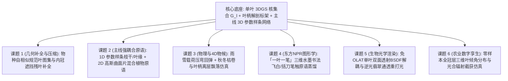

# 基于「单叶级 3DGS 高斯核解耦」的前沿文献调研与新颖课题路线图

> [!NOTE]
> **调研背景与核心壁垒**：在 `ficus_leaf_kernels`（`v01`–`v04`）中，我们已经实现了从无结构植物 3DGS 点云中提取**单叶独立高斯核集合 $\mathcal{G}_l$**、**叶柄铰接解剖标架 $(\mathbf{p}_{\text{base}}, \mathbf{e}_1, \mathbf{e}_2, \mathbf{e}_3)$** 与**遮挡置信分层**，同时你们主线项目（`vec_spline3d`）还拥有高精度的**三维参数样条与扫掠枝干管原语**。这两者结合恰好命中了 **2024–2026 年计算机图形学（SIGGRAPH）与三维视觉（CVPR / NeurIPS）从“无结构辐射场观览”迈向“器官级可编辑/可物理交互植物数字孪生”** 的最核心空白区。

---

## 1. 2024–2026 国际顶会相关前沿文献全景梳理

通过对 SIGGRAPH / SIGGRAPH Asia、CVPR、NeurIPS、Eurographics 等最新文献的系统检索，当前 3DGS 植物与风格化研究主要分为四条赛道，每条赛道均存在明确的**未解痛点**：

| 研究赛道 | 代表性前沿工作（2024–2026） | 现有方法做到了什么 | 尚未解决的核心空白（我们的突破口） |
| :--- | :--- | :--- | :--- |
| **1. 器官级 3DGS 植物重建与资产化** | • **Splanting** (*SIGGRAPH Asia 2024*) • **GaussianPlant** (*arXiv 2025.12*) • **LeafFit** (*Eurographics 2026*) • **LCR-GS / PlantGaussian** (*2025–2026*) | 提出将植物拆解为圆柱枝干 + 圆盘叶片基元（*GaussianPlant*），或用微分移动最小二乘（MLS）将单叶 3DGS 拟合成共享网格模板（*LeafFit*）。 | 拟合为刚性网格/圆盘会丢失 3DGS 天然的半透明边缘与高频纹理；而**直接在原生 3DGS 核空间利用物种自相似性补全内冠被遮挡残叶（Amodal 3DGS Completion）** 仍属空白。 |
| **2. 植物逆向程序化建模与生长** | • **Interactive Invigoration** (*SIGGRAPH 2024*) • **Stressful Tree Modeling** (*SIGGRAPH 2025*) • **Autoregressive Growing Trees** (*SIGGRAPH Asia 2025*) | 基于束模型（Strands）与 Cosserat 杆物理模拟树木生长与折断，或用自回归 Transformer 生成生长树拓扑。 | 纯正向生成多、**从真实扫描 3DGS 盆栽/树木中逆向反推叶序语法（Inverse Phyllotaxis）并结合参数曲线枝干实现拓扑级修剪/嫁接/重生长** 极少有人打通。 |
| **3. 动态风场、天气交互与物候演化** | • **Wind on Trees** (*2026*, RK4 物理先验 4DGS) • **Let it Snow!** (*CVPR 2026*, 物理引导天气) • **TreeSplat** (*NeurIPS*) | 在粗分枝上绑定阻尼谐振子模拟风吹，或用物理引导扩散模型在静态 3DGS 表面生成积雪/降雨外观。 | *Let it Snow!* 无法让**单枚叶片因承接积雪/雨滴重量而发生悬臂下垂与滑落回弹**；更缺乏从变黄枯卷到**叶柄离层断裂飘落（Abscission）**的器官级全生命周期仿真。 |
| **4. 植物光学重打光与艺术笔触化** | • **Subsurface Scattering for 3DGS** (*NeurIPS 2024*) • **Morpheus** (*CVPR 2025*) • **BrushGaussian / Flow-Guided 3DGS** (*2025*) | 用 OLAT 多光源数据训练次表面散射 3DGS；或用局部流场引导高斯核做梵高式细碎笔触变形。 | 缺乏**免 OLAT 数据的薄叶双面逆光透射（Backlit Translucency）实时重打光**；艺术化停留在碎笔触堆砌，未出现**“一叶一笔”书法中锋飞白/水墨撇叶原语**。 |

---

## 2. 六大高潜力新颖研究课题深度剖析

---

### 课题一：基于物种自相似先验的内冠遮挡残叶无模补全与实例化压缩
**（Self-Similarity Canonical Gaussian Leaf Atlas & Amodal Inner-Canopy Completion）**

- **直击痛点**：我们在 [ficus_leaf_kernels_walkthrough.md](../../ficus_leaf_kernels_v04/reports/v01_leaf_partition_walkthrough.md) 中定量发现：受限于多视角互遮挡，全树 `472` 片叶中有 **`195` 片中层半遮挡叶（`MID_PARTIAL_OCCLUDED`）存在缺角截断**，`13` 簇深层叶只剩零星碎核。一旦做大风掀叶、修剪前景枝条或将相机伸入树冠内部漫游，被遮挡叶的空洞便会暴露无遗。
- **核心创新点**：
  1. **单株规范高斯叶潜空间（Eigen-Leaf Gaussian Atlas）**：利用同一株植物外层 `264` 片高完整度叶片（`OUTER_ENCLOSED`）的强自相似性，在解剖归一化坐标 $(s, t, w)$ 下构建少量（如 `K=4`）高保真**原型高斯叶片模板**及低维形变/色度潜码；
  2. **三维无模叶片补全（3D Amodal Leaf Completion）**：对内冠仅观测到半截叶尖或叶基的 `MID_PARTIAL_OCCLUDED` 残叶，通过局部可见核匹配与前景深度遮挡一致性约束（补全部分在原训练视角下必须严格位于前景叶深度 `front_depth` 之后，不破坏原视角渲染 PSNR！），自动推理恢复完整的被遮挡半叶；
  3. **高斯实例化极速压缩（Gaussian Instancing）**：将整株植物压缩为“原型叶高斯核 + 472 组 $SE(3)$ 位姿与铰接弯曲参数”，显存占用可压缩 **10× 以上**。
- **目标顶会**：**CVPR / ICCV / SIGGRAPH / Eurographics**。

---

### 课题二：「一维参数样条骨架 + 二维铰接高斯叶面片」统一混合矢量植物原语
**（Hybrid Vector-Gaussian Botanical Representation: 1D Splines + 2D Trimmed Leaf Surfels）**

- **独特优势（完美打通你们两条实验线！）**：你们主线已重建出全场景**三维参数曲线与扫掠枝干包络**，本分支已提取出**472 片独立叶片高斯核簇与 24 点闭合轮廓**。目前国际上尚无工作将 **1D 连续矢量样条原语**与 **2D 裁剪高斯曲面片**统一为可微分联合优化的植物表达！
- **核心创新点**：
  1. **显式树状运动学拓扑图（Branch-Petiole-Lamina Kinematic Graph）**：将扫掠枝干样条与每片叶子的叶柄铰接点 $\mathbf{p}_{\text{base},l}$ 构建成完整有向树图——弯曲一根主枝样条，整条分枝上的所有子枝与数十枚叶片自动做刚柔耦合跟随运动；
  2. **矢量样条精确裁剪高斯核（Vector-Trimmed Gaussian Patch）**：用闭合三次样条曲线定义单叶精确解析边界，在光栅化器中对跨界高斯核执行解析半平面/样条符号距离裁剪（Analytic Gaussian Trimming），彻底实现**任意放大倍率下零锯齿、零毛刺的矢量级锐利叶缘**；
  3. **逆向叶序语法发现（Inverse Phyllotaxis）**：统计单叶沿枝干样条的螺旋着生角与节间长分布，自动拟合 L-System 生长语法，支持让扫描盆栽“继续向上长出新芽与新枝叶”。
- **目标顶会**：**SIGGRAPH / SIGGRAPH Asia / TOG**（图形学表示与几何造型正统大作题材）。

---

### 课题三：器官级微气象物理交互与四维生命周期物候演化
**（Organ-Level Weather Mechanics & 4D Senescence-Abscission Simulation）**

- **直击痛点**：CVPR 2026 的 *Let it Snow!* 只能给静态场景“涂一层雪”，树叶不会因雪重弯腰；现有 4DGS 植物工作只能回放录制好的几秒微风视频，无法做跨季节演演与破坏性交互。
- **核心创新点**（基于我们已实现的 [leaf_deformer_v04.py](../../../experiments/ficus_leaf_kernels_v04/leaf_kernels/leaf_deformer_v04.py) 可在短期内快速出惊艳 Demo！）：
  1. **雨滴脉冲颤振与积雪压弯—滑落循环**：按每片叶子的天顶受雪面积 $A_l (\mathbf{n}_l \cdot \mathbf{e}_z)_+$ 实时累积雪荷载高斯核并增大悬臂垂落角 $\theta_{\text{flap},l}$；当叶片下垂倾角超过静摩擦角时触发**积雪整块滑落 + 树叶欠阻尼回弹抖动**；
  2. **生物反应扩散衰老与叶柄离层落叶（Reaction-Diffusion Senescence & Leaf Abscission）**：在每片叶子的 $(s,t)$ 流形上求解叶绿素降解与水分流失偏微分方程（色彩由翠绿渐变为秋黄焦褐，几何同步触发横向干枯卷曲 $\kappa_c \uparrow$ 与重力萎蔫），当叶基养分降至阈值时解除 $\mathbf{p}_{\text{base},l}$ 铰接约束，单叶高斯簇在旋转空气升力与阻力下**真实盘旋飘落并堆积于花盆/地面**！
- **目标顶会**：**SIGGRAPH / SCA (Symposium on Computer Animation) / CVPR**（视觉冲击力极强，评审一眼惊艳）。

---

### 课题四：「一叶一笔」三维书法中锋飞白与刮刀笔触原语蒸馏
**（One-Leaf-One-Stroke 3D Calligraphic & Impasto Brush Primitive Distillation）**

- **直击痛点**：现有 3DGS 艺术风格化（*StyleGaussian*、*BrushGaussian*）在植物上全是杂乱无章的细碎色点，完全违背人类画师画叶的**器官级笔法逻辑**（如国画写意竹叶/兰叶/榕叶讲究“一笔撇出一片叶，起笔藏锋、中段饱满、叶尖出锋飞白”）。
- **核心创新点**：
  - 利用每枚叶片已提取的解剖中心线 $\boldsymbol{\gamma}_l(s)$ 与叶宽包络 $w_l(s)$，将原本每片叶 ~`300` 个无序细碎高斯核**蒸馏浓缩为 1～3 枚带宣纸飞白纹理/油画刮刀肌理的「三维曲率丝带笔触原语（3D Curved Stroke Primitive）」**；
  - 支持毛笔运笔动画（整株盆景从空枝开始，按枝干生长顺序**一笔一叶在三维空间实时挥毫写出整棵树**），兼顾极致国风审美与百倍图元精简（全树仅需 ~`800` 个三维笔触原语！）。
- **目标顶会**：**SIGGRAPH / Pacific Graphics / EGSR / TVCG**。

---

### 课题五：免 OLAT 数据的单叶双面透射 BSDF 逆向解耦与逆光重打光
**（Single-Capture Bi-Directional Foliar Translucency & Backlit Relighting in 3DGS）**

- **核心创新点**：真实植物最具感染力的光影瞬间是**逆光下薄叶呈现的半透明翡翠荧光感（Subsurface / Diffuse Foliar Transmission）**。利用单叶分割给出的薄壳法向 $\mathbf{n}_l$、叶片局部光学厚度（由 `M1` 前原始累积不透明度反推）及三维树冠自阴影遮挡关系，可在无需实验室多灯扫描（OLAT）的条件下，从普通多视角图像中分解出每片叶子的**正面蜡质镜面反射（Specular BRDF）**与**背面叶绿素漫透射（Foliar BTDF）**，实现任意 HDR 环境光与太阳角度下的逼真逆光树冠实时渲染。
- **目标顶会**：**SIGGRAPH / EGSR / NeurIPS / CVPR**。

---

### 课题六：零样本单株三维表型解析与冠层光合微气候仿真
**（Zero-Shot Organ-Level 3DGS Phenotyping & Canopy Light-Interception Simulation）**

- **核心创新点**：面向智慧农林与数字植物表型组学，直接在提取的 `472` 片三维叶片簇上自动输出**单叶面积分布、叶倾角分布（LAD）、叶序分形维数**，并通过 GPU 光线投射精确计算一天内不同太阳高度角下**每一枚叶片的光合有效辐射（PAR）截获量**，自动诊断树冠内部“光饥饿叶片”并给出最优疏叶修剪方案。
- **目标期刊/会议**：**Plant Phenomics / ISPRS / Computers and Electronics in Agriculture / CVPR Agri-Vision**。

---

## 3. 课题综合评估矩阵与优先切入建议

结合你们实验室当前的**主线资产（`vec_spline3d` 三维参数曲线）**与**本分支已有底座（`ficus_leaf_kernels` 的 `v01`–`v04`）**，我们从**学术新颖度、视觉冲击力、代码复用度、发表潜力**四个维度进行横向打分：

| 候选课题 | 学术新颖度 | 视觉演示冲击力 | 现有代码复用度 | 工程难度 | 综合推荐优先级 |
| :--- | :---: | :---: | :---: | :---: | :---: |
| **课题 2：1D 参数样条 + 2D 裁剪高斯叶混合植物原语** | ⭐⭐⭐⭐⭐ | ⭐⭐⭐⭐⭐ | **极高（直接融合两条实验线！）** | 中高 | **🥇 首推主线大论文（SIGGRAPH / CVPR）** |
| **课题 1：自相似规范叶图集 + 内冠遮挡残叶无模补全** | ⭐⭐⭐⭐⭐ | ⭐⭐⭐⭐ | 高（已有 264 外叶 + 195 残叶分层） | 中 | **🥇 并列首推（直击 3DGS 遮挡核心痛点）** |
| **课题 3：积雪压弯回弹 + 秋冬枯卷与离层飘落 4D 仿真** | ⭐⭐⭐⭐ | ⭐⭐⭐⭐⭐ | **极高（基于 `v04` 铰接引擎数天可出原型）** | 中低 | **🥈 最快出惊艳动态 Demo 的方向** |
| **课题 4：「一叶一笔」三维水墨飞白/刮刀笔触原语蒸馏** | ⭐⭐⭐⭐⭐ | ⭐⭐⭐⭐⭐ | 高（复用解剖中心线 + 主线丝带原语） | 中 | **🥈 极具特色的美学/NPR 强论文方向** |
| **课题 5：单叶双面逆光透射 BSDF 解耦与重打光** | ⭐⭐⭐⭐ | ⭐⭐⭐⭐⭐ | 中（需扩展可微阴影与光照分解） | 中高 | 🥉 偏渲染光学专精方向 |
| **课题 6：冠层光合辐射截获仿真与表型组学测量** | ⭐⭐⭐ | ⭐⭐⭐ | 高 | 低 | 🥉 适合快速产出高质量交叉学科期刊 |

> [!TIP]
> **组合拳策略建议（一篇顶会论文的黄金架构）**：
> 最具竞争力的顶会论文故事并非只选其一，而是以 **「课题 2（1D 枝干/叶缘样条 + 2D 单叶高斯薄片的混合植物原语）」+「课题 1（利用外层完整叶自相似先验补全内冠遮挡残叶）」** 作为**核心表示与重建方法论（Method）**，然后将我们已经跑通的 **同株异风格编辑（`v03`）**、**单叶叶柄铰接风场变形（`v04`）** 以及 **课题 3/4 中的「整枝修剪落叶 / 一叶一笔水墨挥毫」** 作为极具说服力的 **下游杀手级应用（Applications）**！这样既有扎实的几何重建理论深度（解决 3DGS 遮挡缺损与无拓扑难题），又有极其抓眼球的图形学交互与艺术效果。
