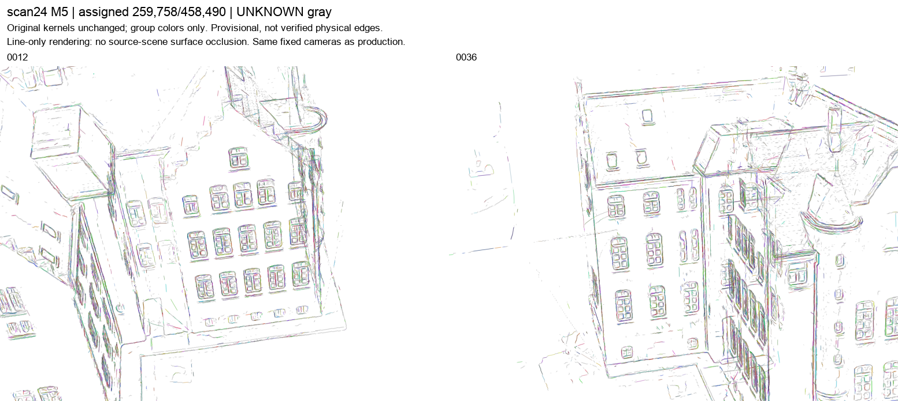
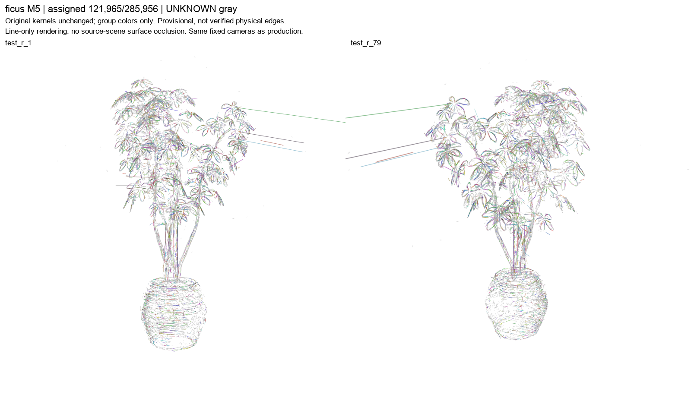
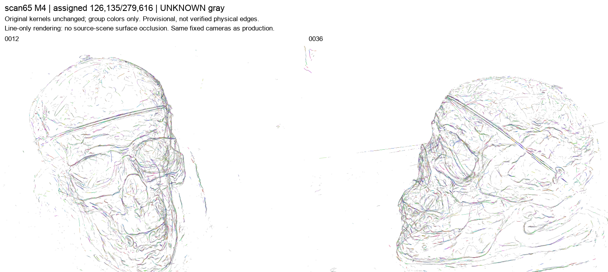
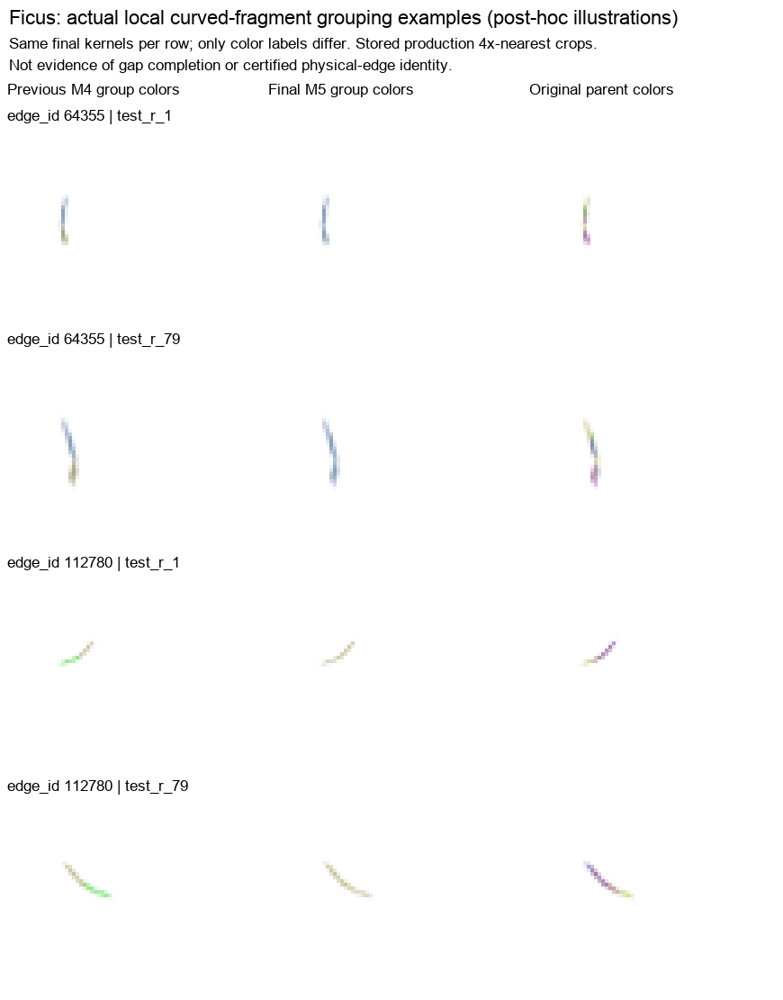

# 线高斯同边分组 v05：当前项目进度

**科学结论：PARTIAL。** 已完成19轮真实实验，得到可保存、冷载和重放的跨片段成员归属与有限支持扩展；尚未证明大规模、连续且物理正确的长边恢复。下面的工程验收不等于物理边正确性认证。

本分支为 `line-kernel-edge-growth-v05`。数值源码冻结版本为 `9f856724bc0fa8ebc615f9ddca347062d591e38a`；此次发布只补充文档、原始报告副本和真实结果图，不修改算法或重跑实验，不合并main。

## 1. 当前做到哪里

- 输入：accepted C2L50+05 / 8BUILD arm C的完整**专用线高斯资产**，不是原RGB场景GS。
- 输出：持久的 `line_kernel_id → edge_id`、UNKNOWN/原因码、原parent贡献、有限辅助载体及合并历史。
- L0是强基线，L1是固定宿主范围的重叠支持池化；M2之后为逐级拓扑合并。后期还检验了拟合预算、端点候选与保护已有前缀的提交策略。
- 原核位置、协方差、opacity、宽度、数量及行顺序冻结；不移动核，不插入无观测支持的连接线。图中只改分组展示颜色。

## 2. 最新保存资产

|场景|保存层级|原核数|L1已归组|最终已归组|相对L1增加|最终覆盖|UNKNOWN|
|---|---|---:|---:|---:|---:|---:|---:|
|建筑 scan24|M5 / unit_018|458,490|220,726|259,758|39,032|56.655%|198,732|
|ficus|M5 / unit_019|285,956|106,399|121,965|15,566|42.652%|163,991|
|颅骨 scan65|M4 / unit_017|279,616|112,061|126,135|14,074|45.110%|153,481|

**这些是成员归组统计，不是准确率。** 候选、预算及竞争提交策略在不同实验中变化，因此不能把整条演进曲线解释为仅增加轮数的因果效果。scan65 M5未运行，不能从其他场景推断其结果。

## 3. 实际结果图

下面是未重采样的生产帧加标题拼接，不是新渲染或拟合线示意。白背景、同组同色、UNKNOWN灰色；仅渲染原始线高斯，**没有源场景表面的遮挡**。仍可见碎片、重复、密集交叠和离群长尖刺。

### 建筑 M5

### ficus M5

### 颅骨 M4

### 局部曲线归组示例

每行显示同一批最终成员，三列为旧M4组色、新M5组色、原parent色。它们是**后验机制示例**，采用生产阶段已保存的4×最近邻裁剪；统一颜色不证明物理连续性，也没有填补空隙。

## 4. 已验证与未解决的问题

### 独立工程与数值验收

- 19个实际科学子进程均退出0；原冻结决定、配置和逐轮源码快照均有记录。
- 核对12,011个父级封存条目，读取27份完整成员映射；检查8,671个PNG路径完整性，解码2,678种不同PNG编码。
- 独立重算最终13,434个主组的支持区间并集、最长连续段、gap、前驱贡献与增长门槛。
- 对最近一轮1,937个改变主组，重算全成员残差、95%残差及轴向切向上限，未发现数值守卫违规。
- 三场景共6帧由原核独立重放，RGB8逐像素一致。交付canonical NPZ全部7个原始数组字节不变。

完整回执：[父级独立验收](parent_acceptance/PARENT_INDEPENDENT_ACCEPTANCE.json)。

### 科学限制

- **组变大不等于连续长边。** 建筑53254总支持44.289p，但最长连续段只有3.458p；ficus112780总支持9.829p，最长连续段只有2.486p。空隙未被记作支持，也未被补画。
- 建筑M5有34个无争议数值门槛组，但新增曲线的整体双视图收益仍不足；ficus M5只有4组，未达预设至少5组，且缺合格新直线组。
- 平行边、分叉、深度交叉的负例往往只有很少原生像素，**误并安全与物理同边身份未通过完整视觉验收**。
- 局部切向替换没有新增收益，单纯增加拟合预算也没有新增合格增长。端点补充在建筑带来少数增益，但联合竞争会破坏一些旧归组；保护前缀修复这类回退，却不是对联合策略的无代价全胜。
- 无独立物理GT、盲测、held-out泛化或时间稳定性结论；全部组仍为provisional。

[原交付中文总报告](parent_acceptance/README_PARENT_ZH.md)保留交付时的记录。其中“未push”等描述是当时状态，本页是本次repo发布入口。

## 5. 19轮原始记录

以下副本保持原字节，含原报告、状态、冻结决定、配置、真实退出和源码绑定。报告中指向`scenes/...`或绝对路径的完整数组/诊断图属于服务器现场资产，**未全部复制到GitHub**；本页展示图使用上方可直接打开的相对链接。

- [unit_001：建筑 L1→M2](results/unit_001/REPORT_ZH.md)
- [unit_002：ficus L0/L1/M2](results/unit_002/REPORT_ZH.md)
- [unit_003：scan65 L0/L1/M2](results/unit_003/REPORT_ZH.md)
- [unit_004：建筑 M3](results/unit_004/REPORT_ZH.md)
- [unit_005：ficus M3](results/unit_005/REPORT_ZH.md)
- [unit_006：scan65 M3](results/unit_006/REPORT_ZH.md)
- [unit_007：建筑 M4](results/unit_007/REPORT_ZH.md)
- [unit_008：ficus M4](results/unit_008/REPORT_ZH.md)
- [unit_009：scan65 M4](results/unit_009/REPORT_ZH.md)
- [unit_010：局部切向等价，负结果](results/unit_010/REPORT_ZH.md)
- [unit_011：增加拟合预算，负结果](results/unit_011/REPORT_ZH.md)
- [unit_012：建筑端点补充／联合竞争](results/unit_012/REPORT_ZH.md)
- [unit_013：ficus端点补充，负结果](results/unit_013/REPORT_ZH.md)
- [unit_014：scan65端点补充，负结果](results/unit_014/REPORT_ZH.md)
- [unit_015：建筑保护前缀策略](results/unit_015/REPORT_ZH.md)
- [unit_016：ficus保护前缀策略](results/unit_016/REPORT_ZH.md)
- [unit_017：scan65保护前缀策略](results/unit_017/REPORT_ZH.md)
- [unit_018：建筑保护策略 M5](results/unit_018/REPORT_ZH.md)
- [unit_019：ficus保护策略 M5，目标未达](results/unit_019/REPORT_ZH.md)

早期v04的143、UNKNOWN、-15以及v05计算前的快照PermissionError属于历史记录，不被上述19次正常数值退出覆盖。停止是12:00停开新单元的行政窗口约束，不是科学方向耗尽。

## 6. 源码与大资产边界

- [v05数值源码与回归测试](../../reproduction/line_kernel_edge_growth_v05)
- [父级独立验收实现](parent_acceptance/independent_acceptance.py)
- [图像/报告发布清单及SHA](PUBLICATION_MANIFEST.json)
- [服务器资产包索引及SHA](ASSETS_SERVER_ONLY.json)

此次push包含源码、中文进度、19轮报告与小型元数据、实际预览图和验收记录。**大规模Gaussian NPZ、PLY、27份历史成员数组和ZIP资产包未加入Git历史**，仍保存在服务器交付目录；先前交付的四个ZIP不因本次push而改变。

服务器根目录：`/mnt/hdd1/u00134/radegs_paper_reproduction_v01/line_kernel_edge_growth_v05_20261031/`。
