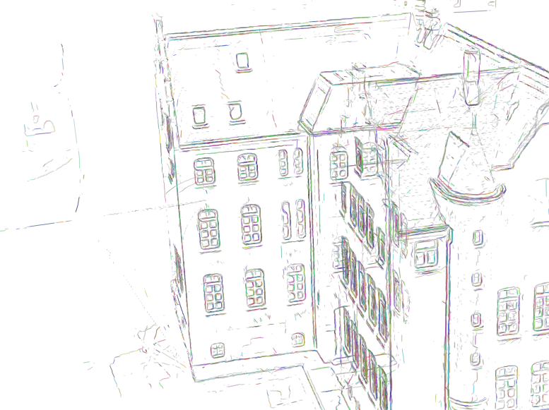
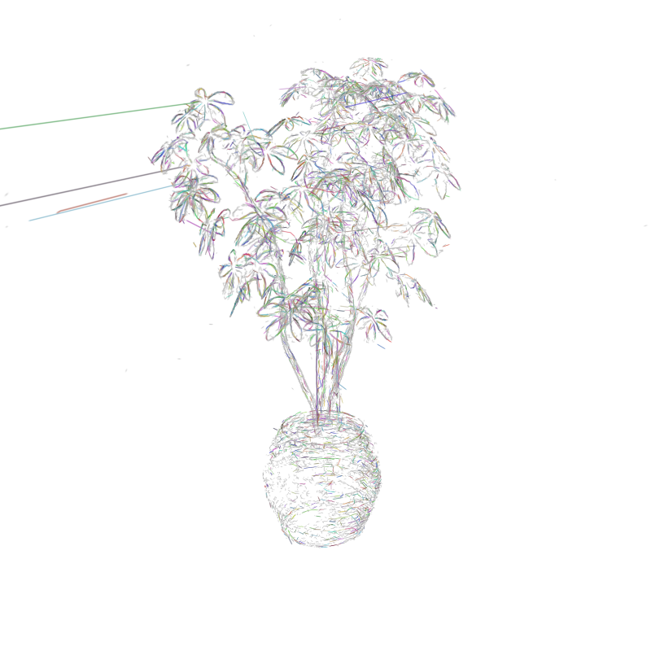

v06最终交付：已经保存多种非Hough归组机制的真实结果，但总体科学结论仍为 **PARTIAL**。较可信的局部成果是scan24跨叶、跨来源的直线重叠归组；尚未证明一种方法同时带来实质直线与曲线的双视图改善，也未证明MILP稳定优于相同表示/候选/成本/守卫下的greedy。没有把颜色、assigned、求解最优或封存数量当作研究成功。

本文件只做工程交付，未运行新科学单元、拟合、测试、渲染或修改源码/参数。09:15后停止开新单元，按ASTRA_STOP_RECOMMENDATION交付已有成果；不是宣称研究方向耗尽。父级独立验收仍为PENDING，目标09:45交接、10:00硬截止。旧v05保持PARTIAL，未晋升为物理真值基线。

父SUPERVISOR_STATUS的reported_units实际包含unit001–011。权威COMPUTE_EXIT记录10次子进程rc0和unit010一次rc1，reason均null；8个单元执行completed，2个partial，1个blocked。rc0只说明程序退出，unit001/007仍有未运行范围。逐单元实际开始/结束、退出、报告、精确输入/配置/源码/helper哈希、历史argv及科学产物清单均在[DELIVERY_STATUS.json](DELIVERY_STATUS.json)。父inventory中包含tests夹具，本交付严格只从各单元scenes/计科学映射和图片；未把合成测试、mock图或隔离事件目录当科学结果。

|单元/场景|实际机制与配对臂|处理范围|child rc / 执行|保存结论|
|---|---|---|---|---|
|[unit_001](units/unit_001/REPORT_ZH.md) / scan24|有限叶复合身份、端口greedy/MILP局部tracer|局部8上下文，5个超限NOT_RUN；3个可处理，只有1个非空|0 / partial|无joint优势；全行导出不代表全场景求解|
|[unit_002](units/unit_002/REPORT_ZH.md) / scan24|相同端口策略，全eligible图，决策/证据邻域分离|699/699 eligible endpoint分量；839边|0 / completed|joint多一未激活路径，主归属零差异|
|[unit_003](units/unit_003/REPORT_ZH.md) / scan24|endpoint-only分量全局反事实歧义认证，共享认证器|73/73含masked且无成功overlap入射的分量；范围外继承unit002|0 / completed|相对unit002多421 assigned；两臂主归属相同；无新实质曲线证据|
|[unit_004](units/unit_004/REPORT_ZH.md) / scan24|固定有限anchor重叠假设库，greedy/互斥MILP|8/1917 overlap分量；42叶/38配对|0 / completed|7个选中假设；两臂相同，固定anchor覆盖不足|
|[unit_005](units/unit_005/REPORT_ZH.md) / scan24|追加38个联合拟合配对模型，有限重叠模型竞争|相同8分量，38模型恢复，12假设|0 / completed|38模型复现但无新增主归属；新小组保持UNKNOWN|
|[unit_006](units/unit_006/REPORT_ZH.md) / scan24|保存配对模型改用全部原核中心作有限域见证|相同8分量，保存模型重载，32假设|0 / completed|多21 assigned；两臂相同，主要是少量重叠归属|
|[unit_007](units/unit_007/REPORT_ZH.md) / scan24|同一有限重叠模型策略扩展scan24全保存overlap图|1774/1917完整；143分量因建库deadline未运行，312叶/173配对保留M4|0 / partial|可见实质直线重叠归组；joint比greedy新增593/撤回641，未证明视觉优越|
|[unit_008](units/unit_008/REPORT_ZH.md) / ficus|同设置有限重叠模型竞争迁移ficus|628/628 overlap分量；1141配对/1222假设|0 / completed|两臂assigned同数但147行ID不同，joint新增3/撤回3；无可辨优势|
|[unit_009](units/unit_009/REPORT_ZH.md) / ficus|ficus有限叶端点复合路径，greedy/MILP|148/148 eligible endpoint分量；163边，593边mask|0 / completed|39个二叶身份、无三叶；两臂相同|
|[unit_010](units/unit_010/REPORT_ZH.md) / ficus|四臂共同有限路径实验，接口失败未执行|输入数值加载前阻断；0映射/0科学PNG|1 / blocked|TypeError guard回调；不是科学反证，失败日志与测试隔离事件保留|
|[unit_011](units/unit_011/REPORT_ZH.md) / ficus|接口修复后四臂：concat/common × greedy/joint|148/148分量；176路径拟合，concat40/common152可行路径|0 / completed|共同参数化改变归属；两种表示内部greedy/MILP各自同解，曲线改善仍未证明|

这些单元不是单调累计版本。多数机制都从同一封存M4重新出发；overlap模型归属与endpoint路径身份是不同实验，不能把它们的assigned相加或将后者称为前者升级。unit004–006会撤回unit003的新身份，unit009相对unit008也有大量撤回；所有原报告和REFERENCE_COMPARISON保留。

**场景与交付范围。** scan24有unit001–007，原458490行；unit002完整处理保存的eligible端点图，unit003只对73个特定完整分量认证，unit007的overlap范围1774/1917完成，余143分量/312叶/173配对因建库期限未运行并保持M4。ficus有unit008/009/011完整保存，原285956行；unit010没有科学映射或PNG。scan65本v06窗口没有计算、映射或图像，明确NOT_RUN；其旧v05 unit017 M4仍仅是外部PARTIAL参考，scan65 M5也未运行。本窗口没有连续帧验证或新held-out评测。

**保守选取的交付入口。** 保留并列方法及对照，不指定“全场景最佳身份”。[delivery_assets](delivery_assets/)的26张图都是从封存文件逐字节复制，已核对SHA，无新渲染、拼接、增强或裁剪。完整科学产物留在原unit/scenes；机器清单按arm提供MEMBERSHIP、原叶CARRIERS、GROUPS/辅助模型、LINEAGE、选择与solver、候选readiness、component结果目录和图像路径。所有22个实际科学映射stage均为全原行数，并核对其checkpoint所列文件哈希；这不等于全空间候选覆盖。

|代表性成对结果|assigned / UNKNOWN（greedy；joint）|必须保留的得失与限制|
|---|---|---|
|scan24 unit007 overlap|263539 / 194951；263491 / 194999|joint相对greedy新增593、撤回641，净少48；5059行ID不同，不支配greedy；范围partial|
|ficus unit008 overlap|121883 / 164073；121883 / 164073|147行ID不同；joint新增3、撤回3，数量相同不代表成员相同|
|ficus unit011 concat|118911 / 167045；两臂相同|39个二叶假设，主归属复现unit009|
|ficus unit011 common|119860 / 166096；两臂相同|130假设含未激活UNKNOWN；相对concat新增1079、撤回130，拆开5个unit009派生组|

上述所有执行成功的变体均报告原M4旧assigned零丢失、旧组零拆分；这不保证保留其他实验新生成的组。原M4基数scan24为246349、ficus为118470。旧v05最新assigned259758/121965/126135对应scan24 M5/ficus M5/scan65 M4，是不同历史结果，不能作为本表准确率分母或累计收益。

scan24推荐先看unit007两臂[0012 greedy](delivery_assets/unit_007/scenes/scan24/stages/greedy/0012_FULL.png)、[0012 joint](delivery_assets/unit_007/scenes/scan24/stages/joint/0012_FULL.png)、[0036 greedy](delivery_assets/unit_007/scenes/scan24/stages/greedy/0036_FULL.png)，以及下方joint全景。建筑细边已可辨，但仍有碎裂、重复、离群尖刺和视野边缘裁切，不能宣传整体视觉清理完成。



308174是较清楚的局部直线例，两臂相同：6叶848核，5个实质原parent，7814的639核占主导。两固定视图可见统一直段，属于重复观测归组；不是端点外延。投影支持并集138.454p、最长连续段仅2.751p、有限长度183.029p、总gap44.575p、最大gap0.312p，重复支持17.099p。不能把138.454p写成连续观测边长。


曲例48211在joint有263核、支持58.976p、最长5.217p、总gap12.148p，主要parent8268占229核；0036仅见浅弯/台阶线，0012实际原生图为空。空白图特意保存，不换相机制造成功：[0012空图](delivery_assets/unit_007/scenes/scan24/stages/joint/diagnostics/COVERAGE_48211_ffb1ea1c_GROUP_0012.png)、[0036局部](delivery_assets/unit_007/scenes/scan24/stages/joint/diagnostics/COVERAGE_48211_ffb1ea1c_GROUP_0036_CROP4.png)。unit002的201906虽有可见C/U形，但主要248核曲叶本来存在，仅加入34核直叶，两臂相同；不能称新曲线生成或MILP优势。

ficus保留unit008 overlap两臂完整对照以及unit011四臂的8张全景。下面是unit011 common_joint全景，其与common_greedy逐字节相同；原叶缘、盆体碎片与长横向尖刺仍在。原核冻结，归属改变不能去掉原有尖刺，也没有隐藏不利成员。



[common视图1](delivery_assets/unit_011/scenes/ficus/stages/common_joint/test_r_1_FULL.png) · [concat视图79](delivery_assets/unit_011/scenes/ficus/stages/concat_joint/test_r_79_FULL.png) · [overlap greedy视图79](delivery_assets/unit_008/scenes/ficus/stages/greedy/test_r_79_FULL.png) · [overlap joint视图79](delivery_assets/unit_008/scenes/ficus/stages/joint/test_r_79_FULL.png)。这些代表不同关系和表示，未合成为一个未经实验的“最佳”输出。

unit011的共同参数化使可行路径库从40增至152，最终选130假设（123个二叶、6个三叶、1个四叶），但选中组内仍有1024核UNKNOWN。137016的152核来自两个实质来源，双视图可辨近直细线，支持26.585p、最长9.209p、总gap5.612p、最大gap0.305p；其[视图1](delivery_assets/unit_011/scenes/ficus/stages/common_joint/diagnostics/PATH_137016_GROUP_test_r_1_CROP4.png)和[视图79](delivery_assets/unit_011/scenes/ficus/stages/common_joint/diagnostics/PATH_137016_GROUP_test_r_79_CROP4.png)是有限局部证据。92122只有浅弯，104核中93核同一parent，支持22.717p而最长1.803p；112780是已有曲线参考，支持9.843p而最长2.474p。二者都不足以证明新增的实质跨来源曲线续接。unit008的65959浅弯主要形状同样已由M4提供，188634仅局部直线池化；不能用更多同色替代新增视觉证据。

**必须随交付保留的失败、缺失与负结果。** unit001有5/8上下文因完整闭包超限NOT_RUN；unit003新最大曲例251530在0012为空、最大新增直例213491两视图为空；unit004固定anchor大量残差失败；unit005虽38模型恢复却无主归属收益；unit006仍有真实中心越界，未扩大EPS；unit007上述143分量未建库、48211缺一视图，部分其他局部图触边，gap负例301451/301459双视图空；unit008两重点配对属于endpoint而非overlap，没有被MILP遗漏；unit009的64355/65064与112780/116525分别被window_turn和self_contact拒绝；unit011前者仍因一个中心右越界0.001682p被拒绝，后者通过但曲线是历史继承。所有negative标签只是保存守卫上下文，不是GT，parallel/branch/depth整体安全仍不可判。

unit010实际rc1，guard回调TypeError发生在数值加载前，fit_calls=0、completed=[]、0科学图/映射；保留[失败报告](units/unit_010/REPORT_ZH.md)、RUN_RESULT、实际EXIT、原始测试日志及测试隔离事件，绝不以unit011 rc0覆盖。unit011用真实加载契约完成RED→GREEN后才执行成功，但测试通过也不是科学正确性证明。每单元缺失列表及原报告均在机器清单中，未抹去任何旧负结果。

**数据就绪、工程完成与科学证据分开。** 输入和检查点绑定证明可追溯，完整行数证明输出没有遗漏行，solver optimal证明给定有限目标求解完成；这些都不证明物理edge_id。局部直线/浅弧可见还需完整邻域排除并行/深度/分支混合。池化是多观测共享归属，端点复合是有序有限叶身份，共同辅助q是参数化见证；三者均不创造新观测。支持并集、最长观测段、有限extent、域外代理和gap必须分别读；投影钳制不是支持增加，连接器无观测、从未渲染。源资产噪声、重叠歧义和固定候选缺口仍存在，旧parent只是provenance。无独立物理真值，无held-out泛化主张；既有GS训练/已看过视角不叫held-out。

**冻结来源与可复核命令。** 本交付按11个PARENT_RUN_FROZEN逐项验证共498项源码快照记录，不依赖最新工作区HEAD。每个unit的CONFIG SHA、decision SHA、完整input_files绑定、原始与快照入口、helper哈希、实际历史命令都收在DELIVERY_STATUS。输入整资产本阶段未重载重算，数据正确性依据各单元保存的readiness与GEOMETRY_AUDIT；封存源码和科学输出未改。共用renderer.py SHA256为`ce24cd30d663e6f421064d83006f097b02a5cf6a74b20c177a905ca514caed93`，libjoint.so为`033a973a71dc5364677a5bf0625f23dc4fe445b70257f04de7cb70cdccca84b0`，本次重新核对一致。所有源码完整hash映射随单元保留。

以下是实际历史命令的可执行语法记录，当前没有运行；**封存目录禁止重跑**。旧CONFIG绑定当时绝对源码路径，不能直接拿latest HEAD重演。未来复现须另行授权、从相应快照建立隔离新目录并重新绑定新输出CONFIG；不是覆盖本次结果。

`unit_007` CONFIG SHA256 `7bf5b9819a1f380d715baa4f990fe4abbf268799838287a56aaf6986242212f3`：

```bash
/mnt/hdd1/u00134/radegs_paper_reproduction_v01/c2l50_8build_part_prior_feasibility_v03/venv/bin/python -B /home/u00134/3dgs_line/line_kernel_global_association_v06/reproduction/line_kernel_global_association_v06/coverage_runner.py --config /mnt/hdd1/u00134/radegs_paper_reproduction_v01/line_kernel_global_association_v06_20261101/units/unit_007/CONFIG.json
```

`unit_008` CONFIG SHA256 `1a1702f58d22b2146bf7958c39ed2fc156a2953e7d6c19b43e238c94cc5dc852`：

```bash
/mnt/hdd1/u00134/radegs_paper_reproduction_v01/c2l50_8build_part_prior_feasibility_v03/venv/bin/python -B /home/u00134/3dgs_line/line_kernel_global_association_v06/reproduction/line_kernel_global_association_v06/scene_runner.py --config /mnt/hdd1/u00134/radegs_paper_reproduction_v01/line_kernel_global_association_v06_20261101/units/unit_008/CONFIG.json
```

`unit_011` CONFIG SHA256 `f13916c506a78b767e01cde78ecd8e0c754428dc55ca1ba69e8610cdc6c61168`：

```bash
/mnt/hdd1/u00134/radegs_paper_reproduction_v01/c2l50_8build_part_prior_feasibility_v03/venv/bin/python -B /home/u00134/3dgs_line/line_kernel_global_association_v06/reproduction/line_kernel_global_association_v06/path_library_runner.py --config /mnt/hdd1/u00134/radegs_paper_reproduction_v01/line_kernel_global_association_v06_20261101/units/unit_011/CONFIG.json
```

唯一延期实验是使用真实多视图观测支持ficus的593条masked endpoint关系的关联/弃权，与原mask基线作对照，共用有限路径表示及几何守卫。独立原图、相机和可见性/投影证据尚未核实；缺输入则NOT_READY，遮挡保持UNKNOWN，禁止用线核自渲染循环证明。完整竞争邻域包含端点和重叠替代解释，不裁竞争者。该实验为NOT_RUN，需要未来明确授权与单独冻结，本窗口不启动、不调阈值补救。详见DELIVERY_STATUS.deferred_experiment。
