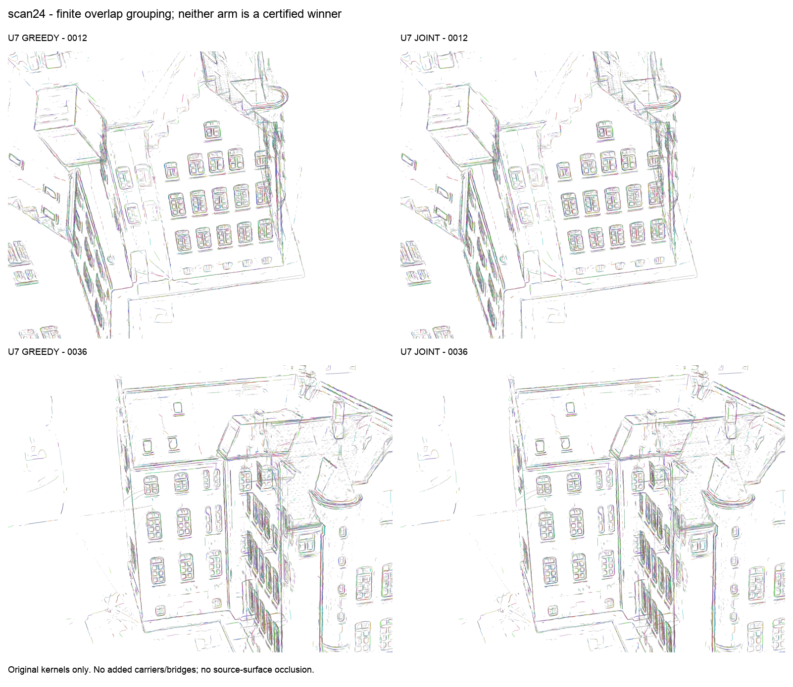
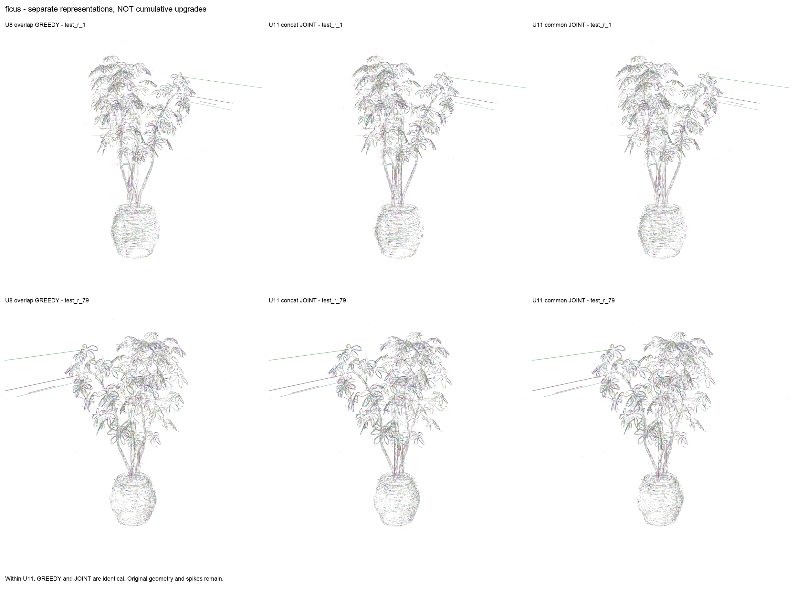
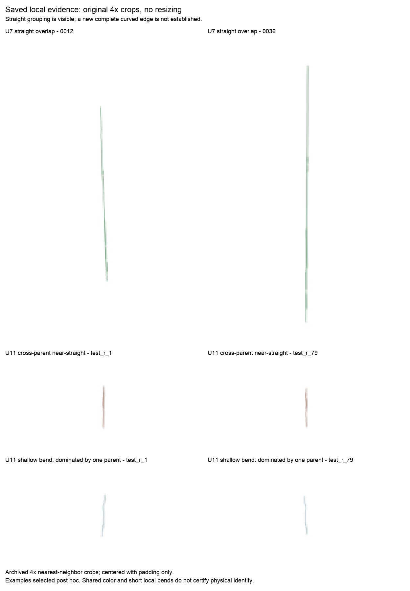

# v06 非 Hough 全局归组：最终独立验收

**科学结论：PARTIAL。已形成可重载的原核→edge_id 归属结果，但未证明联合优化优于贪心，也未验证新的完整跨片段曲边。**

本窗口为 2026-11-01 06:00–10:00 JST；按预先约定的 09:15 停开新轮边界收尾。09:17:52 完成最后实际数值；09:25 左右监督器结束。停止属于行政时间窗口，不是科学方向耗尽。没有重启或延长实验。

## 实际做了什么

11 个已报告实验单元中，10 个实际数值退出 0，1 个退出 1。第 10 轮在真实加载接口处失败，拟合、科学映射和原核图均未产生；第 11 轮独立修复接口后成功执行。失败回执原样保留。

实际机制包括：有限片段上的全局端口路径 MILP、完整端点竞争下的反事实弃权、重叠观测的有限模型竞争，以及共同有限辅助曲线与原片段拼接的表示对照。没有运行新的 Hough 投票，也没有执行所有文献候选方法。贪心和联合选择在每个配对对照中共享其冻结的表示、候选、成本和守卫；第 3 轮贪心还共享全局认证器，不是纯局部贪心。

## 可用的真实输出，不指定“最佳胜者”

- **scan24 重叠归组，第 7 轮：**458,490 核完整映射。贪心 assigned 263,539／UNKNOWN 194,951；joint assigned 263,491／UNKNOWN 194,999。两臂有 5,059 行身份不同，joint 新分配 593、失去 641，不能称为全面改善。完成 1,774／1,917 个完整竞争分量；其余 143 个保留 M4。
- **ficus 重叠归组，第 8 轮：**285,956 核完整映射；两臂均 assigned 121,883／UNKNOWN 164,073，但 147 行身份不同。628／628 个现有完整竞争分量完成。
- **ficus 路径表示，第 11 轮：**原片段拼接两臂均 assigned 118,911／UNKNOWN 167,045；共同有限曲线两臂均 assigned 119,860／UNKNOWN 166,096。每种表示的 greedy／joint 映射分别完全相同。共同曲线比拼接多分配 949 核，但同时改变了几何可解释性和歧义资格，不能说纯求解器带来收益；也不在第 8 轮上累积。
- **scan65：本窗口 NOT_RUN。**没有新结果；旧 v05 仍保留，未改写。

上述 assigned 是归属覆盖量，不是准确率。各轮大多重新从其冻结的 M4 参考运行；不能把第 3、7、8、11 轮的增量逐轮相加。

## 看图后的结论

建筑全景的窗框、屋檐等结构可辨，但碎裂、叠线和异常长线仍在。两臂的全景非常接近；仅凭这组图不能认证 joint 更好。第 7 轮 308174 组在两个视角呈清楚直线，848 核来自 6 个片段，但仍以重叠支持统一为主；不能把有间断的支持并集写成连续长边。

盆栽三种表示的整体轮廓接近，右／左侧长尖刺和冠部碎裂均仍在。固定原核几何的归组不会靠换颜色消除尖刺。每种表示之间不是同一模型逐次升级，也没有证明新的完整曲边。

局部图为封存的 4 倍最近邻裁剪，后续只加白边和标签，不拉伸原图。直段在两个相机可见；第 11 轮的浅弯案例仍由一个旧 parent 主导。新增同色归属、旧弯曲片段和局部像素，不足以证明新恢复了一整条物理曲线。全景与局部均仅渲染原线高斯核：不画辅助载体、不补 gap、没有源场景表面遮挡。图例为后验示例，不是盲测或随机代表性样本。

## 父级独立验收：通过的是结构与重放，不是物理正确性

- 实际逐文件复核 41,721 个单元封存条目、498 个源码快照记录和对应 helper；11 单元、22 份科学阶段全行映射全部检查。
- 独立检查完整行号／primitive_id、核数、原始输入绑定、组成员集，以及所有输出的 M4 已分配核不丢失、不拆旧组。保留 M4 不代表保留所有其他实验轮次。
- 各阶段导出的原片段 CARRIERS 全部数组与其冻结输入逐数组相同；原资产全部 7 个数组哈希绑定且前后不变。辅助曲线只用于解释和身份归组，未替换原核。
- 6,466 个保存组的区间并集、最长连续段及 gap 标量独立重算一致；这是对保存投影区间的算术核验，不是重新测量物理支持。
- 2,808 条科学 PNG 路径核验，655 种独立编码全部解码；从原核、保存颜色和固定相机直接调用冻结 native renderer 独立重放 6 张全景，RGB8 最大像素误差均为 0。
- 57 个旧 worktree、12,025 个旧封存引用、514 个继承文件均未变。47 个记录的自有监督／模型／数值 PID 已退出；未干预他人进程。
- **未独立重跑全部几何判定 oracle，未认证物理同边／完整误并安全，未做新的盲 held-out 或连续视频时间稳定性验证。**空白图、不可辨近平行／深度负例均不是安全通过。

详见 `PARENT_INDEPENDENT_ACCEPTANCE.json`；验收脚本与完整结果也在报告包中。

## 资产包

- `scan24_v06_overlap_assets.zip`：原始完整 gaussians.npz 原字节副本＋第 7 轮 greedy/joint 归属、原片段载体、显示颜色、组和支持统计、固定相机。
- `ficus_v06_overlap_path_assets.zip`：同样保留原核，包含第 8 轮两臂及第 11 轮四臂。明确作为不同候选版本，不将其自动融合。
- `v06_reports_and_real_figures.zip`：全部 11 轮报告、全部科学原核 PNG（不含合成测试图）、冻结源码快照、协议与父级验收；不包含模型认证／凭据或原始聊天日志。科学映射的重点版本在两个资产包，其余历轮完整 NPZ 仍在服务器封存目录。

`line_kernel_id` 是原 NPZ 的零起始行；`edge_id=-1` 是 UNKNOWN。`primitive_id` 是旧 parent 来源，不是新边身份。原核容器不加入“更顺”的辅助几何；想显示同组颜色时用相应 `DISPLAY_COLORS.npz` 替换显示副本的 colors，几何和 opacity 保持原样。不是全 RGB 源场景模型，也不是新拟合曲线的 tube/mesh。

## 源码与剩余问题

隔离分支：`line-kernel-global-association-v06`；本地提交 `4135c3d2f12a44eab52e05de6adee015ea4b7df8`，79 个源码 Git blobs 与第 11 轮冻结快照逐 SHA256 一致，工作树 clean。没有 push 或 merge；main 和旧成果不动。源码保留原样，Git whitespace check 的非零回执单独保存，不以此宣称 lint 全绿。

当前证据更支持“共同载体／候选信息与身份歧义是主要瓶颈”，而非仅将贪心换成 MILP。若要继续，应冻结新的信息／对应关系实验，而不是再堆求解预算或调宽阈值；该后续方向尚未运行，也不包含在本次交付的成功主张中。

服务器原始封存根：`/mnt/hdd1/u00134/radegs_paper_reproduction_v01/line_kernel_global_association_v06_20261101`。
