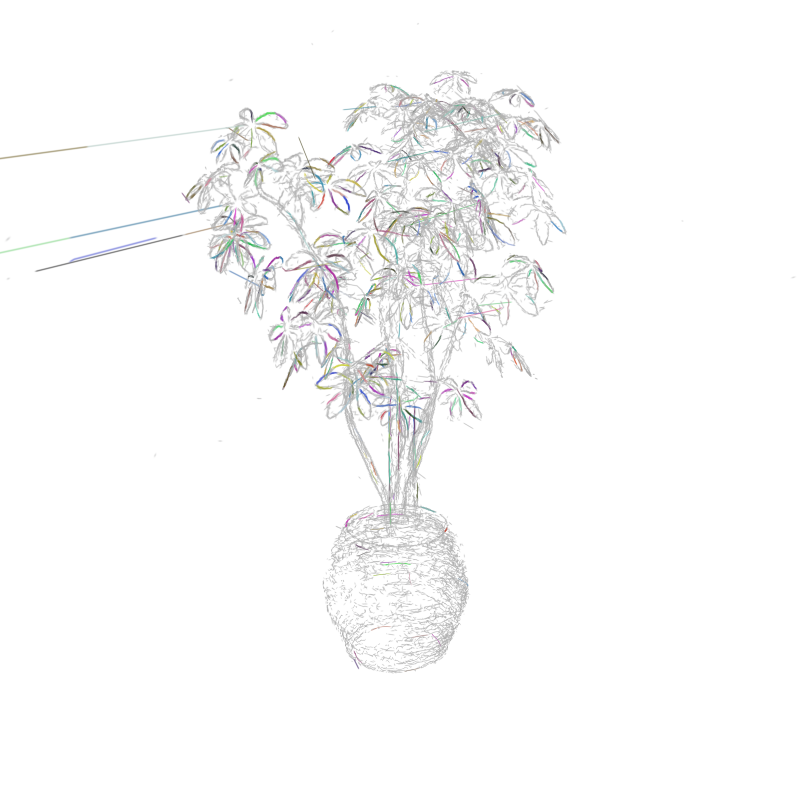
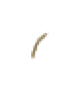
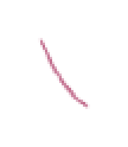

# v07 最终工程交付：逐核自由重归属已实现，完整长曲线恢复仍为 PARTIAL

**六个实际实验已完成并保存，但尚未实现“整物体大量干净、完整、稳定的长直边/曲边统一”。** 结果中存在可辨的局部跨片段短弧、短直段和多来源重叠观测归组；它们不能被统称为新的长曲线外延。最新状态仍有229194/285956核为UNKNOWN，原有尖刺、重复和碎裂明显。所有身份provisional，不能以更多assigned、统一颜色、目标下降或测试数量证明物理正确性。

本交付依据parent `SUPERVISOR_STATUS.json`实际reported_units 1–6及各单元真实COMPUTE_EXIT。六个child返回均为0、reason=null，全部analysis_handoff_ok；没有使用wrapper0替代science0。当前已过19:15停开新单元时间，按ASTRA_STOP_RECOMMENDATION交付现有成果。停止理由是当前窗口边界，不是旧上午截止，也不是宣称方法空间耗尽。独立parent验收尚待完成。

最新全景是实际原核渲染，未经重绘、去尖刺或辅助桥补画。交付副本与源文件逐字节校验；最新U6图与U5相同，并不意味着它在每个局部都优于早期结果。



[另一固定视图](delivery/figures/unit_006/BIRTH_FINAL_test_r_1_FULL.png)；[最新完整映射/模型/谱系目录](delivery/latest_ficus/CHECKPOINT.json)；[所有交付副本与源文件hash](delivery/ASSETS.json)；[完整机器交付状态](DELIVERY_STATUS.json)。最新资产是原核行到edge_id/UNKNOWN的薄映射及辅助模型，原means/covariance/opacity等仍引用封存资产，未重复替换几何。

## 实际方法、对照与执行

每一新主方法均允许原核独立竞争，旧M4/v05/v06与parent仅作参考/来源。辅助有限曲线允许更新、生灭、支持拆分和事务替换；原核的数量、顺序、means/covariance/opacity/宽度等保持冻结。最终笔画只有原始专用线高斯，不是源RGB Gaussian集合，也没有源表面遮挡。

|单元|实际主方法与配对|本单元起始对照assigned → 最终|最终UNKNOWN|实际运行JST|child rc / reason|
|---|---|---:|---:|---|---|
|unit_001|密度优先切向追踪；STATIC/三轮自由自适应|4577 → 6184|279772|17:29:21–17:30:10|0 / null|
|unit_002|覆盖优先旧有限q种子；STATIC/三轮自由自适应|53176 → 56185|229771|17:51:06–17:52:51|0 / null|
|unit_003|动态端点合并及全局能量事务|56213 → 56213|229743|18:14:00–18:15:41|0 / null|
|unit_004|共享兼容核重叠参数化合并|56213 → 56222|229734|18:33:05–18:35:41|0 / null|
|unit_005|位置—切向图有限路径出生|56222 → 56762|229194|18:55:57–19:01:01|0 / null|
|unit_006|真实双视图正向边缘奖励引导固定图路径出生|56222 → 56762|229194|19:17:07–19:21:45|0 / null|

这些箭头是各单元自身对照，不是把六轮串成累计收益曲线。完整状态名、对照、逐阶段计数、实际命令、退出回执与全部旧参考交叉表已列入DELIVERY_STATUS。

- **unit001：密度优先追踪，FREE_STATIC对照三轮FREE_ADAPTIVE。** 原始102910个voxel种子只扫描1742个便达512候选上限。STATIC4577核，最终6184核；自适应相对STATIC新增1814、撤回207、拆分9个静态组。是真正的逐核重排，但覆盖严重不足。
- **unit002：覆盖优先的旧有限q种子，仍为STATIC/三轮ADAPTIVE。** 旧q只作可修改形状，没有锁住旧成员。29019个有限候选中选512，覆盖17580/102910体素；其余模型发现范围未解释完整。相对STATIC新增3323、撤回314、拆分19组。M4片段19563的53核实际拆成33归120、14归246、6UNKNOWN，证明并非不可拆旧片段换名。seed家族和分配共同改变，不能归因求解器。
- **unit003：动态端点合并与能量事务。** 完整539760端点组合仅5提案；2个length_cap、2个vertex_turn、1个window_turn，全部在试验全核重竞争之前失败，0接受。控制NO_MERGE的一次重竞争相对U2新增28核，不能算合并收益；MERGE_FINAL与控制相同。本轮没有实际验证能量接受产生新归组。
- **unit004：共享兼容核的重叠参数化合并。** 18提案仅513+646→712接受；新增13、撤回4，第三模型517的2核改投、旧组拆分1次。712并非完整吞下两个旧组：513另4核变UNKNOWN，647另获2个旧UNKNOWN。自由撤回、第三方竞争是真实行为；其余17拒绝完整保存。
- **unit005：保留多方向的voxel观测图与有界路径出生。** 全285956有效原核进入131891模式、344798有向边；58026候选种子只选64，覆盖8463/88386个UNKNOWN体素。32条路径尝试，15接受；新增540、丢失0，199有3核改投722而形成一次旧组拆分。不是全图最长路径，也不是完整模型发现；12个新组仍是单parent。
- **unit006：真实双视图正向边缘支持引导同图路径。** 25712边获支持；仅1条规范路径改变并被vertex_turn拒绝。最终MEMBERSHIP、MODELS及两张全景与U5文件hash完全一致。相对U5新增、丢失、拆分、重排全为0；其15出生和540新增属于U5已实现效果，绝不再累计一次。

原始竞争结果、替代关联、失败提案、原q/拟合q和谱系均保留在各旧单元中。本交付没有覆盖或删除它们。源码/测试中声明可拆不等于实际科学效果：U1/U2/U4/U5已有具体拆分/撤回证据，U3合并尝试全在重竞争前失败，U6没有新增成员变化，必须分别叙述。

## 可用的局部证据与不可隐去的损伤

最明确的短弧局部正例是U1组144：198核、5个实质M4片段和5个实质parent，每贡献>=12核/4p投影支持。两个固定视图可见短弧，STATIC同核集合两端还有UNKNOWN。这是局部多片段归组线索，而非完整长曲边或物理身份认证。




[STATIC同核对照](delivery/figures/unit_001/CURVED_144/FREE_STATIC_test_r_79_GROUP_CROP4.png)与[实际竞争上下文](delivery/figures/unit_001/CURVED_144/FREE_ADAPTIVE_3_test_r_79_CONTEXT.png)保留。U2的覆盖变化却把这198行拆为150核归55、47归441、1UNKNOWN；到最终仍未修复。**后期覆盖增加不支配早期局部正例。**


U2组7为356核，5个实质M4/5个parent；双视图可辨浅弧。组11为255核、5个实质M4；组15为212核、3个实质M4。但各自都有一个旧来源覆盖整段支持域：7为38.810924p，11为33.466079p，15为33.587728p。多个贡献者确实足够大，收益主要仍是重复支持汇集，**不能当新增域外长曲线**。STATIC同核图已经有主要形状。



U2直例43有180核、4个实质M4/5个parent，双视图是短直段，支持19.470154p；84为122核、3/3贡献、24.248706p。都有单个来源覆盖全长，不能称新增外延。U1直例482是单M4/单parent，127核、36.876p；目录名“STRAIGHT”不是新跨片段直线成功证明。


U4唯一新组712只有两个实质旧片段；双视图呈很小的近直/轻弯竖段。有限长12.798399p，支持union10.647483p，最长代理段9.039903p，总/最大gap0.147181p；相对最大输入域外2.7682p，不达4p。模型数减少、能量下降与颜色统一不足以通过长曲线判据。[同核控制](delivery/figures/unit_004/CURVED_712/NO_OVERLAP_MERGE_test_r_79_GROUP_CROP4.png)和[变体](delivery/figures/unit_004/CURVED_712/OVERLAP_FINAL_test_r_79_GROUP_CROP4.png)同时保留。

U5/U6的717虽有17.672510p支持，但64核全为一个parent；722仅55核、5.581307p且只有2个实质parent，实际图为难辨小点。其4.698436p域外代理只相对含3个旧继承核的模型199，不是三实质片段长曲线。[717](delivery/figures/unit_006/PRIOR_UNIT005_CURVED_717/BIRTH_FINAL_test_r_79_GROUP_CROP4.png)、[722及其竞争上下文](delivery/figures/unit_006/PRIOR_UNIT005_CURVED_722/BIRTH_FINAL_test_r_79_CONTEXT.png)作为限制证据交付。

损失不能略去：U1旧M5组122303/129279/121431分别1186/459/430核全UNKNOWN；U2后旧13054的96核、9969的87核全UNKNOWN，37737的90核中87UNKNOWN，最终仍未恢复。[13054旧M5图](delivery/figures/unit_002/DAMAGED_13054/v05_M5_test_r_79_GROUP_CROP4.png)和[撤回后](delivery/figures/unit_002/DAMAGED_13054/FREE_ADAPTIVE_3_test_r_79_GROUP_CROP4.png)同时保存。灰色不是删除，也不证明误核被正确识别。

U1负例11/80709曾因按旧edge_id筛行得到空集合，原失败保留。U2起按carrier行偏移恢复33个含UNKNOWN原核；最终[同核图](delivery/figures/unit_006/FIXED_2_11_80709/BIRTH_FINAL_test_r_1_GROUP_CROP4.png)虽非空，仍很小且灰，不能判安全。平行、分支、深度交叉和尖刺吸收没有完整物理认证；更多非空裁剪不等于更多成功。所有最终图均为真实原核，未隐藏全景尖刺、减少不利邻居或补画无支持桥。

## 原参考得失与完整范围

以下是最新U6/U5状态**分别对各保存参考的直接交叉比较**，不是累计增益，也不是准确率。完整逐旧组children/counts/revocation表在各COMPARISONS.json；数字ID不同不等于物理身份改变。

|参考|参考assigned|最新新增assigned|最新丢失assigned|旧组拆分数|
|---|---:|---:|---:|---:|
|v05_M4|118470|9797|71505|43|
|v05_M5|121965|9205|74408|45|
|v06_overlap_joint|121883|8748|73869|42|
|v06_common_joint|119860|9677|72775|44|
|unit001_ADAPTIVE|6184|52883|2305|7|
|unit002_ADAPTIVE|56185|581|4|2|
|unit004_OVERLAP_FINAL|56222|540|0|1|
|unit005_BIRTH_FINAL|56762|0|0|0|

U1相对v05 M5曾新增1908、撤回117689、拆分15组；U2则新增9100、撤回74880、拆分44组。覆盖有改善，但最新仍相对v05 M5丢失74408核；这些允许的探索结果不能自动叫正确剔除。旧v05/v06仍是独立PARTIAL参考，本交付没有把它们重标为已完成，也没有累加其M轮数。

只有ficus实际运行了v07，所有接受阶段均保存原285956行，所有有效核在对应模型族内参与完整有限段竞争，原核不变。**模型/候选发现受到种子、可达域和提案族限制**，不能以全行映射冒称所有真实边已被优化。scan24、scan65在v07均NOT_RUN；现有旧版本结果保持原样，不冒充新方法验证。

共有47个接受阶段保存模型/映射/谱系及原字段审计；24张原生全景对应各单元起始对照与最后状态。35个中间接受阶段只有完整状态，没有各自原生全景；它们不用于逐帧或时间稳定性主张。另有raw竞争记录和全部失败/替代解释留在旧单元。parent的成员文件/图/检查点库存数量仅作交付定位，不是研究收益。

支持区间是协方差半宽沿有限q的投影代理，union、最长段、有限范围、域外支持和gap必须区分。即便union=最长段且代理gap=0，也不证明真实原图连续无缺失。未建立physical truth、held-out、连续相机帧稳定性或方法新颖性证明。

## 来源、命令与交付完整性

已核验六个CONFIG/DECISION绑定、126份父级冻结快照文件映射、全部47个接受阶段CHECKPOINT成员hash、两个只读helper绑定及保存的all_fields_exact几何审计。这里的126包含各轮保留快照，不是126个新算法。未重新加载原全资产计算几何；原始审计来自实际数值执行。以每单元PARENT_RUN_FROZEN的immutable_source_snapshot为准，不要求后来工作树HEAD仍有效。

|单元|CONFIG SHA256|已核验快照文件数|
|---|---|---:|
|unit_001|`7f9151d1e010d15029ef745c78459ebc3575c1214686214db168ed5e9c107aea`|6|
|unit_002|`9df62cacc28d37f6cd1ac99c7f75af9908ea7f7e39fb71234b451fecb0b21180`|12|
|unit_003|`8231ab7ff396c30c7e359fd139c53b2cf65f92d6092d97dd81d1ce6eee59e256`|18|
|unit_004|`32e458dc5e5640d0f3a9c91cfd1135fb1f653929a8d446cf608797981ef9dd18`|24|
|unit_005|`10423a1d233148eeb0a106563edad79a25feedf82e666ce10f347182424aba77`|30|
|unit_006|`6ef789ee86b78f1e339b399ce390ebaace322ac7aefa1e1a158d97bf89aa8843`|36|

原ficus gaussians SHA256 `c68a8243172e3aa1a1641e0372b483ff82d082a9000d204b5bcb34a7803ba065`；control `0010535c3f30ce54021b10b6f284508fd04fb57baa099cdc7da91b540553b20a`；固定CAMERAS `9020d0599f28aaa500b3c24bb28a8c6cc0c6896eda6753b407a9924e970670c4`。renderer.py `ce24cd30d663e6f421064d83006f097b02a5cf6a74b20c177a905ca514caed93`；libjoint.so `033a973a71dc5364677a5bf0625f23dc4fe445b70257f04de7cb70cdccca84b0`。完整source/helper/input/reference SHA映射及报告/回执hash在DELIVERY_STATUS与原CONFIG，不是仅检查当前源路径。

U6实际使用真实val/r_1.png、val/r_79.png对应项目test_r_1/test_r_79；原数据test目录同名图相机不同。两张图SHA分别`294de4156912ffbd4c80d3a8404eea4661f54da44a0586b453e7c8ce4ad128cf`、`b6dfd1eafdbb0b9eb4aa416c70bfe09c5853c8e576b6d5599762bc5d977896e9`，transforms_val SHA `0d12d088ff4fb586740e939dff6bc77db7c4aadfacd2f75867965e6786b32990`。已核对标定，不等于验证遮挡；2px局部边缘命中可能来自纹理/前景。已看视图不称held-out。

最新MEMBERSHIP SHA `bbcdc8457c99c14d183370584e82bad93df9cd8add83eda527cca26f1f920ebd`，MODELS SHA `1c79b11b25a7e88baf1342575d5a0274a807377e13f02b1c50e46f8949ac58c5`；它们及双全景与U5相同。最新状态副本有原始checkpoint与来源索引，颜色文件和DISPLAY_SOURCE仍指向封存原核，没有生成替代几何。

以下为COMPUTE_START记载的**历史实际命令**，仅作复现入口记录；交付没有执行它们，旧deadline不会因此获得延长。机器文件同时给出冻结snapshot入口，未来重现须另行授权与新配置。

```text
unit_001: /mnt/hdd1/u00134/radegs_paper_reproduction_v01/c2l50_8build_part_prior_feasibility_v03/venv/bin/python -B /home/u00134/3dgs_line/line_kernel_free_reassignment_v07/reproduction/line_kernel_free_reassignment_v07/runner.py --config /mnt/hdd1/u00134/radegs_paper_reproduction_v01/line_kernel_free_reassignment_v07_20261101/units/unit_001/CONFIG.json
unit_002: /mnt/hdd1/u00134/radegs_paper_reproduction_v01/c2l50_8build_part_prior_feasibility_v03/venv/bin/python -B /home/u00134/3dgs_line/line_kernel_free_reassignment_v07/reproduction/line_kernel_free_reassignment_v07/coverage_runner.py --config /mnt/hdd1/u00134/radegs_paper_reproduction_v01/line_kernel_free_reassignment_v07_20261101/units/unit_002/CONFIG.json
unit_003: /mnt/hdd1/u00134/radegs_paper_reproduction_v01/c2l50_8build_part_prior_feasibility_v03/venv/bin/python -B /home/u00134/3dgs_line/line_kernel_free_reassignment_v07/reproduction/line_kernel_free_reassignment_v07/merge_runner.py --config /mnt/hdd1/u00134/radegs_paper_reproduction_v01/line_kernel_free_reassignment_v07_20261101/units/unit_003/CONFIG.json
unit_004: /mnt/hdd1/u00134/radegs_paper_reproduction_v01/c2l50_8build_part_prior_feasibility_v03/venv/bin/python -B /home/u00134/3dgs_line/line_kernel_free_reassignment_v07/reproduction/line_kernel_free_reassignment_v07/overlap_runner.py --config /mnt/hdd1/u00134/radegs_paper_reproduction_v01/line_kernel_free_reassignment_v07_20261101/units/unit_004/CONFIG.json
unit_005: /mnt/hdd1/u00134/radegs_paper_reproduction_v01/c2l50_8build_part_prior_feasibility_v03/venv/bin/python -B /home/u00134/3dgs_line/line_kernel_free_reassignment_v07/reproduction/line_kernel_free_reassignment_v07/graph_birth_runner.py --config /mnt/hdd1/u00134/radegs_paper_reproduction_v01/line_kernel_free_reassignment_v07_20261101/units/unit_005/CONFIG.json
unit_006: /mnt/hdd1/u00134/radegs_paper_reproduction_v01/c2l50_8build_part_prior_feasibility_v03/venv/bin/python -B /home/u00134/3dgs_line/line_kernel_free_reassignment_v07/reproduction/line_kernel_free_reassignment_v07/image_path_runner.py --config /mnt/hdd1/u00134/radegs_paper_reproduction_v01/line_kernel_free_reassignment_v07_20261101/units/unit_006/CONFIG.json
```

所有真实测试失败和科学拒绝继续保留。U6的API缺失RED、夹具evidence_images遗漏失败及最终85测试通过都有日志；不能把最后通过写成从未失败。所有六个科学子进程实际退出为0，也不意味着科学判据通过。

本次仅创建根交付报告/状态及161个实际保存产物副本，总13113856字节，逐文件hash相同。未写旧单元、源码或快照，没有重跑、拟合、渲染、训练、GPU、安装、模型切换或后台任务；完整失败与未选范围留在原目录。本交付未把可变supervisor/API运行流纳入科学seal，后续由parent独立验收。

## 停止与唯一后续待授权方案

停止新单元并交付现有结果；当前19:15新单元截止已过。唯一建议保留为NOT_RUN：**真实多视图有序边缘链对应生成新的有限三维曲线候选**。未来冻结少量包含至少三个实质旧片段和全部平行/深度/重叠替代解释的邻域，比较不出生与新候选出生，原核可自由改投。改变候选证据，不再给旧局部图反复降权或扫半径/拟合预算。

两张真实图与相机已就绪，但深度可见性、连续边缘链和跨视图对应尚未实现或验证；不能用原核自渲染循环自证，缺证据/遮挡保持UNKNOWN。仍须双视图真实原核证据、三个片段各>=12核/4p代理、>=4p域外代理，且不能误吞不同结构。此方案需要未来明确授权与另行冻结，不在当前窗口启动。研究目标仍未全部达成，工程交付完成不等于物理曲线问题已解决。
