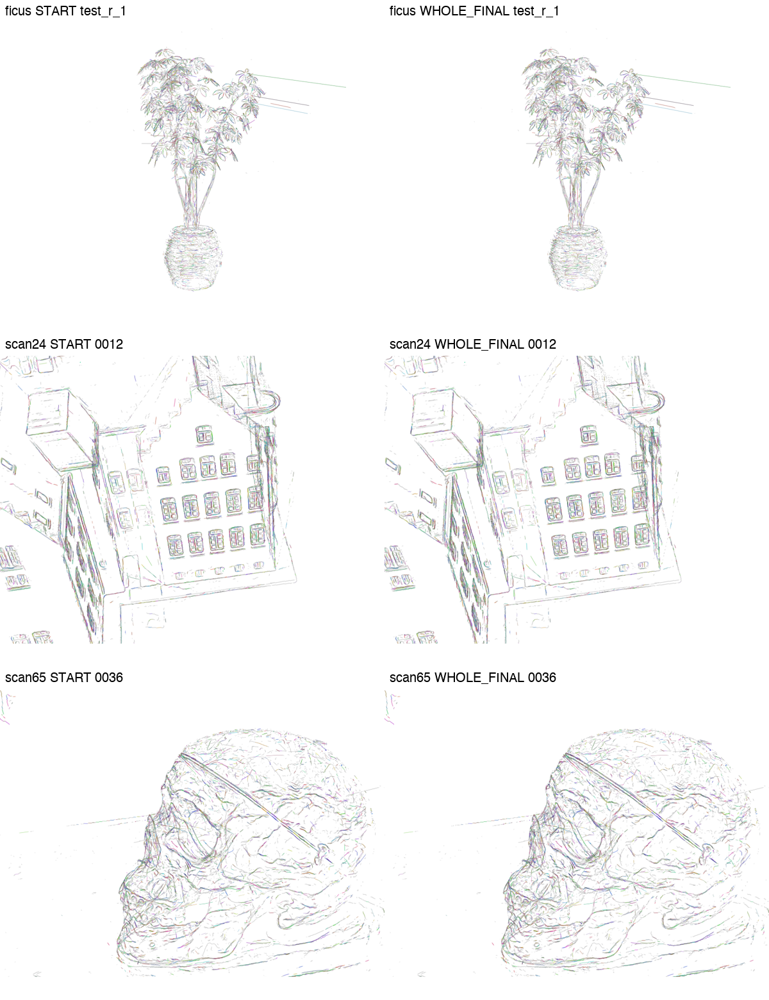
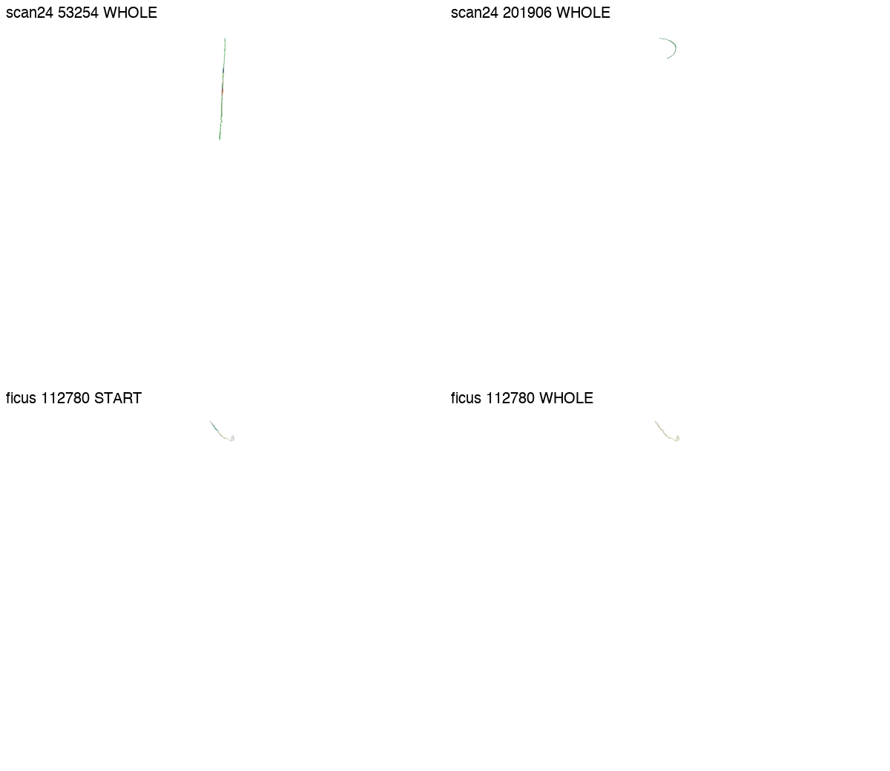
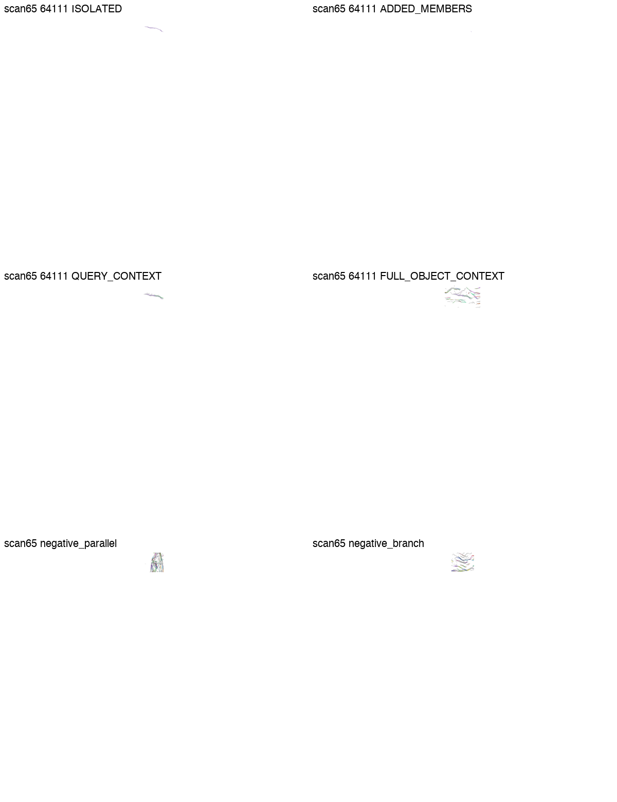
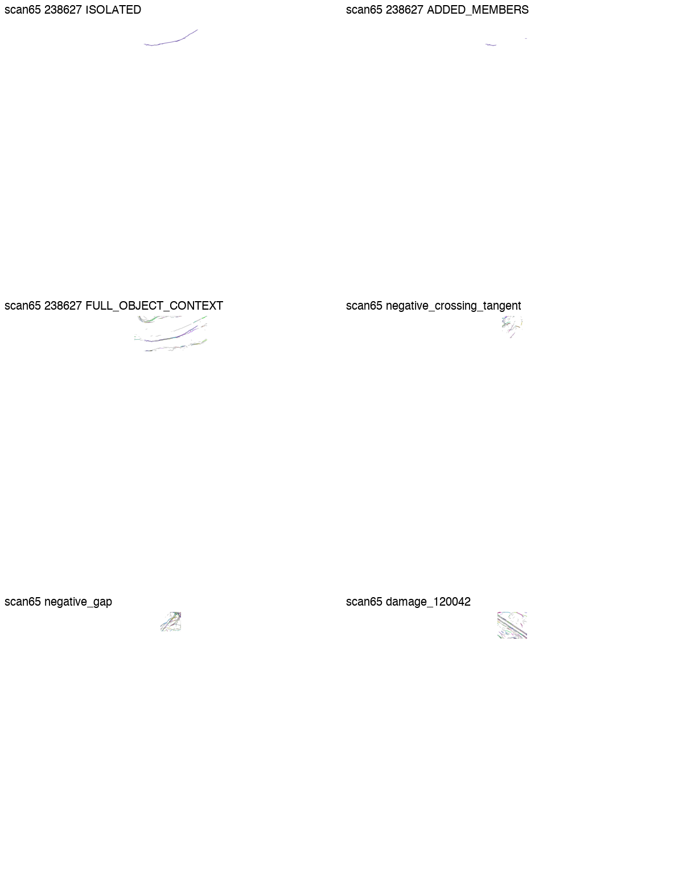

# v09 16:00 独立验收：PARTIAL

**重复择优增长机制已有真实结果；尚不能认证“完整物理同边恢复”。** 本次只读验收保存数据，没有启动新科学、模型、训练、GPU任务或推送。

## 实际成果
- 初运行 initial/unit_001：Ficus，WHOLE 62次接受，最终122354 assigned / 163602 UNKNOWN，相对本轮起点新增335核，撤回0。LOCAL为70次、122393/163563。两臂独立，不能相加。
- continuation_001/unit_001：scan24，WHOLE 49次，259985 / 198505，本轮新增227核；LOCAL42次、新增172核。
- continuation_001/unit_002：scan65，WHOLE48次，126423 / 153193，本轮新增288核；LOCAL51次、新增297核。
- continuation_001/unit_003：scan65分支守卫对照，RADIAL 0次，TRANSPORT仅1次、新增5核，最终126428 / 153188。继承前单元48次，不重复累计。

这四个单元由绝对输出路径区分，两个unit_001不是同一实验。三个场景原始核分别285956、458490、279616行。所有核的位置、协方差、透明度、原颜色及来源ID/行序保持，灰色UNKNOWN没有删除。最终墨迹仅原核；辅助曲线不是新增桥墨；没有源表面遮挡。

## 视觉判断与边界
全景START与FINAL几何基本相同是固定原核的预期，不是清理了尖刺：Ficus右侧长尖刺、建筑重复边和颅骨交叉叠层依然存在。scan24的53254能读成长直段；201906呈短弯檐，但长弧主要继承。scan65的238627是一条可见长弧，新纳入主要短尾/散点，不能称新完整曲线。最新64111新增5核在固定视图近乎不可辨，完整背景有密集平行/分支竞争，无法排除错误同边归属。

同组同色只说明持久成员关系。图中QUERY_CONTEXT只含查询donor，不等同完整投影竞争背景；FULL_OBJECT_CONTEXT也不是独立物理真值。没有认证物理准确率、误并安全、held-out泛化、闭合成功或时间稳定。

## 支持与外延不能混用
scan24 53254：190→685核，18次接受；域外支持代理131.700p，支持并集188.462p，但最长连续run86.218p。201906：282→339核，3次接受，域外13.605p；原长弧占主导。
scan65最新64111：204→209核；并集36.36726→38.59141p，最长run仅到36.93476p，仍有.023524p空洞；仅一个达到12核/2p的实质M4来源。更多核、填洞、区间并集和真正向外延伸分开记账，协方差支持不是实测连续结构。

## 工程验收和停止原因
独立SHA检查：initial保护75535项、continuation保护77240项均未变化；四个单位seal、immutable source_snapshot、配置/决策、两项renderer helper以及336个checkpoint绑定文件均匹配。全部原核七字段已重新读取核对；336份完整映射行序和数量已核验。原机system Python缺numpy的第一次只读数组检查失败，随后使用冻结RUN_REQUEST内已有venv完成检查；未安装依赖。

源码显示每次接受事务保存完整成员并集，重新建立整曲线候选库，全部合格解释择最低J；无8次接受上限。自然停止仅针对所选种子、冻结有限邻域和解释定义，不等于全场景/研究问题穷尽。真实支持闭合为0。工程测试与合并量不等于准确率。

四次数值实际child exit均0/reason=null。初运行analysis和analysis recovery均HARD_DEADLINE并缺四份handoff元数据（另有KeyError），其历史保持失败；后来真实finalization诊断不能抹掉它。续接unit003分析亦曾HARD_DEADLINE，后同session恢复元数据；续接finalization另HARD_DEADLINE。初运行不是用户取消。窗口在15:15停新单元边界行政收口，不是额度失败或科学耗尽。

真实研究模型为gpt-6-astra/ultra，同session 01a187da-c1a9-7a91-9a65-91fad4f3e85f；本报告是独立父级只读验收。工作树HEAD 6eb3d6d9ecd74d8aef9ffdecea15bcfe84f1b90b，实验源码仍untracked，以逐单位immutable快照SHA为准，不伪称已提交。无push/merge。

## 资产复用与证据范围
资产分包必须全部解压到同一新目录，保留initial/与continuation_001/两个独立namespace。ASSET_INDEX.json索引每个臂的完整原核NPZ、line_kernel_id→edge_id映射和辅助模型；UNKNOWN为edge_id<0。读取不需要原服务器，实际NPZ冷载已通过；原冻结配置保留旧绝对路径，renderer外部环境不自包含，不承诺跨机一键重跑。

本次附件优先提供完整最终原核、所有实验臂最终映射/辅助模型、原轨迹控制/基线载体、源码配置和关键原图，不承诺包含每张原始证据图/每个中间checkpoint。原证据没有删除：远端初运行delivery/archives/有7包；continuation_001/delivery/archives/有11包（后者本身是精选便携证据，不是全部原单位）。全体原单位6065项续接文件由ORIGINAL_INVENTORY.json定位；初版完整证据另列manifest。18个现有包均已下载并核对远端manifest SHA和ZIP CRC。

远端总根：/mnt/hdd1/u00134/radegs_paper_reproduction_v01/line_kernel_best_fragment_growth_v09_20261102
初版单位：units/unit_001；续接单位：continuation_001/units/unit_001、unit_002、unit_003。

下一项科学实验尚未运行：在共同固定弧长锚点对64111的8个初始合格解释和接受后21个分支拒绝，做G/F/union同邻域第三臂见证，配合可辨的标定双视图。不得把运输对齐本身当排除真分叉的证据。

## 固定相机全景（原图派生排版；无新渲染）

## 直段/弯段（部分投影很小，证据不足明确保留）

## 最新微小增长与完整竞争背景

## 曲弧及失败/负例

