# v10：放开硬规则之后，究竟得到什么？

**独立验收结论：工程机制成立；物理同边准确性仍未获认证，不能把本轮晋升为更好的最终边资产。**

本次只验收已有成果，没有恢复Astra、重跑归组/渲染、改科学配置、调用GPU或训练。模型历史归属为 `gpt-6-astra / ultra`，同一session `01a187da-c1a9-7a91-9a65-91fad4f3e85f`。用户授权：“其中放开硬规则2，4，6。我们逐步放开限制尽可能的去合并，大胆试错积累经验。同样用astra监督推进到6am”。

## 视觉先说结论

- 建筑与头骨的整物体结构可辨；原有尖刺、交叠和碎纹仍在，归组没有改变这些几何。全景中各轮差别很小，这是固定原核/仅变身份的实验，不应解释为画面清理成功。
- 61271等隔离组确实增加了一段可见的原核支持；但紧邻竞争线密集，原始局部只有几十像素，放大不会产生新的深度或身份信息。
- 放开约束允许平行冲突、自接触及纯池化候选真正被选中；与此同时，联合重拟合会损伤更早加入成员的方向一致性。更多核归组不等于归到同一条真实边。
- 没有用辅助曲线补画gap/桥，也没有用源表面遮挡筛除负例。这里是**原始line-Gaussian单独渲染的诊断**，不是带源模型正确遮挡的最终图。

<figure><a href="01_all_units_overview.jpg">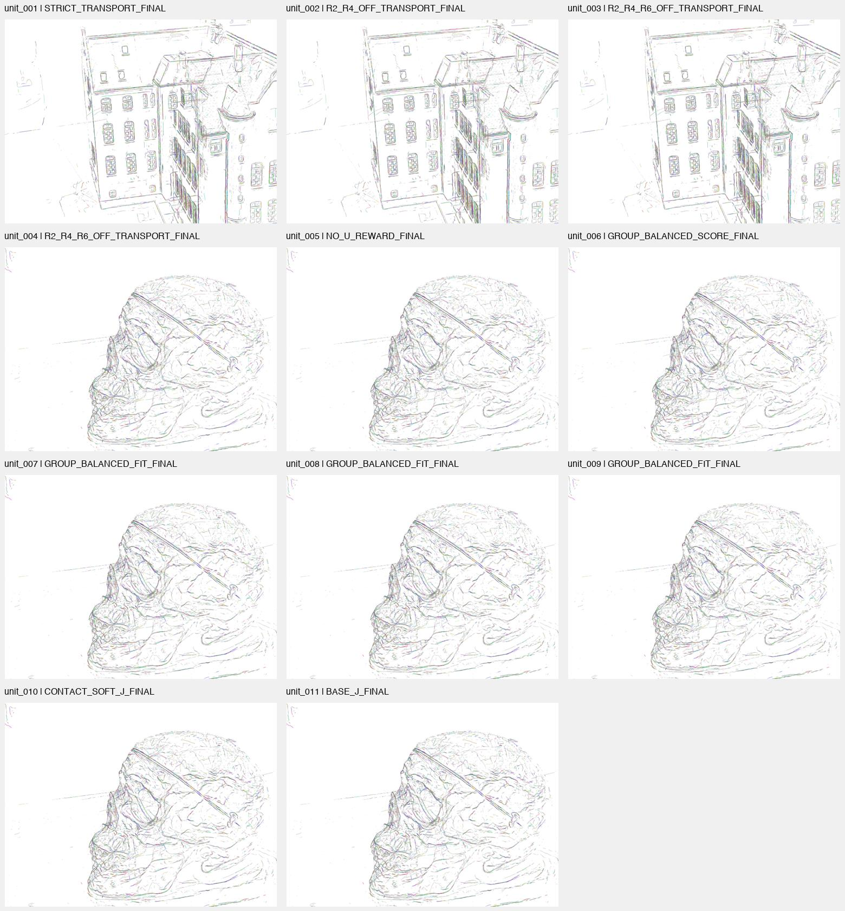</a><figcaption>派生总览：11个真实单元的现存全景；每格为该单元一个实际终态，不覆盖所有实验臂，完整清单见下。不同场景不作质量排名。</figcaption></figure>

<div class="pagebreak"></div>

## 最新原核：完整画面与局部必须一起看

<figure><a href="evidence/units/unit_011/scenes/scan65/stages/BASE_J_FINAL/0012_FULL.png">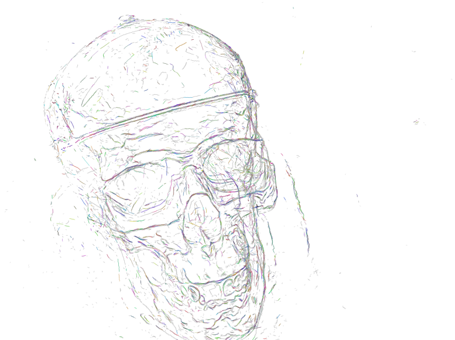</a><figcaption>unit011 scan65／相机0012：真实777×581完整画面，保留全部竞争背景。</figcaption></figure>

<figure><a href="evidence/units/unit_011/scenes/scan65/stages/BASE_J_FINAL/0036_FULL.png">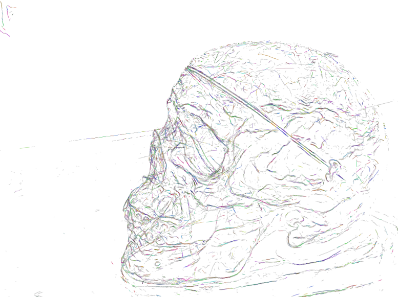</a><figcaption>unit011 scan65／相机0036：真实777×581完整画面，保留全部竞争背景。</figcaption></figure>

<figure><a href="03_latest_61271_4x.png">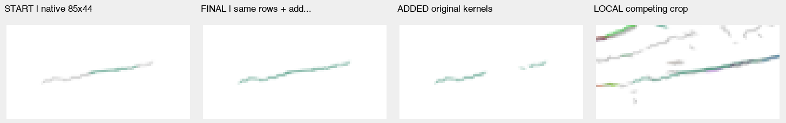</a><figcaption>61271／0036：原图每格85×44，统一最近邻4倍显示；左到右为起点、终态、仅新增核、局部竞争背景。局部图不是完整场景，不能认证深度归属。</figcaption></figure>

## 实际运行覆盖：11单元、15个执行臂

本窗口共保存234次接受事务；这是**分支间的执行次数**，不是234条独立发现，不能累计成同一轨迹的增益。旧控制复用、同状态影子与继承事件均不重复算新执行。

|单元|场景/实际臂|新接受|纯池化|停止范围|
|---|---|---:|---:|---|

|unit_001|scan24 / STRICT_TRANSPORT|0|0|限定种子自然穷尽|

|unit_001|scan24 / R2_OFF_TRANSPORT|5|0|限定种子自然穷尽|

|unit_002|scan24 / R2_OFF_TRANSPORT|0|0|限定种子自然穷尽|

|unit_002|scan24 / R2_R4_OFF_TRANSPORT|6|0|KNOT_CAPACITY|

|unit_003|scan24 / R2_R4_R6_OFF_TRANSPORT|6|0|KNOT_CAPACITY|

|unit_004|scan65 / R2_R4_OFF_TRANSPORT|2|0|限定种子自然穷尽|

|unit_004|scan65 / R2_R4_R6_OFF_TRANSPORT|24|11|限定种子自然穷尽|

|unit_005|scan65 / NO_U_REWARD|33|27|PHASE_DEADLINE|

|unit_006|scan65 / GROUP_BALANCED_SCORE|17|15|限定种子自然穷尽|

|unit_007|scan65 / GROUP_BALANCED_FIT|38|16|PHASE_DEADLINE|

|unit_008|scan65 / GROUP_BALANCED_FIT|1|1|限定种子自然穷尽|

|unit_009|scan65 / GROUP_BALANCED_FIT|74|8|PHASE_DEADLINE|

|unit_010|scan65 / BASE_J|1|0|限定种子自然穷尽|

|unit_010|scan65 / CONTACT_SOFT_J|1|1|限定种子自然穷尽|

|unit_011|scan65 / BASE_J|26|3|PHASE_DEADLINE|


**RULE2OFF、2+4OFF、2+4+6OFF均实际运行。**规则2是全组最大距离/切向门；规则4是平行冲突；规则6是非局部自接触、最大gap及必须新增独特支持。代码中的返回都受对应`not in relaxed`条件控制；关闭后保留有限评分与风险记录。规则1候选、3急折/单调与5运输分叉仍在，8192成员/257结点是工程容量，不能称候选穷尽。

- 实际违反门槛仍被接受的见证：unit001 R2臂5次均有角度超75°、其中1次距离超1.5p；unit002新增6次均含平行冲突；unit003有1次自接触；unit004 R6臂11次纯池化。
- 本批真实接受记录没有gap>1.5p的见证；这不等于gap硬门仍在。源码与保存测试覆盖其条件分支，但不能声称真实长gap连接已发生。
- 相同原核集合可因端点/重叠解释不同映射到不同弧长，产生虚增独特支持；解除R6不认证闭环，也不允许补桥。

## 支持量：重复、内部填充、向外生长必须分开

unit011相对于自己的START：新增142个UNKNOWN行，吸收43个已assigned行；全部26次接受完整保留原成员并集。8765从44核到124核、61271从71核到176核；3次为纯池化。13个origin保留，1871个继承事件与26次本轮事务分开。

|组|去重支持union（p）|最长连续段（p）|固定起点Q内新增独特支持|起点域外支持代理|
|---|---|---|---|---|
|8765|14.419 → 27.462|8.526 → 27.462|0.165p|13.176p|
|61271|22.089 → 55.671|18.631 → 40.629|0.335p|33.217p|

`p`是本场景的世界尺度归一化单位，不是每个相机里的固定像素。61271末最大gap约0.176p。union/run是原核支持投到辅助曲线后的统计；固定域内填洞、Q重映射与真正物理外延不是一回事。域外数字仍是辅助模型代理，不是恢复真实边长度。

**明确损伤**：unit011第15步加入10核后，此前已接受的253954–253956行相对新Q达到79.604°；unit006旧成员最大89.166835°。这说明“整组核不丢”不等于“旧成员解释不受损”。

**规模与吞并**：全部终态最大组是scan24的200509，共1221核（全458490核的0.266309%）；不是整个物体巨型连通分量。但平行结构被合入同身份的风险是真实保存的。scan65最新最大596核属于继承的30579，不是unit011新发现；颜色不能判定其物理准确。

<div class="pagebreak"></div>

## unit_001：scan24／R2_OFF_TRANSPORT

R2解除产生真实有限评分与5次完整最佳片段提交（132977四次、210790一次）；严格臂0次。最早放开的见证是事件1新UNKNOWN行63866的80.6835度；事件2另有1.52436p距离与78.0419度。事件3起原已归属行230338/230339超过75度，说明整组调整也会损害旧成员的方向一致性。132977获得9.078p域外支持代理，但最长连续段缩短；210790域外为0。原核未变、无失核，但小投影/密集竞争背景不足以确定是否吞并并行或深度层。最后瓶颈转移至规则3/4/5/6，不是超时、容量截断或支持闭合。

<figure><a href="unit_001_whole_pair.jpg"></a><figcaption>派生同相机对照：左START、右本单元最后一个实际执行臂终态。原几何冻结；仅身份/可视化颜色改变，不是黑白几何优化。</figcaption></figure>

<figure><a href="unit_001_diagnostic_4x.png">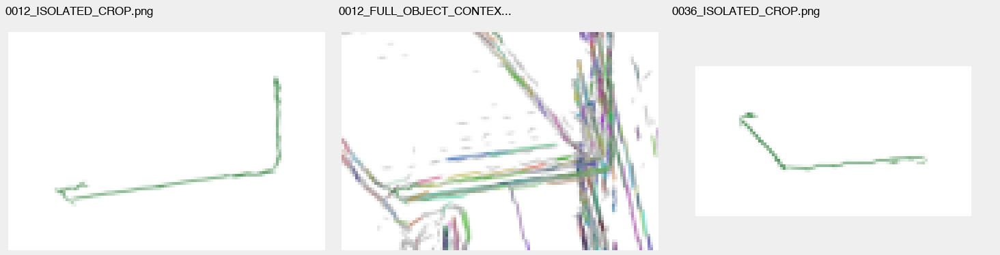</a><figcaption>从原分析记录中按顺序选择前三张局部负例/隔离图（事后展示选择，不是盲测或代表性抽样）。统一4倍像素显示；原尺寸与原路径见图像清单。名为FULL_OBJECT_CONTEXT的文件实为小裁剪，完整竞争画面在上方。</figcaption></figure>

本轮接受：STRICT_TRANSPORT=0, R2_OFF_TRANSPORT=5；各自停止：限定种子自然穷尽, 限定种子自然穷尽。

[原始完整中文分析](evidence/units/unit_001/REPORT_ZH.md) · [原始STATUS](evidence/units/unit_001/STATUS.json)

<div class="pagebreak"></div>

## unit_002：scan24／R2_R4_OFF_TRANSPORT

R4硬拒绝已真实解除：匹配R2控制0次且完整状态复现，R2_R4新增6次（200509/201906/202023各2次），每次均带parallel冲突见证。末端因KNOT_CAPACITY停止，数值rc=0不等于科学完整，无连接/闭合不能覆盖此容量中断。新增10个UNKNOWN核、406个原assigned核被整组吸收；已有平行结构被试验性归入同身份，但图像小、竞争背景拥挤，物理误并尚不能认证。

<figure><a href="unit_002_whole_pair.jpg">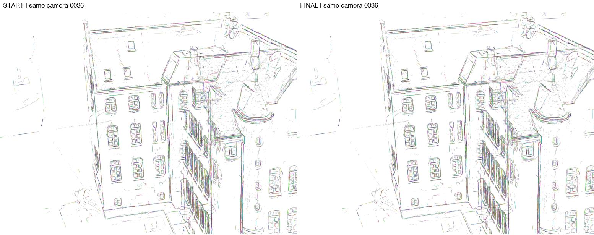</a><figcaption>派生同相机对照：左START、右本单元最后一个实际执行臂终态。原几何冻结；仅身份/可视化颜色改变，不是黑白几何优化。</figcaption></figure>

<figure><a href="unit_002_diagnostic_4x.png">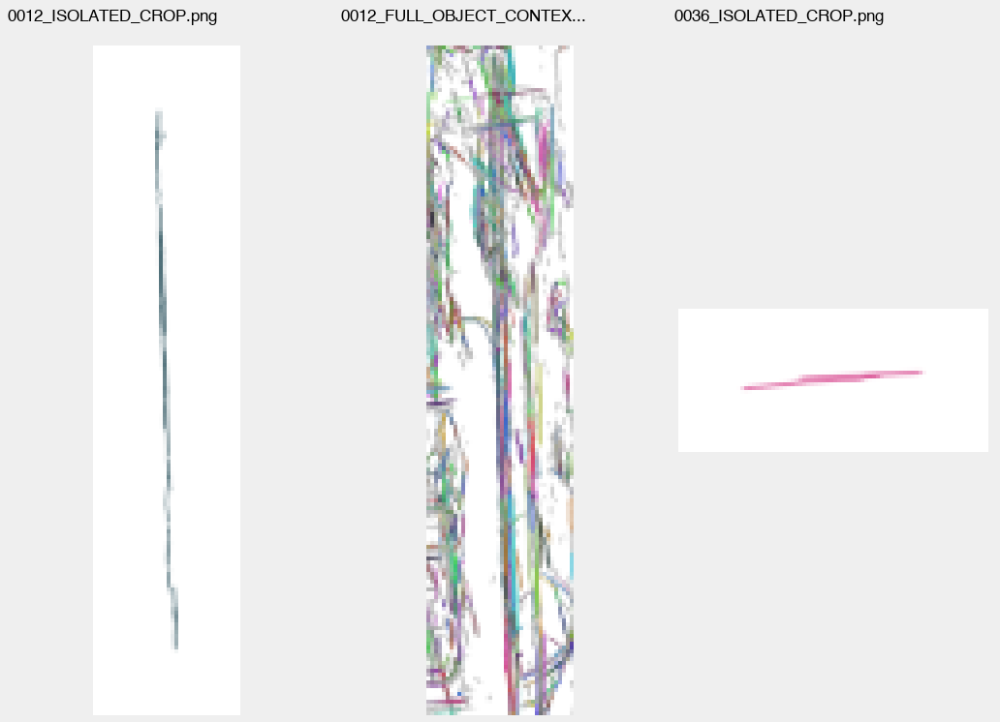</a><figcaption>从原分析记录中按顺序选择前三张局部负例/隔离图（事后展示选择，不是盲测或代表性抽样）。统一4倍像素显示；原尺寸与原路径见图像清单。名为FULL_OBJECT_CONTEXT的文件实为小裁剪，完整竞争画面在上方。</figcaption></figure>

本轮接受：R2_OFF_TRANSPORT=0, R2_R4_OFF_TRANSPORT=6；各自停止：限定种子自然穷尽, KNOT_CAPACITY。

[原始完整中文分析](evidence/units/unit_002/REPORT_ZH.md) · [原始STATUS](evidence/units/unit_002/STATUS.json)

<div class="pagebreak"></div>

## unit_003：scan24／R2_R4_R6_OFF_TRANSPORT

规则6解除确实使完整库和第5步选择改变：201906以自接触端点解释吸收19个UNKNOWN核，原控制选择另一10核donor；两者各6次后均容量中断。原核与既有成员保留，WHOLE旧段实际移动，但候选关系导致的U差异及微小图像使物理连续性未证实。

<figure><a href="unit_003_whole_pair.jpg"></a><figcaption>派生同相机对照：左START、右本单元最后一个实际执行臂终态。原几何冻结；仅身份/可视化颜色改变，不是黑白几何优化。</figcaption></figure>

<figure><a href="unit_003_diagnostic_4x.png">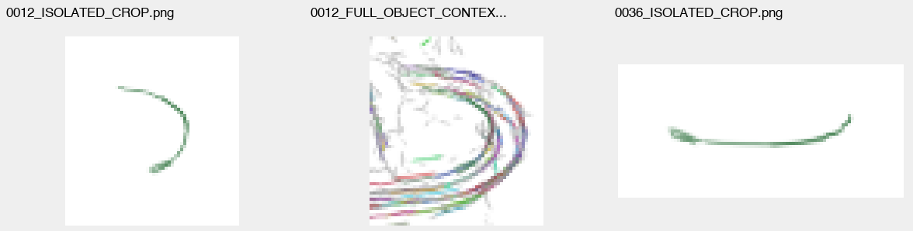</a><figcaption>从原分析记录中按顺序选择前三张局部负例/隔离图（事后展示选择，不是盲测或代表性抽样）。统一4倍像素显示；原尺寸与原路径见图像清单。名为FULL_OBJECT_CONTEXT的文件实为小裁剪，完整竞争画面在上方。</figcaption></figure>

本轮接受：R2_R4_R6_OFF_TRANSPORT=6；各自停止：KNOT_CAPACITY。

[原始完整中文分析](evidence/units/unit_003/REPORT_ZH.md) · [原始STATUS](evidence/units/unit_003/STATUS.json)

<div class="pagebreak"></div>

## unit_004：scan65／R2_R4_R6_OFF_TRANSPORT

匹配终态中关闭R6解锁24次提交（5558为16、22130为5、64111为3），对照[2,4]为2次；11次是U=0纯池化，未接受自接触/超gap/闭合。最早分歧5558<-76498仅4核池化，之后整组曲线改变才出现可连接外延。工程层面所有26次并集/checkpoint/最低J验证通过；科学层面5558的47.854p域外支持仍是依赖辅助Q的代理，两视图主要见继承细线变密，22130只有0.0114p域外、64111只有1.6186p且投影极小，尚不满足新增实质直曲身份的可见证据。末库余下瓶颈是规则1注册/端点解释与规则3急折/单调性，部分规则5分叉；不是R2/R4/R6暗中恢复或容量停止。

<figure><a href="unit_004_whole_pair.jpg"></a><figcaption>派生同相机对照：左START、右本单元最后一个实际执行臂终态。原几何冻结；仅身份/可视化颜色改变，不是黑白几何优化。</figcaption></figure>

<figure><a href="unit_004_diagnostic_4x.png">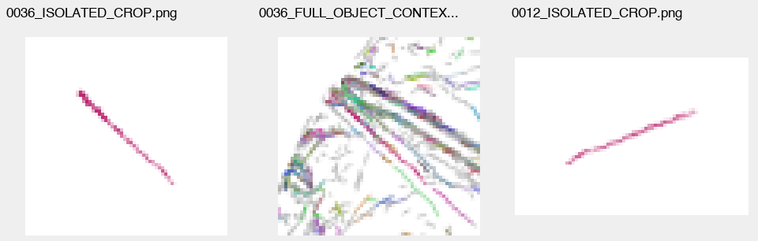</a><figcaption>从原分析记录中按顺序选择前三张局部负例/隔离图（事后展示选择，不是盲测或代表性抽样）。统一4倍像素显示；原尺寸与原路径见图像清单。名为FULL_OBJECT_CONTEXT的文件实为小裁剪，完整竞争画面在上方。</figcaption></figure>

本轮接受：R2_R4_OFF_TRANSPORT=2, R2_R4_R6_OFF_TRANSPORT=24；各自停止：限定种子自然穷尽, 限定种子自然穷尽。

[原始完整中文分析](evidence/units/unit_004/REPORT_ZH.md) · [原始STATUS](evidence/units/unit_004/STATUS.json)

<div class="pagebreak"></div>

## unit_005：scan65／NO_U_REWARD

仅移除U奖励确实改变轨迹：5个初始原J库精确重放，11个同状态影子选择分歧；最早第3步64111从127285改选纯池化-158889，新增3行方向角77.118°，小donor角度问题对全组均值贡献较小（待下轮验证组成稀释，不当物理误并真值）。本轮33步/27次纯池化，5558域外代理0.134p而旧控制47.854p；64111则从旧控制1.619p提高到8.356p且20步连续生长。效果是增长方向和池化分配改变，不能称整体准确率提高或恶化。末库238627在450秒阶段预算中断；关键曲线0012投影只有约4×15像素有效范围，不能给实质双视图身份认证。

<figure><a href="unit_005_whole_pair.jpg">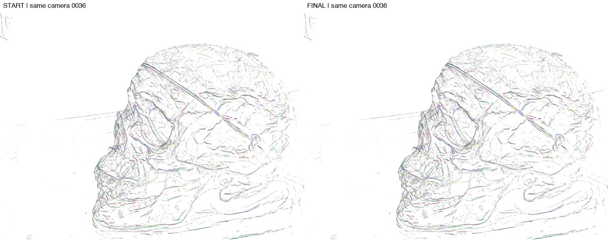</a><figcaption>派生同相机对照：左START、右本单元最后一个实际执行臂终态。原几何冻结；仅身份/可视化颜色改变，不是黑白几何优化。</figcaption></figure>

<figure><a href="unit_005_diagnostic_4x.png">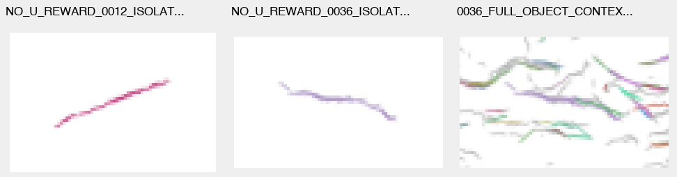</a><figcaption>从原分析记录中按顺序选择前三张局部负例/隔离图（事后展示选择，不是盲测或代表性抽样）。统一4倍像素显示；原尺寸与原路径见图像清单。名为FULL_OBJECT_CONTEXT的文件实为小裁剪，完整竞争画面在上方。</figcaption></figure>

本轮接受：NO_U_REWARD=33；各自停止：PHASE_DEADLINE。

[原始完整中文分析](evidence/units/unit_005/REPORT_ZH.md) · [原始STATUS](evidence/units/unit_005/STATUS.json)

<div class="pagebreak"></div>

## unit_006：scan65／GROUP_BALANCED_SCORE

最早排序分歧发生在第3次提交：64111改选25核127285（带[64111,127285]平行冲突），替代12核-158889；均衡评分对两者分别为0.109068/0.208513。软排序可避开一个高方向损伤donor，却没有解决旧成员拟合损伤：第6次后旧行240923超75度，第12次旧行240923/240924最大89.166835度。17次接受中15次U=0，新增UNKNOWN65核，全部起点成员保留；最终实质域外支持代理很小，不能把均衡评分/池化当身份改善。五组均完整无连接停止；旧NO_U控制33步为PHASE_DEADLINE截断。

<figure><a href="unit_006_whole_pair.jpg"></a><figcaption>派生同相机对照：左START、右本单元最后一个实际执行臂终态。原几何冻结；仅身份/可视化颜色改变，不是黑白几何优化。</figcaption></figure>

<figure><a href="unit_006_diagnostic_4x.png">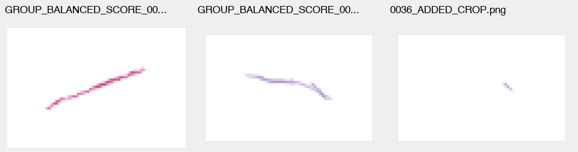</a><figcaption>从原分析记录中按顺序选择前三张局部负例/隔离图（事后展示选择，不是盲测或代表性抽样）。统一4倍像素显示；原尺寸与原路径见图像清单。名为FULL_OBJECT_CONTEXT的文件实为小裁剪，完整竞争画面在上方。</figcaption></figure>

本轮接受：GROUP_BALANCED_SCORE=17；各自停止：限定种子自然穷尽。

[原始完整中文分析](evidence/units/unit_006/REPORT_ZH.md) · [原始STATUS](evidence/units/unit_006/STATUS.json)

<div class="pagebreak"></div>

## unit_007：scan65／GROUP_BALANCED_FIT

组均权拟合真实改变几何和排名：38次接受（5558/22130/64111/238627分别8/5/4/21），16次纯池化，新增UNKNOWN183核。相较封存ROW_FIT17步自然停止，238627原死端被释放，但新增116核仍无起点域外支持，长弧主要继承/内部填充。第6步22130平行冲突、第15步64111自接触是明确保留的风险；同donor自接触端点Q的J=.067926低于无接触重叠Q的.076681，不是U奖励导致。全部接受的最大距离1.298543p/角71.753462度，未复现unit006的89度超限，这只是几何代理改善。最终因450秒增长预算PARTIAL，238627末库已有5个合格解释但其余未完，不能宣称自然耗尽或挑选截断库赢家。

<figure><a href="unit_007_whole_pair.jpg">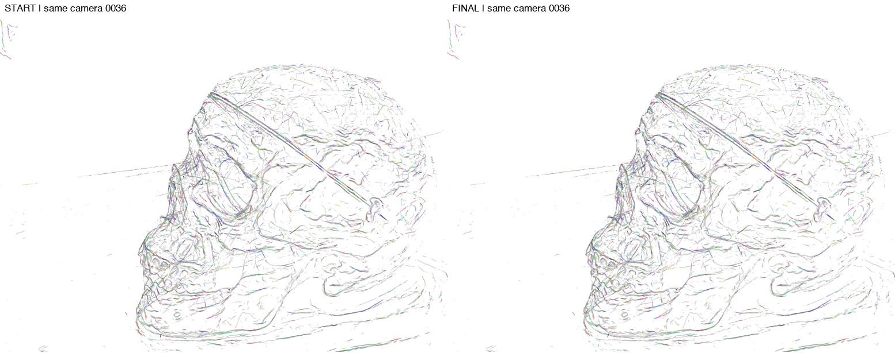</a><figcaption>派生同相机对照：左START、右本单元最后一个实际执行臂终态。原几何冻结；仅身份/可视化颜色改变，不是黑白几何优化。</figcaption></figure>

<figure><a href="unit_007_diagnostic_4x.png">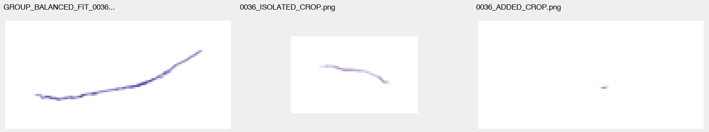</a><figcaption>从原分析记录中按顺序选择前三张局部负例/隔离图（事后展示选择，不是盲测或代表性抽样）。统一4倍像素显示；原尺寸与原路径见图像清单。名为FULL_OBJECT_CONTEXT的文件实为小裁剪，完整竞争画面在上方。</figcaption></figure>

本轮接受：GROUP_BALANCED_FIT=38；各自停止：PHASE_DEADLINE。

[原始完整中文分析](evidence/units/unit_007/REPORT_ZH.md) · [原始STATUS](evidence/units/unit_007/STATUS.json)

<div class="pagebreak"></div>

## unit_008：scan65／GROUP_BALANCED_FIT

本轮补完旧时间截断库，仅接受238627←-62053一次，新增5个UNKNOWN原核；随后五组完整库均无可连接解释，属当前候选/规则下自然停止，非时间或容量截断。R6关闭允许U=0纯池化；新5核在固定本轮起点Q上独特支持为0，动态union/run从122.992112p变123.413066p是Q变化相关统计，不能称新外延。长弧及4对平行冲突继承；本轮未报告新增自接触/超gap或R2超限。当前小新增视图不足确认物理身份。 最早后续阻断发生在接受后的第一次重搜：三个原合格解释转规则5分叉拒绝，一个失去规则1对应；未恢复2/4/6。完整搜索只覆盖既定五组和当前2p提案定义。

<figure><a href="unit_008_whole_pair.jpg"></a><figcaption>派生同相机对照：左START、右本单元最后一个实际执行臂终态。原几何冻结；仅身份/可视化颜色改变，不是黑白几何优化。</figcaption></figure>

<figure><a href="unit_008_diagnostic_4x.png">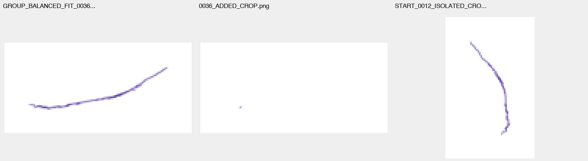</a><figcaption>从原分析记录中按顺序选择前三张局部负例/隔离图（事后展示选择，不是盲测或代表性抽样）。统一4倍像素显示；原尺寸与原路径见图像清单。名为FULL_OBJECT_CONTEXT的文件实为小裁剪，完整竞争画面在上方。</figcaption></figure>

本轮接受：GROUP_BALANCED_FIT=1；各自停止：限定种子自然穷尽。

[原始完整中文分析](evidence/units/unit_008/REPORT_ZH.md) · [原始STATUS](evidence/units/unit_008/STATUS.json)

<div class="pagebreak"></div>

## unit_009：scan65／GROUP_BALANCED_FIT

工程链已通过保存证据审计：74次完整库最小J选择、全成员均衡拟合、原核并集与原子checkpoint均成立；新六组产生947个身份加入行，其中400来自UNKNOWN、547来自既有组。最早风险为第30步30579平行对30422/274294；第62步84607接入3核时牵动已接受行214901至83.06度；第72步30579自接触端点解释低分胜出，下一部分库出现47个急折拒绝。400新增UNKNOWN不等于准确率。预算中断与身份未证实是独立限制。

<figure><a href="unit_009_whole_pair.jpg">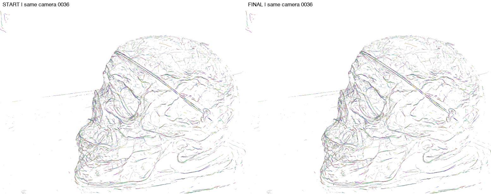</a><figcaption>派生同相机对照：左START、右本单元最后一个实际执行臂终态。原几何冻结；仅身份/可视化颜色改变，不是黑白几何优化。</figcaption></figure>

<figure><a href="unit_009_diagnostic_4x.png">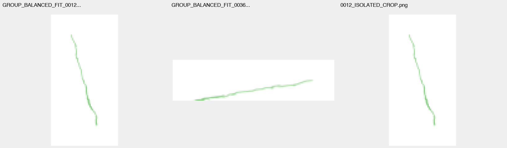</a><figcaption>从原分析记录中按顺序选择前三张局部负例/隔离图（事后展示选择，不是盲测或代表性抽样）。统一4倍像素显示；原尺寸与原路径见图像清单。名为FULL_OBJECT_CONTEXT的文件实为小裁剪，完整竞争画面在上方。</figcaption></figure>

本轮接受：GROUP_BALANCED_FIT=74；各自停止：PHASE_DEADLINE。

[原始完整中文分析](evidence/units/unit_009/REPORT_ZH.md) · [原始STATUS](evidence/units/unit_009/STATUS.json)

<div class="pagebreak"></div>

## unit_010：scan65／CONTACT_SOFT_J

0.01有限接触代价确实改变首次全库最低分赢家，但两臂均一次接受后完整无连接；没有解除局部死端。BASE选-30821端点自接触（10个UNKNOWN核），SOFT选67269无接触纯池化（18个已归属核），新增平行冲突67265/67269。固定起点曲线独特支持增量两臂均0；BASE动态Q的支持增加包含重映射，不是已证实外延。

<figure><a href="unit_010_whole_pair.jpg">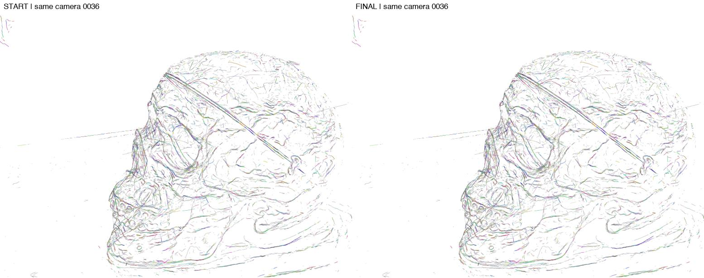</a><figcaption>派生同相机对照：左START、右本单元最后一个实际执行臂终态。原几何冻结；仅身份/可视化颜色改变，不是黑白几何优化。</figcaption></figure>

<figure><a href="unit_010_diagnostic_4x.png">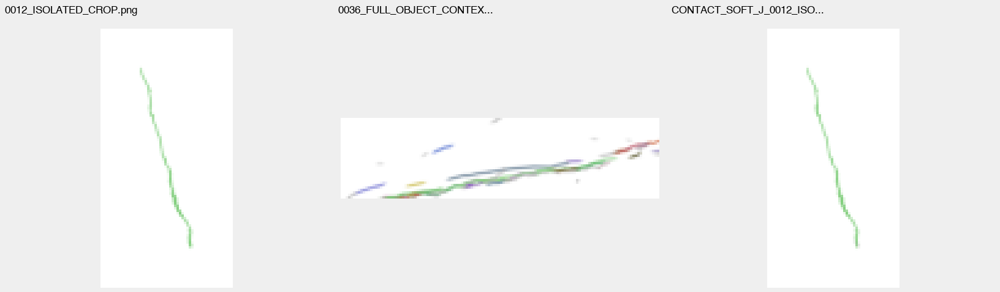</a><figcaption>从原分析记录中按顺序选择前三张局部负例/隔离图（事后展示选择，不是盲测或代表性抽样）。统一4倍像素显示；原尺寸与原路径见图像清单。名为FULL_OBJECT_CONTEXT的文件实为小裁剪，完整竞争画面在上方。</figcaption></figure>

本轮接受：BASE_J=1, CONTACT_SOFT_J=1；各自停止：限定种子自然穷尽, 限定种子自然穷尽。

[原始完整中文分析](evidence/units/unit_010/REPORT_ZH.md) · [原始STATUS](evidence/units/unit_010/STATUS.json)

<div class="pagebreak"></div>

## unit_011：scan65／BASE_J

26次真实最佳片段提交并重搜（8765八次、61271十八次）证实新队列可重复增长，非仅池化：3次U=0，其余为动态支持增加，但仅为投影代理。第15步首现原R2方向超限，旧成员253954–253956被新donor拟合牵至79.604°，这是明确的旧成员方向损伤。未见接受事件的R4平行冲突、self-contact或超gap诊断；不得凭空声称新第三臂/深度误吞。最终240s增长阶段中断在8765重复重查，61271最新状态尚未重查，故PARTIAL而非自然穷尽。

<figure><a href="unit_011_whole_pair.jpg"></a><figcaption>派生同相机对照：左START、右本单元最后一个实际执行臂终态。原几何冻结；仅身份/可视化颜色改变，不是黑白几何优化。</figcaption></figure>

<figure><a href="unit_011_diagnostic_4x.png">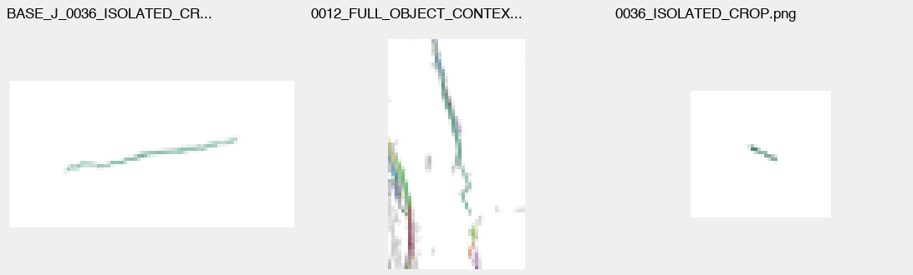</a><figcaption>从原分析记录中按顺序选择前三张局部负例/隔离图（事后展示选择，不是盲测或代表性抽样）。统一4倍像素显示；原尺寸与原路径见图像清单。名为FULL_OBJECT_CONTEXT的文件实为小裁剪，完整竞争画面在上方。</figcaption></figure>

本轮接受：BASE_J=26；各自停止：PHASE_DEADLINE。

[原始完整中文分析](evidence/units/unit_011/REPORT_ZH.md) · [原始STATUS](evidence/units/unit_011/STATUS.json)

<div class="pagebreak"></div>

## 独立核验结果与未验证边界

- 全部15个执行臂的234次事务，从START全行重放：逐步并集、完整全行映射、完整候选库最小分（含donor/relation/direction确定性并列次序）、所选Q与提交Q相等，均未发现不一致。后期可用FIT_EVIDENCE核查全成员拟合输入；不据此认证拟合物理正确。
- 271个保存阶段的全行ID顺序与原primitive_id核对；581个主候选库检查。原核七数组逐字段SHA与前后记录匹配，原顺序/数量不变。
- 11份DECISION/CONFIG、冻结源快照及helper逐项核查；61旧工作树HEAD/status、85852旧引用、514继承文件核查无变更。最初父验收把514相对路径当cwd路径，产生假缺失，原错误回执保留；正确根W下复核514/514通过，见INHERITED_SOURCE_CORRECTED.json。
- 11个真实数值子进程均rc=0/reason=null，但科学增长的容量/阶段时间截断仍为PARTIAL；unit002/004/006原analysis_0超时与finalization的HARD_DEADLINE保留，不用外层SSH0洗成成功。
- 没有continuation指针；已按绝对O/units路径枚举11个单元。父验收读取到的本任务自有科学PID/comm均已不存在。

实际窗口停止是05:15“不再开新单元”的行政边界，最终监督器05:35:09结束，不是算法把全场景全部候选耗尽。所谓自然穷尽只在固定种子、整曲线2p邻域及现有提案/规则范围内成立。unit011末8765只完成60/102解释，61271最后一次接受后尚未重查。

**NOT_RUN / UNCERTIFIED**：ficus新实验；scan65已执行M5/v06匹配对照；新的依赖缓存控制与可读标定视图实验；物理同边准确率、独立语义真值、GS-unseen泛化、连续视频时间稳定性。保存的观察图像名单不是父级对所有Astra图像调用逐返回字节审计的替代；本验收独立看过真实总览及关键原图/放大诊断，但未认证全部Astra看图次数。

## 可冷载交付与操作

8个`v10_assets_partXX_of_08.zip`是**独立ZIP，不是二进制分卷**。请全部解压到同一空目录，保留`v10/`、`dependencies/`结构；各包独有PART清单不会互相覆盖。也可把所有ZIP与`cold_load.py`放同一目录，执行：

```sh
python cold_load.py scan24 scan65
```

冷载只需现有NumPy，无原服务器路径、无pickle执行、无拟合/渲染。从实际ZIP成员字节读取全部原核、全行映射，并递归恢复历史/当前辅助模型；辅助结点转为世界坐标。完整旧背景的成员列表按最终映射刷新，只影响加载视图，不改封存数据。辅助Q不能作为gap桥墨。

本机和服务器分别验证：8包SHA、每成员SHA/字节数/CRC、大小写冲突（0）、2014个载荷成员；加8份分包清单后ZIP总成员2022。压缩字节总数165201867。原图本机解码193张，原字节未降分辨率。

冷载场景：scan24=458490原行，260048 assigned/198442 UNKNOWN，6196个已assigned组辅助模型（缺失0）；scan65=279616原行，127152 assigned/152464 UNKNOWN，3655个已assigned组辅助模型（缺失0）。

**不包含全部中间证据。**8包包含全部11单元报告/状态/配置/决策/冻结源码，所有START及终态checkpoint、精选已记录原图、原核/控制/代表点/相机和冷载辅助模型依赖。完整中间候选库、全部中间checkpoint数组及未选PNG仍原封保留服务器O/units（22961文件，1452030968字节）；不能把此交付叫完整原始证据全集。

HTML/PDF及本父级新验收文件另置`v10_report_and_acceptance.zip`。精确逐文件SHA见`DELIVERY_MANIFEST.json`，ZIP成员见`PAYLOAD_MANIFEST.json`，本机验收见`LOCAL_VERIFICATION.json`及`TRANSACTION_SOURCE_AUDIT.json`。

## 保守结论

此次试错的收获是：解除硬门能打开真实合并路径；强制独特支持会拒绝合法的身份池化；按行均值评分/拟合会被组规模支配，均衡后路径会变；但自接触辅助载体、紧邻平行结构、旧成员方向损伤和候选重复重算成为新瓶颈。有限软接触项改变赢家却未解除30579死端。**这些是机制与风险经验，不是新边准确率的成功结论。**

后续方案仅为原Astra建议、NOT_RUN；本验收没有启动。保留当前latest作为可冷载候选和控制，不替代更强完整参考。