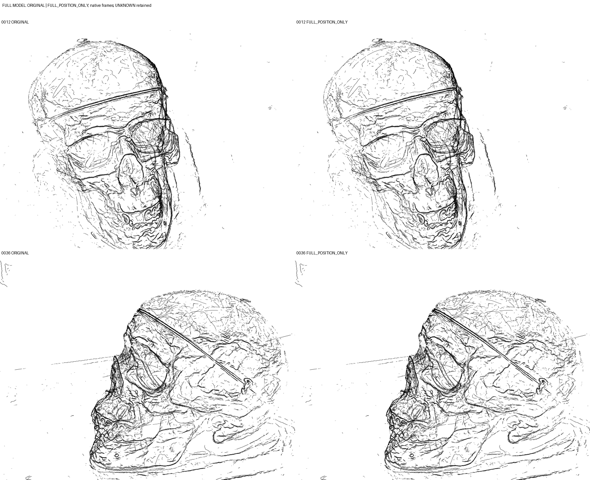

完整模型逐组POSITION_ONLY已执行完成；整体清理改善有限，局部平滑及形状变化须保留为风险。实际数值子进程rc=0、reason=null，不等于视觉/物理成功。此分析只读取保存输出。

已实际查看四幅原生完整帧、0012及0036各四个固定空间分区的原版/处理后对照，以及238627的双视图隔离图。3655组全部SUCCESS，覆盖127152 assigned候选核；SKIPPED_NUMERICAL/FAILED/NOT_RUN均0组0核。实际改变126477行means，另675行assigned保持原值；152464 UNKNOWN明确未处理并逐位保留。完整279616行和成员身份不变，本轮不是新归组或增长。

从整帧和八区看，主要轮廓/线网仍在，局部有平顺化；额头细碎线、眼眶/面部交叉、重复轮廓及散线仍明显。未看到支持“全模型缠绕已经消除”的证据。238627最大位移2.996954p，其双视图局部弯折被更规则弧替代，不能仅称为更准确的真实边。p=0.001725801957946726，原场景单位。

assigned位移分位[0,50,90,95,99,100]%为[0,0.079273449,0.289637008,0.381079943,0.683872113,2.996953933]p。原版和输出covariance、opacity、colors、primitive_id、internal_piece_id、arc_t全行逐位相同；UNKNOWN means逐位相同。源Gaussian SHA前后相同；输出冷载字段和完整双视图内存/冷载渲染逐位一致。30579对v11保存POSITION_ONLY的596行means逐位一致、最大差0。保护结论来自保存审计，后续可补充独立只读复核。

四幅完整图均含279616核，使用同一完整派生资产及既有CPU Gaussian EWA replica，原相机0012/0036、777×581、COLMAP W2C、floor=.12²；没有辅助曲线墨迹、源表面遮挡删核、逐相机调几何或透明度补偿。位置变化仍可能影响密度、深度合成和视觉强度。四区没有后验选图；放大为2倍最近邻显示，不增加证据。细小、遮叠及画外组仍缺逐组保真证据。

执行时刻13:19:51.182643至13:20:04.420463 JST，PID3569946，actual_child_exit=true；runner总13.0286秒，readiness0.4904、transform9.0225、render3.3128、audit0.2029秒。无超时、quota、容量截断。一次全局means副本、3655次局部调用、累计127152局部行、单组最大596；其它六字段共享只读。完整checkpoint先于昂贵渲染。

[四区0012](FIXED_FOUR_QUADRANTS_0012_2X.png)、[四区0036](FIXED_FOUR_QUADRANTS_0036_2X.png)、[全组账本](GROUP_LEDGER.json)、[保护审计](GEOMETRY_AUDIT.json)、[渲染收据](RENDER_RECEIPTS.json)、[原始输出](ORIGINAL_GAUSSIANS.npz)、[完整派生输出](FULL_POSITION_ONLY_GAUSSIANS.npz)、[成员映射](MEMBERSHIP.npz)、[checkpoint](CHECKPOINT.json)。

NEXT=stop，单个完整模型demo完成。保留弱结果与最大位移坏例，不调整参数或改处理范围。几何规整不是新增观测、物理身份或held-out/时间稳定性认证。

保存输出独立复核已完成：[ANALYSIS_SAVED_AUDIT.json](ANALYSIS_SAVED_AUDIT.json)验证所有checkpoint文件SHA、11份源码快照与三个helper哈希，重新读取两个完整NPZ及完整成员表。3655组行集精确互斥覆盖assigned，全部组至少有一个中心改变；675个未改变核不等于漏跑组。全部成员字段与原文件逐位一致，原始line_kernel_id仍等于行序；所有UNKNOWN字段及全资产六个非means字段均不变。UPDATED_ROWS与实际改变行精确一致。最终完整NPZ SHA256为`677d333965404ba6caa9873bfd17bc9b52abace0453bab25f7baabfce3d9e06c`。没有重拟合或重渲染。

UNKNOWN占全资产54.5262%，它们的线条及跨组竞争结构仍保留。这是完整资产上全部既有组的处理完成，并非所有279616核均被规整，更非重复身份已合并。

|数值最差组|核数|位移中位p|最大p|实际双视图观察|
|---|---:|---:|---:|---|
|238627|489|0.856776|2.996954|0012弧下端拐折收拢，0036左侧浅凹变平顺；原长弧仍弯曲，没有整体拉直，但局部形状已改变。|
|156151|169|0.249092|2.260554|短线弯头/折点变得圆顺；原生投影小，不能认证尖角保真。|
|84607|184|0.452924|2.224945|0012上段抖动和转弯更规则，0036短近竖线局部变化；完整上下文仍有重叠竞争线。|

以上六个隔离对照及六个完整背景对照均实际查看，按已冻结的最大位移排序选出，未以好坏改变拟合。最大位移原行199137属于238627，旧中心[0.1444195549842973,0.007344765051102299,0.3752863316638791]，新中心[0.14838213362407268,0.004971703190919074,0.37761392115831977]，单位为原场景。没有真实边参照，不能把这些平滑必然称为损伤或恢复；它们明确限制“无损清理”的结论。

八区覆盖记录：0012 Q1头顶/额部细碎线与横向主线仍在，Q2右侧轮廓和杂散线仍在；Q3眼眶/面部弧线局部平顺但交叉没有消失，Q4边缘及下部线网仍密集。0036 Q1主要空白和前部少量线保持，Q2头顶部及斜向多重主线仍在，Q3前面部密集交叉仍在，Q4下颌/颈部多条近平行轮廓仍在。补看0012 Q3、0036 Q4单区2倍图后结论不变：局部有调整，整体可读性改善没有强证据；未见v11窄宽度版本那样明显新增全局串珠退化，也不能认证所有细线完全连续。

|相机|alpha总和原版→处理后|相对变化|非白像素原版→处理后|
|---|---|---:|---|
|0012|27128.1875→27039.8203|-0.3257%|78424→78213|
|0036|31523.0488→31404.7305|-0.3753%|95881→95588|

未修改opacity/covariance，像素覆盖仍因位置/重叠/深度合成而变；这些减少不是准确率。当前缺证据主要是细小、遮叠及画外区域的逐组几何真值，而非漏交整帧或四区。部分小图标题被尺寸限制，左右阶段由保存文件名及固定顺序辨认。RENDER_RECEIPTS的worst crop.coverage沿用旧模板文字“all three”，本轮实际仅ORIGINAL/FULL_POSITION_ONLY两阶段；保存图片、资产哈希和运行源码均为两阶段，未改写该原始收据。

首次四文件落盘：2026-11-03T13:21:33.197791+09:00，距分析请求不足两分钟。后续仅扩展已保存证据，不包装、不追加计算。停止原因为FULL_MODEL_DEMO_FINISHED；父级独立验收待完成。

实际已查看的unit相对图片：
- images/ORIGINAL_0012_FULL.png
- images/FULL_POSITION_ONLY_0012_FULL.png
- images/ORIGINAL_0036_FULL.png
- images/FULL_POSITION_ONLY_0036_FULL.png
- FIXED_FOUR_QUADRANTS_0012_2X.png
- FIXED_FOUR_QUADRANTS_0036_2X.png
- WORST_238627_0012_ISOLATED_2X.png
- WORST_238627_0036_ISOLATED_2X.png
- WORST_238627_0012_CONTEXT_2X.png
- WORST_238627_0036_CONTEXT_2X.png
- WORST_156151_0012_ISOLATED_2X.png
- WORST_156151_0036_ISOLATED_2X.png
- WORST_156151_0012_CONTEXT_2X.png
- WORST_156151_0036_CONTEXT_2X.png
- WORST_84607_0012_ISOLATED_2X.png
- WORST_84607_0036_ISOLATED_2X.png
- WORST_84607_0012_CONTEXT_2X.png
- WORST_84607_0036_CONTEXT_2X.png
- images/ORIGINAL_0012_Q3_2X.png
- images/FULL_POSITION_ONLY_0012_Q3_2X.png
- images/ORIGINAL_0036_Q4_2X.png
- images/FULL_POSITION_ONLY_0036_Q4_2X.png
- FULL_MODEL_BEFORE_AFTER_TWO_VIEWS.png
