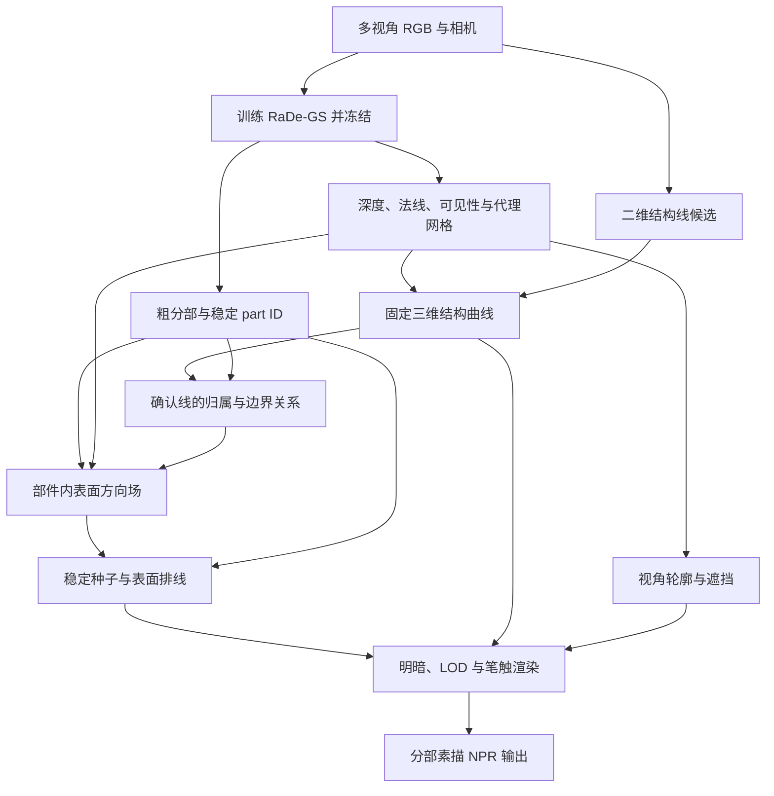

# 面向分部素描与排线的高斯物体表示：完整实验大纲

- **版本：** v1.0
- **整理日期：** 2026-10-20
- **目标效果：** 同一物体的不同部件采用不同素描／排线笔触，在旋转、缩放和局部编辑时保持可控、清晰和稳定。
- **输入：** 静态物体的多视角 RGB 图像、相机参数；第一阶段允许少量点击和人工分部修正。
- **主要基础：** RaDe-GS 表面重建、跨视角部件标签、少量结构曲线、表面排线生成。
- **当前状态：** 实验设计，尚未实现或运行。本文中的数量、参数、周期和验收阈值均为建议；不是已有实验结果或文献报告值。
- **核心原则：** 以最终分部 NPR 的质量与可用性决定模块取舍；通过受控实验验证贡献，不预设“线高斯”或“纯高斯实现”必然更好。

## 0. 执行摘要

项目要建立一个可以编辑的 NPR 物体资产：用户选择一个部件，改变其排线方向、疏密、长短、粗细或交叉方式，其他部件保持稳定；改变相机时，笔触附着于物体，并正确处理遮挡。

建议采用四类相互关联、职责清晰的表示：

1. **表面与部件层：** RaDe-GS 提供几何、深度和法线，附加跨视角固定的部件 ID。
2. **固定结构曲线层：** 表示真实棱边、接缝、实体圆环等需要长期保存的结构。
3. **视角轮廓层：** 根据当前相机生成光滑表面外轮廓和遮挡边界。
4. **生成排线层：** 沿部件内的表面方向场生成笔触，用于表达形体、明暗和风格。

**关键区别：结构线需要从图像与几何中恢复；排线主要由风格规则生成，通常不对应原始照片中的边缘。** 两者可以共享曲线或高斯渲染后端，但不能使用同一套“拟合照片边缘”的目标训练。

首版优先采用“冻结 RaDe-GS + 代理网格辅助附着 + 少量交互分部 + 显式笔触曲线”。线高斯作为可微优化／统一渲染的候选后端。逐高斯贡献追踪先作为困难结构线定位模块，待消融实验确认收益后再决定是否纳入主方法。

最小成果为：**一个台灯，灯罩、支杆、底座三个部件，三种排线配置，三个视频——旋转、缩放、单部件编辑。**

阅读导航：

- [任务与范围](#1-任务定义与范围)
- [研究假设与已有工作](#2-研究问题假设与贡献边界)
- [表示与坐标](#3-表示术语与数据契约)
- [总体流程](#4-总体-pipeline)
- [模块实现](#5-模块设计与实现顺序)
- [数据与标注](#6-数据与标注方案)
- [风格与交互协议](#7-风格与交互协议)
- [实验矩阵](#8-实验矩阵避免全因子组合)
- [指标定义](#9-指标与计算口径)
- [公平比较](#10-统计与公平比较)
- [阶段与验收](#11-阶段计划与验收门槛)
- [风险处理](#12-风险与处理)
- [实现工作包](#13-实现工作包)
- [复现记录](#14-配置记录与复现)
- [最终交付](#15-最终交付与论文叙事)
- [执行清单](#16-当前执行清单)
- [参考资料](#17-参考资料)

---

## 1. 任务定义与范围

### 1.1 目标能力

| 能力 | 用户可以完成的操作 | 成功表现 |
|---|---|---|
| 分部选择 | 选择灯罩、支杆、底座等区域 | 不同视角选择到同一个三维区域 |
| 局部笔触编辑 | 单独改变方向、间距、线宽、长度、交叉角度 | 修改局限在目标部件 |
| 形体表达 | 让排线沿轴向、周向或曲面方向排列 | 排线帮助理解表面形状 |
| 干净结构线 | 显示必要轮廓、棱边和接缝 | 少重影、少碎线、少错误连接 |
| 连续视角浏览 | 环绕和缩放观察 | 笔触不异常滑动、漂浮或闪烁 |
| 明暗调节 | 改变固定光照或目标色调 | 排线逐层增减，已有笔触尽量保持 |

### 1.2 首版范围

- 单个静态、刚性、不透明物体。
- 建议 3–8 个部件或风格区域；允许一个语义部件包含多个不连通实例，但必须明确其编辑规则。
- 已知或通过 SfM 获取的相机；相机精度作为前置诊断项。
- 先实现黑白素描／排线，白色背景和简单虚拟光照。
- 允许少量点击、区域合并和边界修正，记录人工成本。
- 可使用代理网格辅助表面邻接和笔触定位；并不要求所有中间表示均为高斯。
- 分部首先要求稳定区域 ID；自动生成“灯罩”等语义名称不属于首版必需能力。

### 1.3 后续范围

- 透明、半透明、强镜面或毛发物体。
- 可变形物体、关节运动、动画中的笔触迁移。
- 完全自动的开放类别部件识别。
- 自动从任意参考图片学习复杂铅笔、炭笔或版画风格。
- 曲线与 RaDe-GS 表面的联合几何优化。
- 完全不依赖网格的高斯表面方向场与笔触行走。

这些扩展分别设实验，不作为首版必须同时成功的条件。

## 2. 研究问题、假设与贡献边界

### 2.1 按优先级排列的研究假设

| 编号 | 假设 | 验证方式 | 不成立时的处理 |
|---|---|---|---|
| H1 | 稳定的三维部件归属和表面笔触锚定，能够改善局部编辑与视角稳定性 | 与逐视角二维分部／屏幕排线对比 | 检查附着、遮挡和标签质量，不能直接扩大模型 |
| H2 | 在粗分部、有噪声表面条件下，经过确认的结构线与部件边界关联能够减少排线越界、走向混乱和交界杂线 | 独立模块与关联模块对比；分割质量相同 | 保留较简单系统，不宣称联合约束有效 |
| H3 | 逐高斯贡献提供的局部深度／来源信息，可以改善困难区域的固定结构线定位 | 与普通深度、median、最大贡献深度比较 | 从主方法中移除，保留普通深度初始化 |
| H4 | 线高斯后端在相近笔触质量下具有速度、优化或统一表示方面的收益 | 与相同路径的抗锯齿曲线／带状笔触渲染比较 | 最终使用更适合的曲线渲染后端 |
| H5 | 可信结构线能够改善局部表面，并进一步改善排线 | 独立几何真值、留出视角与相同计算预算对比 | 不加入几何反馈闭环 |

H1 是系统有效性的基础；**H2 是当前最贴合应用的研究候选**；H3 是原始贡献追踪想法的独立验证；H4、H5 为后续问题。以上均不代表已经证明新颖。

### 2.2 已有工作的边界

| 工作 | 已经支持的能力 | 本项目如何使用 |
|---|---|---|
| [RaDe-GS][R1] | 高斯深度／法线渲染，以及深度融合提取表面 | 几何底座与代理网格来源 |
| [CurveGaussian][R2] | 参数曲线与沿曲线布置的高斯耦合，多视角边缘优化 | 固定结构曲线后端参考 |
| [SAGA][R3] | 多粒度、提示驱动的高斯分割 | 粗分部与交互选择组件 |
| [COB-GS][R4] | 识别、细分跨越边界的高斯，改善分割边界 | 边界问题的既有对照 |
| [StyleSplat][R5] | 对选定对象进行局部风格迁移，支持不同对象不同风格 | 局部风格化的相关工作；不直接等于显式排线基线 |
| [Illustrating Smooth Surfaces][R6] | 轮廓、可见性和表达形体的表面排线 | 排线方向与形体表达基础 |
| [Real-Time Hatching][R7] | 不同明暗、尺度之间保持笔触一致性的实时排线 | 嵌套笔触、明暗与 LOD 设计基础 |
| [SplaTAM][R8]、[MonoGS][R9] | 深度反投影初始化新高斯；包括已有 GS 渲染深度初始化 | 明确“深度 → 新高斯”本身已有 |
| [Coherent Stylized Silhouettes][R10] | 视角变化下风格化轮廓的连续性 | 将视角轮廓作为独立问题处理 |

不得单独宣称为创新：从深度创建高斯、为高斯附加部件标签、使用 Bézier 曲线、生成曲面排线、按明暗增减笔触、局部赋予风格、细分跨界高斯。

可以研究但仍需证明的方向：**有噪声重建与粗分部条件下，结构曲线、部件边界、方向场和笔触附着的具体关联机制，是否带来稳定且可解释的收益。**

本文是方案与相关组件核验，不是覆盖全部文献的排他性新颖性证明。正式投稿前必须围绕最终实现再做一次最近工作检索。

## 3. 表示、术语与数据契约

### 3.1 线的分类

| 类型 | 示例 | 是否保存为固定三维曲线 | 风格控制 |
|---|---|---|---|
| 固定几何结构线 | 棱边、接缝、杯口实体圆环 | 是 | 线宽、线色、重要性 |
| 视角轮廓 | 球体轮廓、圆柱可见侧边 | 不保存为跨视角不变的同一几何线 | 独立描边与时间对应 |
| 部件边界 | 材质区域或编辑区域交界 | 根据需求保存曲线或标签边界 | 可显示、隐藏、留白 |
| 装饰线 | 图案、文字、人工细节 | 可附着于表面 | 单独开关 |
| 生成排线 | 平行线、顺形弧线、交叉线 | 保存稳定笔触路径或可重建种子 | 方向、密度、长度、粗细 |
| 非结构图像边缘 | 阴影、高光、反射 | 默认不转成固定结构线 | 后续单独建模 |

固定圆环与球体轮廓不能混同。部件边界与几何锐边不能默认互相等价。

### 3.2 建议保存的实体

| 实体 | 必要字段 |
|---|---|
| 表面检查点 | 几何参数、相机、尺度、代码版本、训练配置、稳定快照 ID |
| 部件 | `part_id`、名称、实例／语义粒度、置信度、人工修正记录 |
| 固定结构曲线 | `curve_id`、类型、控制点、所属部件／相邻部件对、证据视角、置信度 |
| 表面锚点 | 代理网格三角形 ID＋重心坐标，或直接高斯方案的局部支持与附着坐标 |
| 排线笔触 | `stroke_id`、`part_id`、锚点／路径、方向层、层级优先级、随机种子 |
| 部件风格 | 主方向、间距、长度、线宽、交叉角度、曲率偏好、扰动强度、色调映射 |
| 贡献记录 | 视角、像素、快照 ID、Gaussian ID、逐像素深度、alpha、透射率、贡献权重 |

训练增密和剪枝可能改变高斯数组索引。第一阶段冻结几何并绑定快照；需要持续修改时再设计稳定 UID 或重新关联。数组索引不能直接当作永久部件或曲线身份。

### 3.3 坐标约定

明确存储深度是相机光轴深度 `z`，还是沿归一化视线的距离 `t`。如果世界到相机变换为：

\[
X_c=R_{cw}X_w+t_{cw},
\]

且 \(\tilde p=(u,v,1)^\mathsf{T}\)，则光轴深度的反投影为：

\[
X_w=R_{cw}^{\mathsf T}\left(zK^{-1}\tilde p-t_{cw}\right).
\]

若输入为射线距离，先使用归一化射线；不可把 `t` 直接代入上述 `z` 公式。相机坐标、世界坐标、归一化物体坐标和法线变换需集中实现并做一致性检查。

所有世界空间长度建议同时报告为“物体包围盒对角线的比例”；图像指标同时标明分辨率和像素单位。

## 4. 总体 Pipeline



纯文本顺序：**几何 → 部件／结构证据 → 方向场 → 表面笔触 → 可见性与风格渲染 → 连续视角与编辑评价。**

首版中的部件分割和结构曲线可独立完成，然后建立关联。不要要求先获得完整闭合线框才允许分部或渲染。

## 5. 模块设计与实现顺序

### 5.1 M0：重建与几何质量诊断

1. 用多视角 RGB 与相机训练 RaDe-GS；保存官方配置、实际修改和代码 commit。
2. 导出 RGB、alpha、深度、法线和必要的可靠性标记。
3. 检查前后景混合、薄结构、孔洞、相机误差和深度坐标定义。
4. 用训练视角深度融合生成代理网格，冻结此版本。
5. 为每个对象建立失败区域标签，避免后续笔触错误全部被误判为排线算法问题。

RaDe-GS 原论文提供深度经 TSDF 与 Marching Cubes 提取网格的路线；代理网格是已有工程基础，不是本项目的新贡献。[R1]

不得使用测试视角 RGB 优化几何或补洞。合成真值网格仅用于独立上限／诊断，不得偷偷替换实际重建网格。

### 5.2 M1：部件标签与风格区域

首版流程：

1. 在若干训练视角通过点击或掩码定义部件。
2. 统一跨视角 ID，允许合并／拆分并记录操作。
3. 用特征蒸馏、标签渲染或受可见性约束的投票向三维传播。
4. 输出每个高斯／表面采样点的标签分布及未知状态。
5. 为代理网格建立对应部件标签；投射与邻近转移必须检查遮挡、法线和表面距离。

如果高斯标签分布为 \(q_i(k)\)，可以用渲染权重构成像素标签预测：

\[
\hat q_v(k\mid p)=
\frac{\sum_i w_{vpi}q_i(k)}
{\sum_i w_{vpi}+\epsilon}.
\]

这是标签聚合模型，不能据此将权重解释为独立证据或经过校准的概率。低覆盖、跨部件混合位置保留未知状态，不强制归类。

邻域平滑只在可靠表面邻接内进行，避免把空间接近但表面分离的把手与杯身、薄片两侧合并。

实验保留三类标签输入：

- **人工／真值标签：** 诊断上限和隔离其他模块。
- **点击辅助标签：** 首版可用系统的主结果，报告点击与修正成本。
- **自动预测标签：** 后续自动化结果，单独报告，不与人工修正结果混合。

### 5.3 M2：结构线筛选与普通深度初始化

1. 从训练图像获得候选边缘及局部方向。
2. 综合跨视角支持、深度、法线、部件关系和可见性，区分固定结构与其他边缘。
3. 首先使用普通深度反投影；比较期望深度、有效 median 深度、最大贡献深度。
4. 按局部表面、部件关系和切向聚合点链，拟合线段、圆弧或 Bézier 曲线。
5. 优化重投影误差、方向、表面附着和简洁性，清理重复线与错误连接。
6. 保存曲线归属：部件内部结构线、共享边界、装饰线或未知。

约束原则：

- 不以“所有边缘都必须解释”为目标；只保留有用且有证据的结构。
- 交点和真实角点处允许方向不连续。
- 只有被确认属于同一结构的曲线才合并。
- 两侧部件共享边界只建立一个边界实体，避免双重描边。
- 原始图像中的纹理或阴影边缘不能自动变成几何棱边。

CurveGaussian 可用作参数曲线后端，但它并不直接提供分部排线、表面附着与尺度控制。[R2]

### 5.4 M3：逐高斯贡献追踪——作为可选研究模块

仅对候选结构线像素及其小范围邻域记录贡献，避免全图保存庞大列表。

记录：

\[
\mathcal T_{vp}=\{(\mathrm{id}_i,z_i,\alpha_i,T_i,w_i)\},
\qquad w_i=\alpha_iT_i.
\]

工程要求：

1. 在渲染器真正接受当前贡献的位置记录，沿用原有阈值、排序和提前终止逻辑。
2. 区分原始 Gaussian ID 和遍历序号。
3. 将逐高斯深度统一转换为本项目约定的深度坐标。
4. 校验贡献和与 alpha、加权深度与原渲染结果一致；输出 RGB 不应因记录而改变。
5. 记录截断策略和保留贡献比例；top-K 截断后的均值不能直接当作完整渲染深度。
6. 首版采用离线、非可微记录；曲线优化继续使用已有可微后端。

研究过程：

- 先查看贡献是否包含有用的额外几何信息。
- 按深度与局部表面关系形成少量候选，而不是把每个高斯都当一个独立真实表面。
- 通过其他视角的边缘、切向、部件关系和遮挡一致性选择候选。
- 使用“保留／拒绝／未知”，允许证据不足。

必须比较：最佳单深度方法、相同候选预算的扰动深度、多贡献候选，以及只作诊断的真值 oracle-best。

RaDe-GS 的逐高斯射线位置是密度最大位置的近似几何解释；它不保证是真实物理表面交点。渲染权重不是边缘存在概率，高斯协方差也不是重建不确定性。[R1]

该模块只影响固定结构线定位；不应同时改变分部、排线种子、风格参数和渲染预算。

### 5.5 M4：部件内的表面方向场

先提供简单、可控的方向方案：

- 轴向：支杆、椅腿等沿长轴。
- 周向：灯罩或杯身沿环绕方向。
- 局部引导：用户给少量方向线。
- 几何增强：从可靠曲面估计主曲率方向。

给定部件参考方向 \(a_k\) 和单位法线 \(n(x)\)，可以先投影到切平面：

\[
\tilde t(x)=a_k-(a_k^\mathsf Tn(x))n(x),\qquad
t(x)=\frac{\tilde t(x)}{\|\tilde t(x)\|}.
\]

当投影长度接近零时，使用备用方向或邻域传播，不能直接归一化。球面、近平面和曲率接近相等的位置，主方向可能不稳定，需要置信度与回退策略。

方向是无向线场：\(t\) 与 \(-t\) 等价。平滑时要考虑局部切平面的方向传递和正负等价，不能直接平均相反向量。

结构曲线可提供可选方向约束：

- 沿边界排线；
- 与边界保持设定夹角；
- 只作为停止边界，不约束方向。

具体规则由部件风格决定，不能强迫所有排线平行于结构线。不同部件之间不做无条件方向平滑。

### 5.6 M5：稳定种子、笔触生成与表面附着

**首版推荐：代理网格附着。**

1. 在各部件表面生成确定性的种子分布。
2. 沿方向场积分成短曲线，跨三角形追踪并保持在表面。
3. 达到长度、边界、曲率、间距或可靠性限制时停止。
4. 用三角形 ID＋重心坐标或等价表面坐标存储路径采样点。
5. 为笔触分配固定 ID、层级优先级和随机种子。
6. 对局部风格编辑复用未修改部件的笔触；需要重新生成时，明确哪些笔触身份发生变化。

几何代理如果被重新提取或重网格化，必须重新投射锚点并检查误差；原三角形索引不能继续直接使用。

**后续对照：直接高斯表面附着。**

建立局部支持面和受法线、距离、可见性约束的邻域图，再做方向传播与路径行走。重点检验薄结构跨面连接、浮点、高斯身份变化及累计漂移。空间 KNN 不等于表面邻接。

### 5.7 M6：明暗与排线密度

首版使用稳定法线和简单虚拟光照，例如：

\[
b(x)=\operatorname{clamp}\left(a+(1-a)\max(0,n(x)^\mathsf T\ell),0,1\right),
\qquad \tau(x)=1-b(x).
\]

\(\tau\) 为目标暗度。材质底色、真实阴影与镜面反射暂时分开处理。

明暗控制优先采用稳定笔触集合中的分层选择：

- 浅色：基础层少量排线。
- 中间色：增加同方向笔触或长度。
- 暗部：增加第二方向交叉排线。

笔触集合在暗度增加时尽量嵌套，避免整片区域重新采样。必要时对笔触的局部可见区段做平滑控制，但记录区段变化，避免形成高频开关。

笔触层级与相机缩放的细节层级分别管理。明暗变化不能通过任意改变三维锚点实现。Tonal Art Maps 可作为已有基线或设计参考。[R7]

### 5.8 M7：渲染、遮挡与尺度控制

建议先实现抗锯齿曲线／带状笔触后端，再加入线高斯后端。

| 问题 | 首版策略 |
|---|---|
| 遮挡 | 使用实际重建表面深度判断，并对不可靠区域保留诊断标记 |
| 自遮挡与深度冲突 | 采用受控深度容差或细小偏移，并测试是否产生漂浮 |
| 线宽 | 三维路径固定，线宽按屏幕像素控制 |
| 缩放 | 使用共享笔触子集的 LOD，加平滑过渡 |
| 手绘扰动 | 绑定笔触 ID 与物体坐标，不按帧重新随机 |
| 交叉排线 | 独立方向层，控制叠加暗度 |
| 结构描边 | 与排线分层合成，共享边界去重 |
| 视角轮廓 | 从当前视角生成，必要时做轮廓路径跟踪 |

直接使用固定协方差的三维线高斯，不会自动得到恒定屏幕线宽；多层 alpha 叠加也可能导致过黑和软边。比较后端时，应匹配实际线宽、笔触路径、目标暗度与抗锯齿质量。

固定表面深度、相机和覆盖阈值后再比较遮挡算法。禁止通过让笔触大幅浮出表面来“解决”遮挡错误。

### 5.9 M8：结构线—部件—排线关联

该模块是 H2 的主要候选，首版只采用可解释的约束：

1. **归属约束：** 笔触属于一个稳定部件，共享结构线保存相邻部件对。
2. **停止／留白约束：** 在确认的部件边界终止笔触，或留出可调空白带。
3. **方向约束：** 仅在风格需要时，由可信曲线引导局部排线方向。
4. **边界修正：** 仅在粗掩码、局部结构证据与多视角关系支持时调整区域交界。
5. **置信度处理：** 未确认的结构线只用于可视化或弱约束，不强制切开部件。

必须区分两种结果：

- **笔触裁剪改善：** 只改变渲染／排线范围，原分割没有改变。
- **分割边界改善：** 真实改变部件标签，并在独立标签真值上验证。

前者不能写成后者。内部几何棱边不能自动作为部件分界。

### 5.10 M9：可选的表面反馈

仅在固定表面系统已经可用且误差可归因于局部几何时开展：

1. 用独立多视角证据确认结构曲线比当前表面更可靠。
2. 固定可信曲线，局部更新对应表面，而不是把整片高斯中心拉到线上。
3. 重新验证几何、标签、锚点和 NPR 图像。
4. 与相同预算的继续训练、普通二维边缘约束进行比较。

“由表面生成线，再让同一表面靠近该线”本身不能产生新证据。反馈收益必须由独立真值或留出视角支持。

## 6. 数据与标注方案

### 6.1 数据规模

| 阶段 | 建议规模 | 用途 |
|---|---|---|
| 调试 | 平面、圆柱、球面等解析形状 | 坐标、附着、方向场与遮挡正确性 |
| MVP | 1 个三部件台灯 | 打通编辑与三个视频 |
| 预实验 | 3 个合成＋3 个真实物体 | 确认主要失败类型，固定评价协议 |
| 正式实验 | 建议扩展到 12 个合成＋6 个真实物体 | 跨对象比较和分组报告 |

这些是建议规模，尚未收集资产。正式实验规模应根据预实验的对象间方差与可用资源确定。

### 6.2 对象覆盖

- 硬边、多部件：台灯、椅子、小家电。
- 曲面、圆环、孔洞：带把手杯、环形物体。
- 细杆、薄片、邻近表面：支架、椅背、灯罩。
- 弱几何部件边界：玩具的不同区域、同一曲面上的风格区域。
- 纹理与阴影干扰：有图案但几何简单的对象。

第一批应包含纹理稀少对象，便于定位几何问题；随后逐步加入纹理干扰，而不是只选择最容易的白色模型。

### 6.3 合成数据

推荐用自建或许可明确的参数化模型，保存部件 ID、网格、相机、深度、法线及固定结构线真值。结构线真值是人为确认的功能／形体线，不是三角网格所有边。

可复现的初始相机方案：

- 图像：1024×1024。
- 训练：三个仰角，各 12 个方位，共 36 张。
- 验证：相同仰角，使用与训练不同的 4 个方位，共 12 张。
- 测试：相同仰角，使用与训练、验证不同的 24 个方位，共 72 张。
- 另增加未训练仰角的转台轨迹和缩放轨迹。

例如训练方位为 \(30m^\circ\)，验证为 \(7.5^\circ+90m^\circ\)，测试为 \(3.75^\circ+15m^\circ\)，并在脚本中断言三者不重合。仰角和距离存入配置；避免每种方法自行选择视角。

离散留出视角用于定量测试；连续轨迹用于时序评价。轨迹可能靠近训练视角，需分别报告近视角插值与更大视角变化，不宣称所有帧都具有相同外推难度。

### 6.4 真实数据

- 建议每个对象采集约 80–120 张多视角图像，实际数量按遮挡覆盖调整。
- 划分训练、验证、测试视角，避免仅随机抽取高度相邻视频帧。
- 允许 SfM 为完整采集估计相机，但须披露是否使用了测试图像估计位姿；测试 RGB 不进入几何、标签或风格优化。
- 标注少量测试视角的部件掩码、应显示结构线、遮挡关系和明显失败区域。
- 独立记录人工标注与纠正时间；人工修正仅可作用于训练证据。
- 没有真实三维真值时，不能声称获得绝对表面附着精度；使用多视角人工核验与图像指标补充。

### 6.5 标签与线的标注规则

1. 在实验前定义部件粒度，同一对象各方法使用同一规则。
2. 区分部件实例与语义类别，例如四条椅腿是否可独立编辑。
3. 对共享边界记录相邻部件对。
4. 标注“必须显示”“可选细节”“不应作为结构线”三类线。
5. 保存不确定标签与遮挡区，不强行填补不可见信息。
6. 预实验后锁定测试标注，禁止看到方法输出后随意修改真值。

## 7. 风格与交互协议

### 7.1 首版笔触配置

| 配置 | 特征 | 用途 |
|---|---|---|
| S1 长疏平行排线 | 单方向、较长、较大间距 | 支杆、椅腿等轴向形体 |
| S2 顺形弧线 | 随表面方向弯曲、连续性较高 | 灯罩、杯身 |
| S3 短交叉排线 | 两个方向、短笔触、较高暗度 | 底座或需要强调的部件 |

各风格参数以配置保存；不同对象可调整，但同一对象的方法比较必须共用同一配置。复杂铅笔纹理放在几何与稳定性实验之后。

### 7.2 标准编辑任务

每个对象至少进行：

1. 只修改一个部件的排线角度。
2. 只修改一个部件的线宽或间距。
3. 交换两个部件的笔触配置。
4. 开关某个部件的内部结构线。
5. 调整全局光照，观察密度变化。

每次编辑保持相机、其他部件配置和随机种子固定，记录编辑耗时、重生成范围与外部影响。

### 7.3 标准视频

- **转台：** 360°，建议 360 帧，固定光照与笔触配置。
- **缩放：** 沿固定方向靠近／远离，建议 180 帧。
- **编辑：** 固定相机，展示单部件调整；需要时补充编辑后转台。
- **光照：** 固定相机、缓慢改变光照，检查密度层切换。

所有方法共用轨迹、帧率、背景、分辨率及曝光。帧数为建议，不是最低论文要求。

## 8. 实验矩阵：避免全因子组合

### 8.1 系统递进比较

| 编号 | 系统 | 主要问题 |
|---|---|---|
| B0 | 每视角二维掩码＋屏幕空间排线 | 简单二维方案的上限与稳定性问题 |
| B1 | 固定三维部件＋代理表面附着排线 | 三维身份与表面附着的收益 |
| B2 | B1＋普通深度初始化的固定结构曲线 | 结构线对可读性与编辑的价值 |
| B3 | B2＋结构线、部件边界和方向场关联 | H2：关联机制是否有效 |
| B4 | B3＋逐高斯贡献辅助结构线定位 | H3：额外几何信息是否有用 |

逐视角二维基线本身并不等价于最佳传统 NPR 方法；必须另有下面的三维强基线。

先用可靠标签隔离笔触与结构模块，再在预测／点击辅助标签下重复最终方法与 B1 的直接比较。每张结果表明确标注几何来源、标签来源、方向来源及人工干预。不能只用真值标签完成消融，再将其改善归入自动系统。

### 8.2 三维强基线与上限

- **同一重建代理网格＋传统表面排线：** 尽可能匹配方向、色调、线宽与 LOD，检验新关联机制相对成熟表面方法的收益。
- **合成真值网格＋真值部件：** 几何与分部的诊断上限，单独标注，不能与实际重建主结果混合。
- **相同曲线路径的曲线渲染／线高斯渲染：** 只测试后端，不重新拟合不同笔触。

StyleSplat 是局部风格化相关工作；如果输出不是同类显式排线，不应直接用一个图像指标决定其“优劣”，也不应替代传统排线强基线。

### 8.3 分阶段消融

| 实验族 | 固定因素 | 改变因素 |
|---|---|---|
| A：分部 | 几何、方向规则、种子、渲染 | 人工／GT、点击辅助、自动预测 |
| B：关联 | 同一粗分部、结构线、几何、风格 | 无关联／只边界停止／再加方向引导 |
| C：结构线深度 | 同一部件、边缘、优化器与预算 | expected／有效 median／max-weight／贡献候选 |
| D：附着载体 | 同一重建来源、部件、目标风格 | 代理网格／直接高斯表面 |
| E：尺度与明暗 | 同一笔触路径、数量上限与轨迹 | 无 LOD／独立重采样／嵌套 LOD 与平滑切换 |
| F：渲染后端 | 同一路径、线宽、目标暗度 | 抗锯齿曲线／线高斯 |

执行顺序为 A 的上限设置 → B → A 的预测标签 → C → D/E/F 中出现实际瓶颈的项目。不要一次跑完整笛卡尔积。

如果关联机制与分部质量存在明显交互，再追加“可靠／粗分部 × 有／无关联”的 2×2 消融。

自动方向场另做手动方向→自动方向的单独替换，不与自动分部同时首次启用。附着载体比较尽可能共用最终笔触表示和渲染器；无法共用时标为整套系统比较，不能把全部差异归因于附着载体。

### 8.4 贡献追踪的特殊诊断

1. 用独立真值判断多候选中是否存在更准确位置。
2. 对比最佳单深度和相同数量的扰动候选。
3. oracle-best 只报告为候选覆盖上限，不作为可用方法成绩。
4. 上限没有改善时，停止复杂消歧开发。
5. 上限改善而实际选择不改善时，定位对应与选择问题。
6. 初始化改善但最终曲线无改善时，进一步测收敛速度和稀疏视角；不能声称提升最终质量。

## 9. 指标与计算口径

### 9.1 部件与边界

- **部件 mIoU：** 固定部件 ID 对应关系，按对象汇总。
- **边界 F1：** 在固定像素容差下比较预测与真值边界；建议报告 1、2、4 px 三档，分辨率为 1024。
- **人工成本：** 点击数、修正次数、总分钟数和无法纠正区域。

如果部件没有自动语义名称，采用一次固定的实例匹配；不能逐帧重新匹配标签以掩盖 ID 跳变。

### 9.2 局部编辑泄漏

同一视角编辑前后图像为 \(I_0,I_1\)，归一化到相同色彩范围，定义：

\[
\Delta(p)=\|I_1(p)-I_0(p)\|_1,\qquad
L_{\mathrm{out}}=
\frac{\sum_{p\notin M_k}\Delta(p)}
{\sum_p\Delta(p)+\epsilon}.
\]

\(M_k\) 使用独立目标部件掩码。同时报告目标区域内的变化量，防止“没有执行编辑”得到低泄漏。

分开报告：

- 目标边界附近的窄带；
- 远离边界的其他部件；
- 背景。

边界抗锯齿带的宽度固定并公开；不能通过不断扩大容差隐藏越界。

### 9.3 排线越界与边界缺口

- **越界率：** 笔触可见采样长度中，属于其他部件的长度比例。
- **边界空白误差：** 实际笔触终止位置与指定留白带的偏差。
- **边界杂线：** 共享边界附近的重复描边、异常短线和交叉事件。

标签真值不足时，图像越界率与少量人工核验并列报告。已知部件颜色差异不是可靠的全部真值来源。

### 9.4 表面附着

合成数据上，对笔触采样点 \(x_j\) 和独立真值表面 \(S^\ast\)：

\[
E_{\mathrm{attach}}=
\frac{1}{N}\sum_j d(x_j,S^\ast).
\]

同时报告中位数、P95 和相对于对象尺度的误差。薄结构处补充法线方向与正确表面分支检查，因为最近距离可能落到错误一侧。

相对于自身代理网格的距离只能证明实现满足附着约束，不能证明重建位置正确。

### 9.5 连续视角稳定性

分开测三类变化：

1. **持续可见的固定笔触：** 用独立深度／表面对应将中心线投影到相邻视角，测量渲染中心线的对齐误差。
2. **预期持续显示的笔触：** 统计没有遮挡变化、没有计划 LOD 切换时的异常消失／重现。
3. **计划 LOD 或明暗切换：** 单独测切换区间的突变和拖影。

合成数据优先使用真值几何定义共同可见区域；真实数据使用可靠几何与人工抽查，并说明误差来源。

外轮廓不使用“固定三维笔触不动”的标准，应与当前视角轮廓参考比较。真实遮挡和正常轮廓移动不计作抖动。

仅检查存储锚点坐标不变会得到近乎平凡的好结果；主指标必须包含实际渲染输出。只用当前估计表面同时生成和评估对应，可能掩盖错误，应报告这一限制。

所有稳定性指标同时报告有效样本／可见长度覆盖比例，避免通过大量排除困难区域降低误差。

### 9.6 方向、明暗与线条质量

- **方向误差：** 先把参考切向投影到图像，计算无向夹角；可使用 \(1-|\hat t^\mathsf Tt^\ast|\)。投影退化区域单独排除并报告。
- **暗度误差：** 在固定滤波尺度下比较局部墨量与目标暗度，同时检查部件之间是否保留风格差异。
- **结构线精度／覆盖率：** 对人为确认的应显示结构线评估；生成排线不拿原图边缘作真值。
- **重复、碎线和错连：** 采用固定距离、方向、长度阈值统计；保留典型失败图。
- **几何简洁度：** 曲线数、笔触数、平均长度、可见墨量与控制点数。

评价干净度时必须同时报告覆盖率与目标暗度，防止用“少画／不画”获得好成绩。

合成固定结构线可进一步按统一弧长间距采样。设预测点集为 \(P\)，真值为 \(G\)，对象尺度为 \(L\)，则：

\[
\operatorname{Precision}_{\tau}
=\frac{|\{p\in P:d(p,G)<\tau\}|}{|P|},
\qquad
\operatorname{Recall}_{\tau}
=\frac{|\{g\in G:d(g,P)<\tau\}|}{|G|}.
\]

报告多个固定的 \(\tau/L\) 阈值，以及双向距离。线宽不能用于扩大几何匹配容差；空预测的 precision／recall 处理规则须统一，不能记成完美成绩。

### 9.7 效率与用户评价

- 预处理、几何训练、分部、结构线优化、笔触生成分别计时。
- 报告渲染帧时间的中位数和 P95、显存峰值、分辨率、GPU 与笔触数量。
- 编辑延迟包含需要的重生成，不能只记录 UI 参数赋值。
- 首版可做小规模成对偏好评价：形体可读性、干净度、部件风格区分、动画稳定性。
- 评价展示顺序随机化，视频长度与播放速度统一；不只选最好帧。

## 10. 统计与公平比较

1. 所有方法共用相机、训练图像、分部粒度和测试视角。
2. 方法比较使用相同边缘输入、方向目标、笔触预算、风格配置与输出分辨率。
3. 比较线高斯与其他后端时匹配实际墨量和线宽，不能只匹配基元数量。
4. 固定训练／优化预算；同时报告达到相同质量的耗时，可另列质量—成本曲线。
5. 对有随机性的核心比较建议使用 3 个种子；昂贵重建先固定检查点，关键结论再跨检查点复核。
6. 统计以对象为单位；不要把同一对象的数百帧当作数百个独立样本。
7. 正式实验报告每对象结果、总体中位数或均值及对象级区间；小样本预实验主要描述趋势，不夸大显著性。
8. 分类报告硬边、曲面、薄结构、弱分部边界和纹理干扰。
9. 人工分部、人工方向和人工删除曲线必须公开，并对各方法给相同预算。
10. 风格与阈值只在验证集调整，测试集锁定。

## 11. 阶段计划与验收门槛

### 11.1 里程碑

| 阶段 | 内容 | 交付物 | 进入下一阶段的依据 |
|---|---|---|---|
| P0 | 环境、数据与解析形状调试 | 坐标／深度检查、基础曲面笔触 | 没有系统性坐标和遮挡错误 |
| P1 | 单对象分部排线 MVP | 台灯三个部件＋三个视频 | 编辑局部、笔触可附着、能完成展示 |
| P2 | 结构线与关联 | B1/B2/B3 对照、失败分类 | 新模块有可测价值或被明确移除 |
| P3 | 粗分部与真实对象 | 3 合成＋3 真实预实验 | 主要失败来源与参数协议明确 |
| P4 | 贡献追踪与后端消融 | C 族及必要的 D/E/F 实验 | 确认最终主方法的必要模块 |
| P5 | 正式评价 | 汇总表、连续视频、消融与失败案例 | 结果可复现且结论与证据一致 |

推荐工程顺序是先 P1，再研究 P2/P4；不要等到完成所有曲线研究才开始看 NPR 视频。

### 11.2 建议的预实验门槛

下表仅作为初始工程目标。应在预实验结束后一次性修订并冻结，不能在看到正式测试结果后改变。

| 项目 | 建议目标 | 说明 |
|---|---|---|
| 贡献记录一致性 | 不改变 RGB；alpha／深度误差与原实现浮点误差量级相符 | 容差按精度与尺度确定，不能随意忽略偏差 |
| 非目标部件编辑泄漏 | 远离边界的泄漏墨量占比不高于约 2% | 同时报目标编辑强度与边界带结果 |
| 持续可见笔触位置抖动 | 1024 分辨率下 P95 约 1.5 px 以内 | 排除真实遮挡和计划 LOD，使用实际输出 |
| 固定几何下附着 | 相对代理面的误差接近数值容差 | 另报相对真值表面的误差 |
| 交互显示 | 1024 分辨率争取达到 24 FPS | 需指定 GPU；当前不是性能承诺 |
| 可操作性 | 三个标准编辑任务均可完成 | 记录人工修正、等待时间与失败 |

研究继续门槛不只看固定阈值，还看新增模块的增益：

- H2：在相同粗分部下，多数测试对象越界／杂线改善，且暗度、覆盖率和稳定性没有明显退化。
- H3：候选上限与实际选择都显示相对最佳单深度的收益；仅 oracle 改善不足以成立。
- H4：同等视觉质量下，渲染或优化收益能够抵消基元数量和管理成本。
- H5：独立几何或留出视角改善，不能只有训练损失下降。

### 11.3 资源与周期

建议按 **6–10 周的单人研发窗口**规划，但这只是工作量安排，不是已估算的训练时长：

- 第 1–2 周：P0/P1，几何、部件、基础表面排线。
- 第 3–4 周：结构线、遮挡、方向与边界关联。
- 第 5–6 周：真实对象、稳定性与主要消融。
- 后续 2–4 周：按结果决定贡献追踪、直接高斯路线与正式评测。

正式排期前记录 GPU、显存、已有代码、数据可用性和人员分工。每阶段先测一个对象的时间／显存，再外推预算；预算中同时包含失败重跑与视频输出。

## 12. 风险与处理

| 风险 | 可观察症状 | 首选处理 |
|---|---|---|
| 相机或深度错误 | 所有笔触系统性滑动、双层结构 | 先修几何与坐标，不加排线损失掩盖 |
| 高斯跨部件覆盖 | 标签看似正确但风格串入邻区 | 分析边界贡献；比较标签修正与局部细分 |
| 代理网格抹掉薄结构 | 杯柄、灯罩边缘缺失 | 检查融合参数；局部保留或回退高斯支撑 |
| 直接高斯邻域跨面 | 笔触跳到另一侧表面 | 增加法线／可见性／局部连通约束 |
| 方向场退化 | 球面或近平面方向跳变 | 部件主轴、人工引导与低置信度回退 |
| 曲线被误当部件边界 | 物体被过度切分、笔触断裂 | 显式分类线的角色，只有确认边界能切分 |
| 纯屏幕排线 | 纹理像贴在屏幕上 | 稳定物体空间锚点，单独控制屏幕线宽 |
| 每帧重采样 | 闪烁、随机噪声 | 固定种子与笔触 ID，使用嵌套集合 |
| 线高斯叠加过黑 | 暗部糊成块、边缘模糊 | 校准墨量、减少重叠，并比较曲线后端 |
| 硬 LOD 切换 | 缩放时笔触跳变 | 共享子集、连续过渡，记录计划切换 |
| 表面与曲线相互确认错误 | 训练更好但测试更差 | 保持独立证据与真值，推迟几何反馈 |
| 方法堆叠掩盖贡献 | 系统提升但无法解释来源 | 分阶段单因素消融，移除无收益模块 |

## 13. 实现工作包

| 工作包 | 必要工作 | 首版优先级 |
|---|---|---|
| W1 数据与几何 | 相机、RaDe-GS、深度法线导出、代理网格 | 必须 |
| W2 分部与交互 | 标签身份、掩码传播、修正记录、风格区域 | 必须 |
| W3 表面笔触 | 方向场、种子、路径积分、锚点与停止规则 | 必须 |
| W4 NPR 渲染 | 线宽、抗锯齿、明暗、遮挡、LOD | 必须 |
| W5 结构曲线 | 边缘筛选、普通深度初始化、曲线拟合和归属 | 第二阶段 |
| W6 关联机制 | 部件边界、方向引导、去重与局部编辑约束 | 主要研究 |
| W7 贡献追踪 | 稀疏记录、候选分析、跨视角选择 | 可选研究 |
| W8 后端扩展 | 线高斯与直接高斯表面附着 | 可选 |
| W9 评价 | 固定轨迹、指标、统计、图表、失败案例 | 从首版开始 |

团队协作时，W1/W2 与 W3/W4 可以在数据契约固定后并行；W7 必须依赖可用的普通深度基线。

## 14. 配置、记录与复现

### 14.1 建议的实验目录

```text
project/
  configs/                 # 几何、部件、笔触、渲染和评测配置
  data_manifest/           # 来源、许可、划分与标注规则
  checkpoints/             # 固定几何与标签版本
  surfaces/                # 重建代理与独立真值，明确区分
  parts/                   # ID、标签置信度与修正记录
  curves/                  # 固定结构曲线
  strokes/                 # 排线种子、路径与样式
  traces/                  # 可选逐高斯贡献记录
  renders/                 # 测试图与四类视频
  metrics/                 # 每视角、每对象与汇总结果
  reports/                 # 图表、失败案例、配置差异与结论
```

这是建议的未来实现结构；本文交付不表示这些目录或实验已经建立。

### 14.2 每次实验的必填记录

- 实验 ID、日期、负责人、代码 commit、依赖与硬件。
- 对象 ID、数据版本、训练／验证／测试划分。
- RaDe-GS 检查点、表面提取配置、坐标与单位。
- 部件来源、粒度、点击与修正量。
- 结构线来源、深度方法、候选数和优化预算。
- 笔触种子、方向场版本、风格配置、LOD、遮挡与后端。
- 高斯数、结构曲线数、笔触数、渲染基元数。
- 阶段时间、帧时间、显存、失败和人工干预。
- 输出图像、视频和原始指标位置。

### 14.3 必须做的一致性检查

1. 已知相机与解析平面下，投影—反投影往返一致。
2. 深度图、代理网格和高斯模型在同一坐标系中重合。
3. 法线朝向和方向场在简单曲面上符合预期。
4. 固定种子多次生成得到相同笔触。
5. 编辑一个部件时，其他部件的参数与笔触身份保持一致。
6. 贡献记录与原渲染的 alpha／深度一致。
7. 已知遮挡测试中，前后关系正确；轮廓边界单独检查。
8. 指标对人为加入的漂移、越界和闪烁能够响应。

这些检查用于验证几何和指标正确性；无需为文档格式或简单配置变更编写重复测试。

## 15. 最终交付与论文叙事

### 15.1 系统交付

- 可加载同一物体并选择部件。
- 可调整各部件方向、间距、长度、粗细、交叉层与手绘扰动。
- 可开关外轮廓、结构线和部件分界线。
- 可导出固定相机图片、转台、缩放、编辑与光照视频。
- 保存完整配置，能够复现同一组笔触与输出。

### 15.2 实验交付

- 主方法与三维强基线比较。
- 部件质量、关联机制及贡献追踪的独立消融。
- 正确性、编辑泄漏、越界、附着、稳定性与效率指标。
- 全部对象逐项结果，而非只有精选示例。
- 失败分类与适用范围。
- 人工成本与自动化程度说明。
- 最终方法中每个模块的必要性说明。

### 15.3 推荐论文主线

> 多视角重建提供近似表面，粗分部提供可编辑区域，但二者的边界与几何误差会导致排线越界、方向混乱和视角不稳定。本项目研究如何通过部件、结构曲线与表面笔触的关联，构建可控且稳定的分部素描表示。

论文贡献应根据结果收敛：

- H2 成立：围绕具体关联机制、问题诊断与 NPR 改善组织。
- H3 也成立：将贡献追踪作为解决困难结构定位的独立技术点。
- 只有系统集成有效：按工具、系统或应用工作准确定位。
- 只有后端性能有优势：围绕速度／质量取舍定位，不夸大几何创新。

不建议预先将“首次从深度创建线高斯”“首次局部风格化”写入标题或摘要。

## 16. 当前执行清单

- [ ] 确认 GPU、已有 RaDe-GS 代码与可用数据。
- [ ] 选择一个三部件台灯，明确标签粒度。
- [ ] 固定图像、相机与数据划分。
- [ ] 完成 RaDe-GS 深度／法线与代理网格。
- [ ] 完成少量点击辅助分部，保存固定 ID。
- [ ] 手动指定三种部件方向，生成稳定表面笔触。
- [ ] 完成曲线笔触渲染、遮挡与屏幕线宽。
- [ ] 输出转台、缩放和单部件编辑视频。
- [ ] 检查附着、越界和帧间变化，建立首轮指标。
- [ ] 加入普通深度初始化的固定结构曲线。
- [ ] 比较有无结构线—部件—笔触关联。
- [ ] 扩展预实验对象并冻结参数与评价规则。
- [ ] 根据失败类型决定是否开发逐高斯贡献追踪。
- [ ] 根据质量与成本决定最终渲染后端。
- [ ] 扩展正式数据，完成消融、统计和失败分析。

## 17. 参考资料

以下以原始论文、作者项目页或官方实现为主。引用用于说明已有模块和技术边界；本文提出的实验数量、公式化评价口径和验收阈值是本项目的设计建议。

1. **RaDe-GS: Rasterizing Depth in Gaussian Splatting.** [项目][R1] · [论文](https://arxiv.org/html/2406.01467) · [官方代码](https://github.com/HKUST-SAIL/RaDe-GS)。关注深度／法线定义与表面提取。
2. **Curve-Aware Gaussian Splatting for 3D Parametric Curve Reconstruction.** ICCV 2025. [项目][R2] · [论文](https://arxiv.org/abs/2506.21401)。关注曲线与高斯耦合及拓扑操作。
3. **Segment Any 3D Gaussians（SAGA）.** [项目][R3] · [论文](https://arxiv.org/abs/2312.00860) · [代码](https://github.com/Jumpat/SegAnyGAussians)。关注多粒度交互分割。
4. **COB-GS: Clear Object Boundaries in 3DGS Segmentation Based on Boundary-Adaptive Gaussian Splitting.** CVPR 2025. [项目][R4]。关注高斯跨边界与局部细分。
5. **StyleSplat: 3D Object Style Transfer with Gaussian Splatting.** [论文][R5] · [项目](https://bernard0047.github.io/stylesplat/)。关注局部对象风格化，避免混同于显式表面排线。
6. **Illustrating Smooth Surfaces.** SIGGRAPH 2000. [作者页面][R6]。关注轮廓、可见性与形体排线。
7. **Real-Time Hatching.** SIGGRAPH 2001. [作者页面][R7]。关注 tonal art maps、表面参数化和明暗／尺度一致性。
8. **SplaTAM: Splat, Track & Map 3D Gaussians for Dense RGB-D SLAM.** CVPR 2024. [论文][R8]，§3 Initialization。明确深度反投影创建新高斯的先例。
9. **Gaussian Splatting SLAM（MonoGS）.** CVPR 2024. [论文][R9]，§3.3.2。明确利用当前高斯场景渲染深度初始化新高斯的先例。
10. **Coherent Stylized Silhouettes.** SIGGRAPH 2003. [作者页面][R10]。关注随视角变化的轮廓与时间一致性。

[R1]: https://baowenz.github.io/radegs/
[R2]: https://zhirui-gao.github.io/CurveGaussian/
[R3]: https://jumpat.github.io/SAGA/
[R4]: https://cob-gs.github.io/
[R5]: https://arxiv.org/html/2407.09473
[R6]: https://mrl.cs.nyu.edu/publications/illustrating-smooth/
[R7]: https://hhoppe.com/proj/hatching/
[R8]: https://arxiv.org/html/2312.02126v2
[R9]: https://arxiv.org/html/2312.06741
[R10]: https://gfx.cs.princeton.edu/pubs/Kalnins_2003_CSS/index.php
