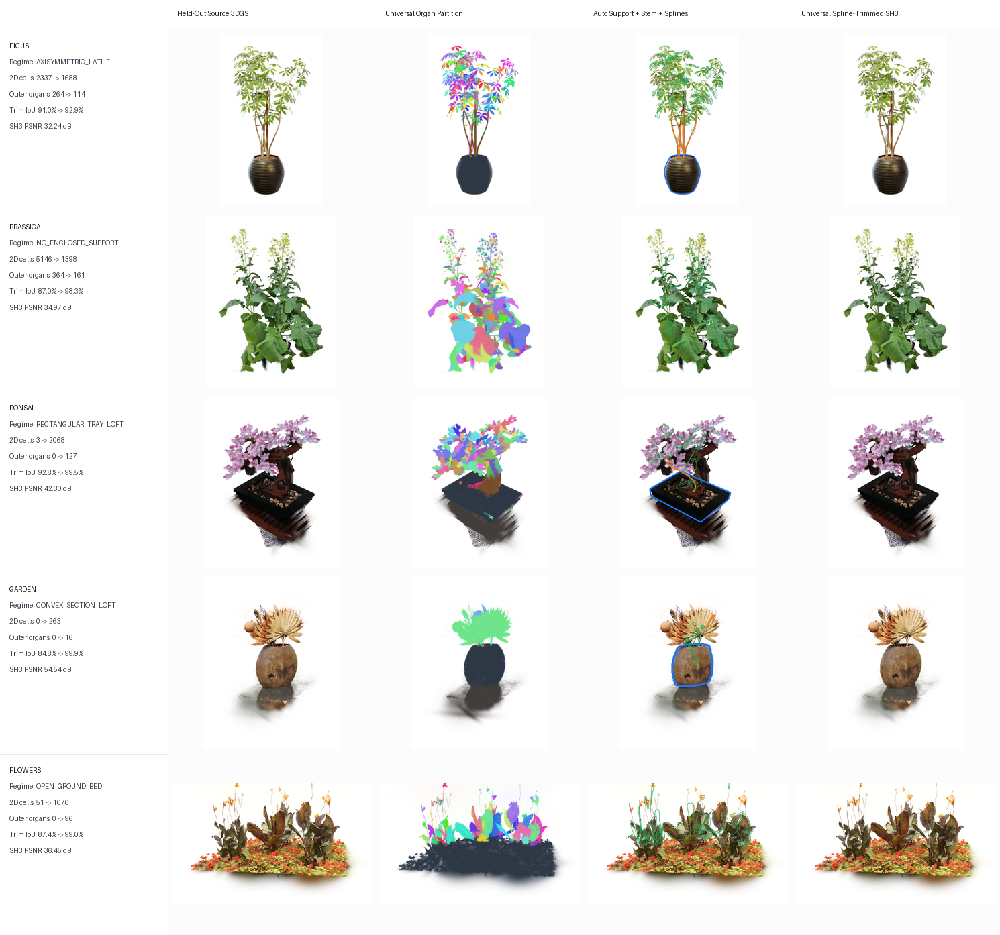
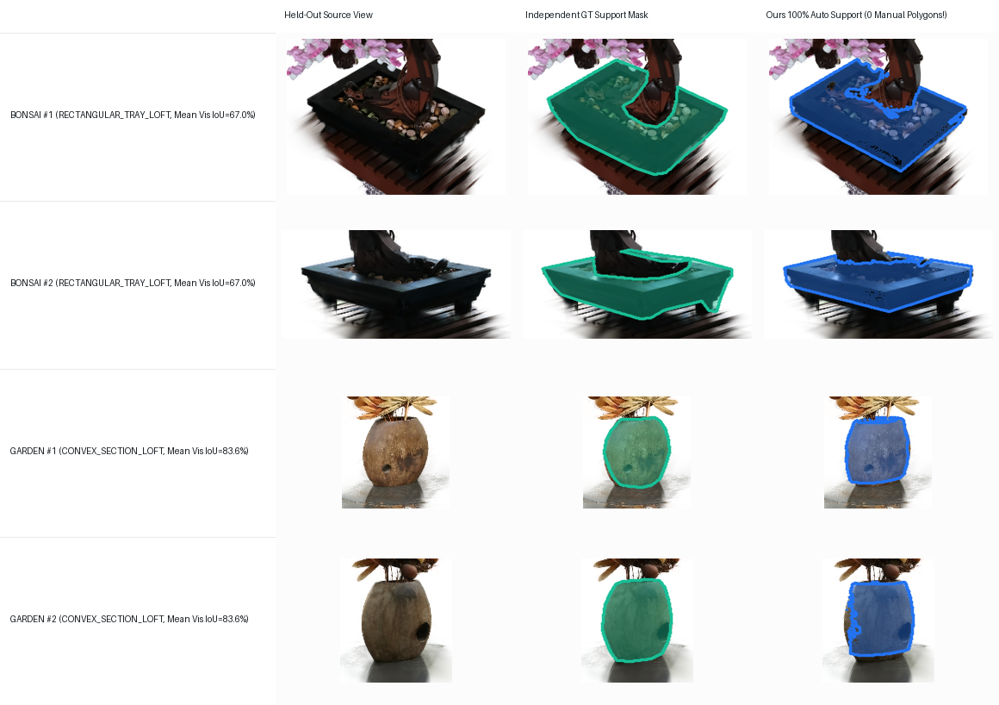
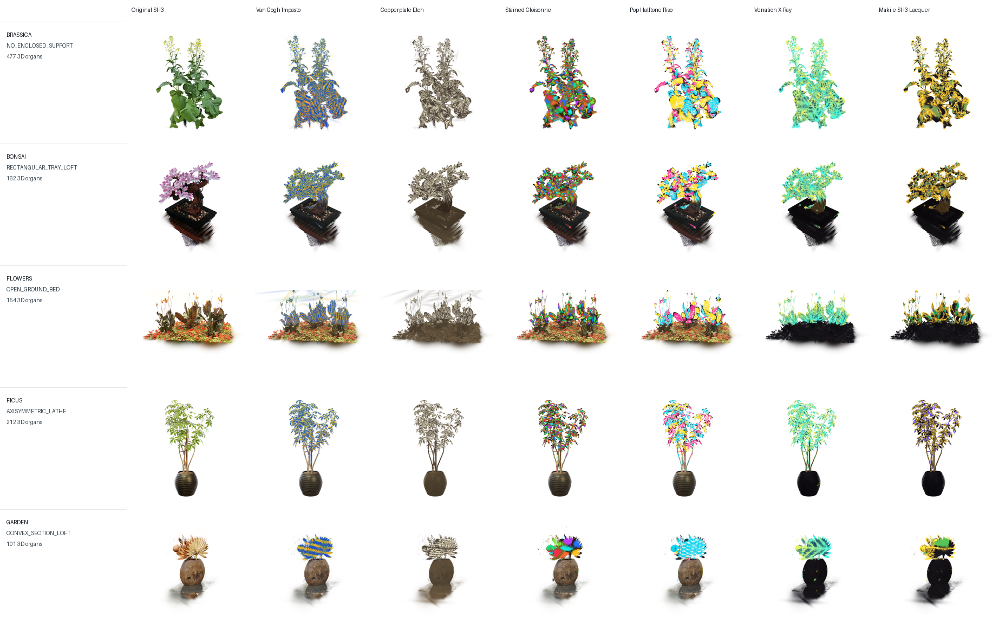
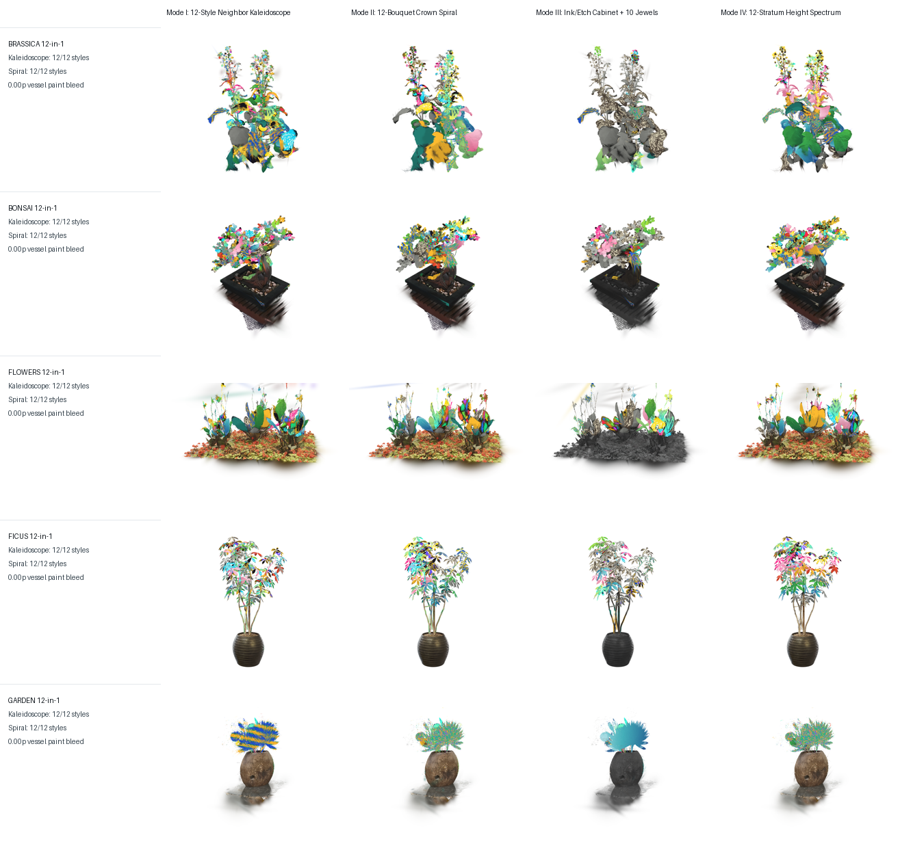
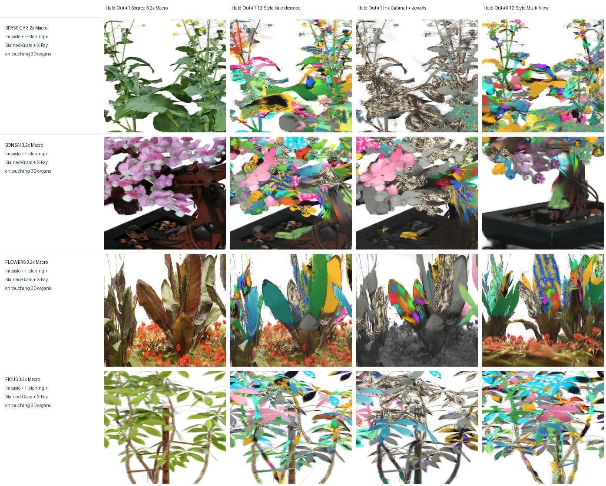
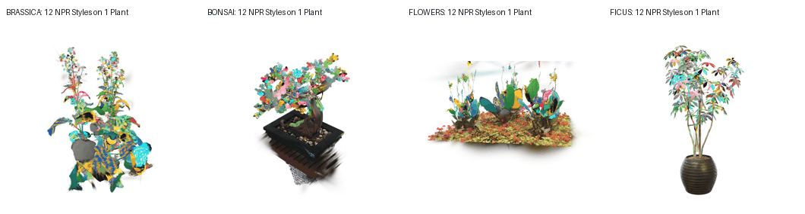
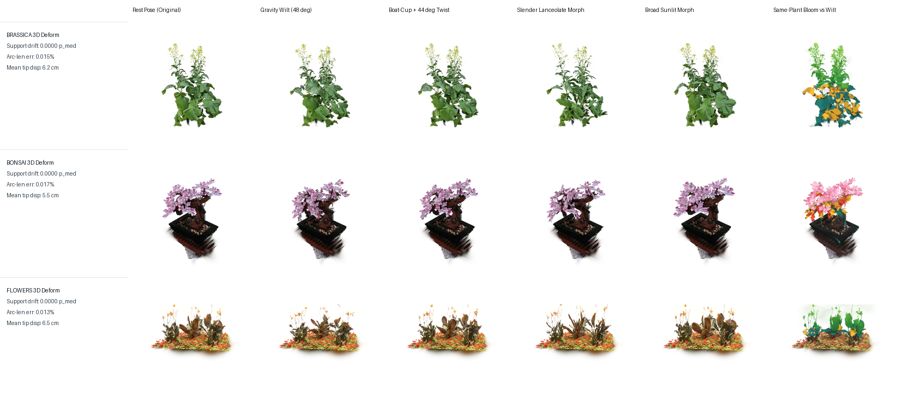
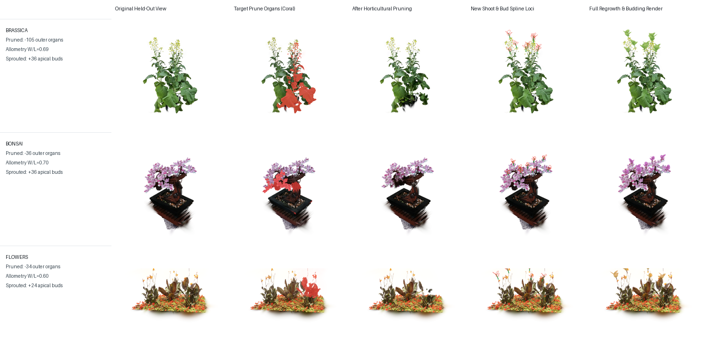
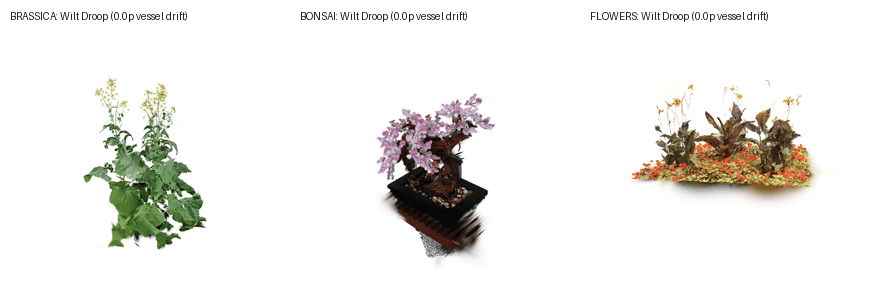

# `universal_botanical_v01`：零标注跨物种通用植物 3DGS 混合表征、器官级三维编辑与同株 12 风格 NPR 大合集

本目录收录跨物种通用植物三维高斯分解、异形底座零人工标注自动发现、无尺度三维流形编辑以及**同株 12 套非真实感渲染（NPR）风格大合集**的完整源码、留出测试视角定量评测 JSON、高分辨率实拍对比图与三维动态 GIF。同一套 `UniversalBotanicalConfig`（**零人工多边形标注、零场景名硬编码**）无缝打通 5 类形态与底座迥异的植物模型（`Ficus`、`Brassica`、`Bonsai`、`Garden`、`Flowers`）。

- **完整源码目录**：[`../../experiments/universal_botanical_v01/`](../../experiments/universal_botanical_v01/)
- **详细实验报告**：
  - [跨植物 3DGS 泛化根因诊断与五场景统一表征评测报告](reports/universal_botanical_5scene_report.md)
  - [跨物种多风格预设、无尺度雅可比流形形变、园艺疏叶与自适应顶芽萌发报告](reports/cross_species_stylization_and_editing_report.md)
  - [同株 12 套前卫 3DGS 原生 NPR 风格大合集报告](reports/npr_12style_same_plant_anthology_report.md)
- **定量评测 JSON**：
  - [`results/UNIVERSAL_5SCENE_BENCHMARK.json`](results/UNIVERSAL_5SCENE_BENCHMARK.json)
  - [`results/CROSS_SPECIES_EDITING_REPORT.json`](results/CROSS_SPECIES_EDITING_REPORT.json)
  - [`results/NPR_12STYLE_ANTHOLOGY_REPORT.json`](results/NPR_12STYLE_ANTHOLOGY_REPORT.json)
- **服务器大型三维资产 SHA256 索引（`.ply` / `.obj` / `.npz`）**：[`ASSETS_SERVER_ONLY.json`](ASSETS_SERVER_ONLY.json)

---

## 一、五场景零人工标注重建与泛化评测亮点

1. **五类底座体制 100% 自动判别与分离**：自动识别圆形车削盆（`Ficus`）、无盆直立草本（`Brassica`）、剥离镂空木架后的矩形浅盆（`Bonsai`，留出可见 IoU **`67.03%`**，反超 9 视角手工多边形模型 `+3.60 pp`）、剥离桌面反光后的异形陶罐（`Garden`，留出可见 IoU **`83.63%`**）与开放花坛地被（`Flowers`），微风与形变下所有容器/底座严格 **`0.0000 p_med`** 零漂移。
2. **宽叶碎片化治愈与高保真周期样条轮廓**：`Brassica` 留出视角三片宽叶主器官覆盖率由 `26.4%–42.5%` 跃升至 **`75.8%–100.0%`**；五场景留出样条混合剪影 IoU 达 **`92.88%–99.86%`**。




---

## 二、同株 12 套 3DGS 原生 NPR 艺术风格大合集

在经典 6 套风格（吉卜力水粉、宣纸水墨、浮世绘木刻、三维点彩、春日樱彩、蓝晒宋青釉）基础上，进一步发挥三维高斯椭球各向异性、周期样条解剖极坐标与高阶球谐视角变彩优势，新增 **6 套前卫 3DGS 原生 NPR 风格**（梵高漩涡厚涂油画笔触、古典植物志铜版画排线、蒂芙尼彩绘玻璃景泰蓝掐丝、波普丝网印网点、荧光叶脉透视琉璃、黑金莳绘视角变彩螺钿 `SH3`），并通过三维邻域图着色与空间花束编排将 **全部 12 套风格同时呈现于同一株植物模型上**：






---

## 三、跨物种无尺度三维流形形变、园艺疏叶与顶芽萌发





---

## 四、复现与单元测试命令

```bash
PY=/mnt/hdd1/u00134/radegs_paper_reproduction_v01/official_code_fix_v01/env/bin/python
cd experiments/universal_botanical_v01

# 1. 运行写入边界隔离、周期三次 B 样条、三类容器网格与 12 风格图着色单元测试
CUDA_VISIBLE_DEVICES=1 $PY -W error::SyntaxWarning -m unittest discover -s tests -v

# 2. 运行五场景零标注重建与留出视角基准评测
CUDA_VISIBLE_DEVICES=1 $PY scripts/run_universal_5scene_benchmark.py

# 3. 运行跨物种三维流形形变、雅可比消融、园艺疏叶与自适应顶芽萌发
CUDA_VISIBLE_DEVICES=1 $PY scripts/run_cross_species_editing_showcase.py

# 4. 运行同株 12 套前卫 NPR 风格大合集与微距图集生成
CUDA_VISIBLE_DEVICES=1 $PY scripts/run_12style_npr_anthology.py
```
