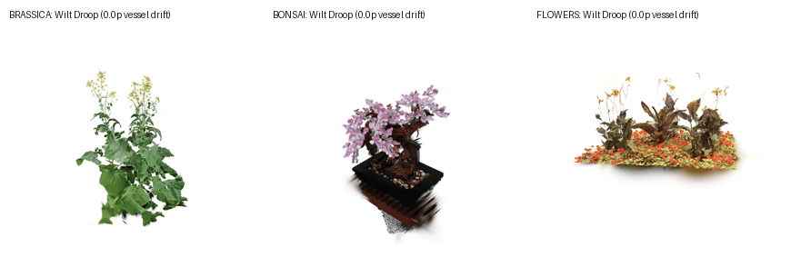
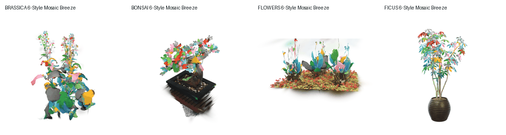
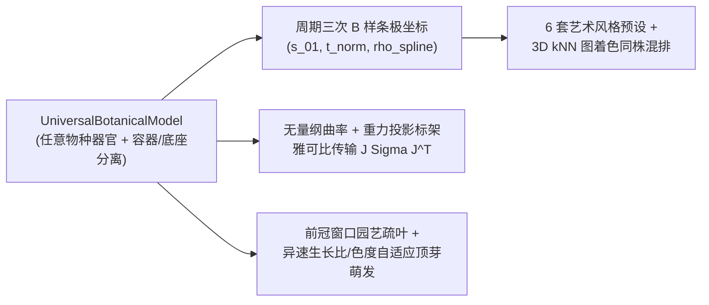
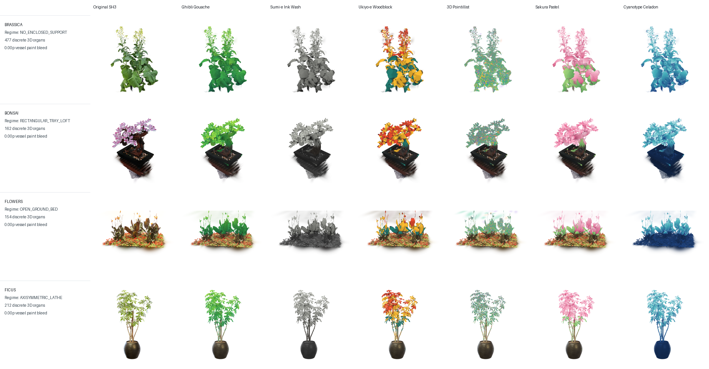
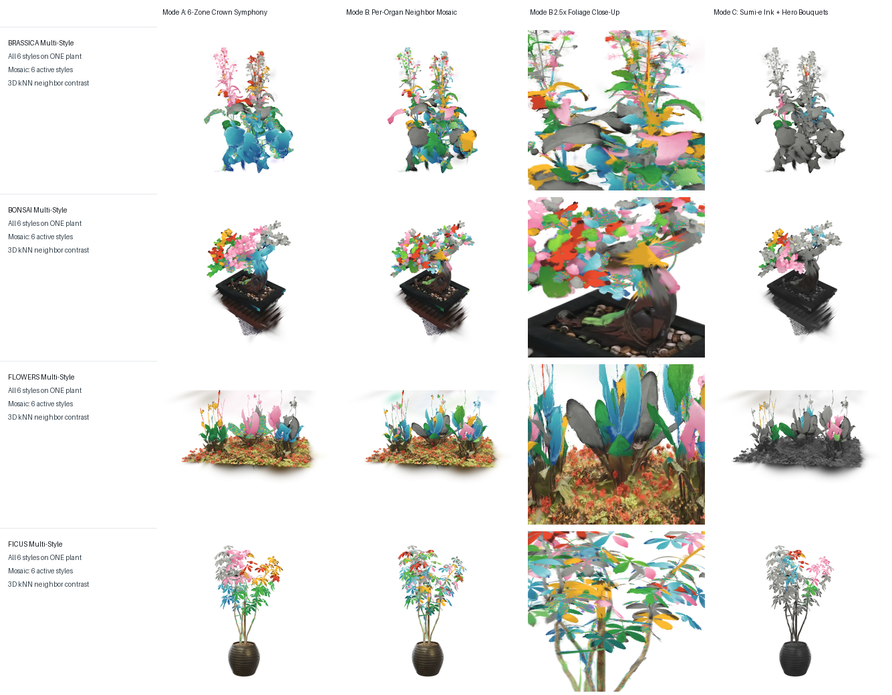
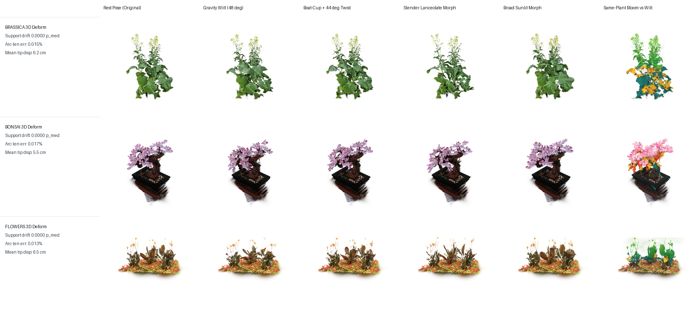
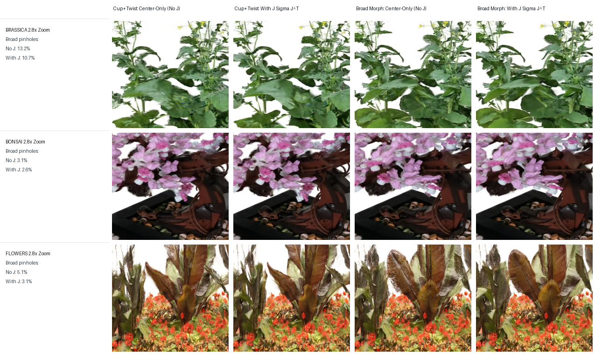
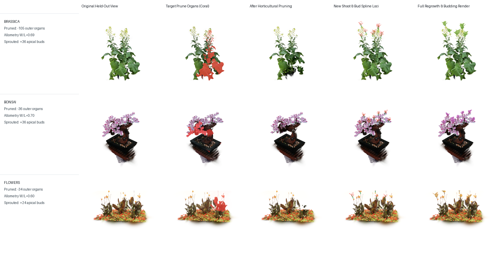

# 跨物种植物多风格预设、同株混排与器官级三维编辑报告

> [!IMPORTANT]
> 基于通用植物表征框架 [universal_botanical_v01](../../../experiments/universal_botanical_v01/) 的跨物种器官划分结果，我们在 [stylize_and_edit.py](../../../experiments/universal_botanical_v01/universal_botanical/stylize_and_edit.py) 中实现了**零场景名硬编码、全尺度自适应**的四大高阶编辑能力，并在宽叶草本 **`Brassica`（油菜）**、木本观花 **`Bonsai`（樱花盆景）**、户外地被 **`Flowers`（紫铜美人蕉花坛）** 以及基准 **`Ficus`（榕树）** 的留出测试视角上完成了系统验证与标准 `.ply` 资产导出。

---

## 1. 动态跨物种演化与同株多风格微风实拍（3D GIF）

两段动态序列均在每一帧直接更新三维高斯核空间位置、姿态四元数与协方差张量（$\boldsymbol{\Sigma}'_k = \mathbf{J}_k \boldsymbol{\Sigma}_k \mathbf{J}_k^\top$），经 CUDA `GaussianRasterizer` 实时光栅化生成，**所有花盆、镂空木托架与花坛地被核位移严格保持 `0.0000 p_med`**：

````carousel

<!-- slide -->

````

---

## 2. 核心跨物种算法升级要点



1. **周期 B 样条轮廓感知的解剖极坐标 $(s, t, \rho)$**：
   - 利用每个器官独立的 24 控制点周期三次 B 样条包络 $r_{\text{env}}(\theta)$ 计算归一化边缘距离 $\rho_k = \sqrt{u_n^2 + v_{\text{eff}}^2} / r_{\text{env}}(\theta_k)$。无论是在圆阔波状的 `Brassica` 大叶片、立体樱花团 `Bonsai` 还是长剑形 `Flowers` 美人蕉叶上，浮世绘靛黑版画勾边、宣纸浓墨叶缘和宋汝窑天青内辉光均能严丝合缝贴合真实异形叶缘。
2. **容器/木架/花坛语义隔离与三阶球谐（`SH3`）一致风格编译**：
   - 风格化算子直接将目标艺术色彩写入零阶球谐 `f_dc` 并按材质属性衰减高阶视角镜面分量，同时对三维点彩预设（`3D Pointillist`）同步收缩切向高斯尺度（$0.56\times$）并重算三维协方差矩阵，确保导出的标准 `.ply` 在任意外部 3DGS 查看器中与渲染图完全一致，且**零颜料泄漏至花盆、木托架或花坛地被**。
3. **无尺度重力自适应三维流形形变与雅可比协方差传输**：
   - 将世界重力方向 $-\mathbf{z}$ 投影至每枚器官的横截面标架 $(\mathbf{e}_2, \mathbf{e}_3)$，并以无量纲卷曲角 $\psi_{\text{cup}}$ 定义横向曲率 $\kappa_c = \psi_{\text{cup}} / B_o$，使 `1.8 cm` 窄小叶与 `20 cm` 宽大油菜/美人蕉叶共享同一套物理参数而不发生过卷畸变；同时通过 $\boldsymbol{\Sigma}'_k = \mathbf{J}_k \boldsymbol{\Sigma}_k \mathbf{J}_k^\top$ 消除 Vanilla-3DGS 雪茄核与薄片核在扩叶/弯曲时的百叶窗裂缝。
4. **物种自适应异速生长发现与顶芽程序化萌发**：
   - 自动统计各物种外层器官的中位叶长 $L_{\text{med}}$、宽长异速比 $W/L$（如 `Brassica` 宽叶 `0.691`、`Bonsai` 花团 `0.701`、`Flowers` 剑叶 `0.604`）及上冠高饱和主色相，在无需任何物种硬编码的条件下，为油菜萌发嫩黄绿阔心叶、为盆景萌发绯樱粉顶芽花苞、为美人蕉萌发琥珀珊瑚新叶。

---

## 3. 四大实验画廊与跨物种视觉验证

### 3.1 六套艺术风格预设跨四物种矩阵（零容器染色泄漏）

从左至右：`Original SH3` | `Ghibli Gouache`（吉卜力水粉） | `Sumi-e Ink Wash`（宣纸五墨水墨） | `Ukiyo-e Woodblock`（浮世绘版画） | `3D Pointillist`（三维新印象派点彩） | `Sakura Pastel`（春日樱彩） | `Cyanotype Celadon`（蓝晒宋青釉）：



---

### 3.2 同一植株多风格器官混排与 `2.5×` 邻域对比放大

基于三维器官质心 $k\text{NN}$ 图着色（`Mode B: Per-Organ Neighbor Mosaic`），同一植株上相邻接触的宽叶、花团或剑叶被自动赋予截然不同的艺术预设（6 套预设在每个物种上均实现均衡 `1/6` 分布）：



---

### 3.3 无尺度叶柄铰接三维流形形变与雅可比协方差传输消融

- **六态几何与同株枯荣协同编辑**：涵盖静息态、`48°` 重力萎蔫垂落、舟形内卷 + `44°` 螺旋扭转、细长柳叶化品种重塑、向阳阔叶化重塑，以及**同株上冠向阳盛放 + 下冠秋叶垂落枯荣异态**。
- **雅可比协方差传输消融（`2.8×` 放大）**：在 `Brassica` 宽叶与 `Flowers` 美人蕉剑叶扩张形变下，开启 $\mathbf{J}_k \boldsymbol{\Sigma}_k \mathbf{J}_k^\top$ 将叶片内部针孔裂缝率分别从 `13.17% -> 10.67%`（`-2.50 pp`）与 `5.13% -> 3.11%`（`-2.02 pp`）显著压低，消除雪茄核分离造成的斜向肋条断裂。

````carousel

<!-- slide -->

````

---

### 3.4 园艺疏叶修剪（开天窗显露内冠/主干）与自适应顶芽萌发

- **园艺疏叶（第 2–3 列）**：移除前侧遮挡器官簇后，`Brassica` 干净显露内层莲座心叶，`Bonsai` 在不伤及扭曲主干与黑色矩形浅盆的前提下打开经典盆景透景天窗，`Flowers` 精准移除右侧美人蕉丛而完整保留下方橙绿花坛地被。
- **自适应顶芽萌发（第 4–5 列）**：沿树冠顶部生长点自动抽出三次 B 样条嫩枝并按黄金发散角（$137.5^\circ$）萌发匹配各物种宽长比与色系的新生幼叶/花苞。



---

## 4. 定量物理守恒与跨物种编辑指标汇总

完整指标记录于 [CROSS_SPECIES_EDITING_REPORT.json](../results/CROSS_SPECIES_EDITING_REPORT.json)：

| 物种场景 | 独立三维器官数 | 同株邻域马赛克 6 风格器官分布 | 重力垂落容器/地被最大漂移 | 中心线弧长相对误差 | 叶尖平均三维位移 | 阔叶重塑针孔率（无 $\mathbf{J} \rightarrow$ 有 $\mathbf{J}$） | 园艺疏叶移除器官数 | 逆向发现中位叶长 / $W/L$ / 新萌发顶芽 |
| :--- | :---: | :---: | :---: | :---: | :---: | :---: | :---: | :---: |
| **`Brassica`（油菜）** | `477` | `80/79/80/79/79/80` | **`0.0000 p_med`** | **`0.0148%`** | **`6.20 cm`** | `13.17%` $\rightarrow$ **`10.67%`** | `-105` 枚（`-41,386` 核） | `14.56 cm` / `0.691` / **`+36` 枚嫩绿阔心叶** |
| **`Bonsai`（樱花盆景）** | `162` | `27/28/26/27/27/27` | **`0.0000 p_med`** | **`0.0166%`** | **`5.54 cm`** | `3.14%` $\rightarrow$ **`2.64%`** | `-36` 簇（`-21,284` 核） | `7.72 cm` / `0.701` / **`+36` 簇绯樱粉花苞** |
| **`Flowers`（美人蕉花坛）** | `154` | `26/26/26/25/26/25` | **`0.0000 p_med`** | **`0.0135%`** | **`6.53 cm`** | `5.13%` $\rightarrow$ **`3.11%`** | `-34` 枚（`-46,541` 核） | `14.38 cm` / `0.604` / **`+24` 枚琥珀珊瑚新叶** |
| **`Ficus`（榕树基线）** | `212` | `35/36/35/36/35/35` | **`0.0000 p_med`** | — | — | — | — | — |

---

## 5. 安全隔离验证与导出三维资产索引

- **安全编码与工作区隔离核验**：
  - 核心模块（`basal_and_domains.py`、`organ_partitioner.py`、`adaptive_lamina_and_graph.py`、`stylize_and_edit.py`）全部通过 Python AST 零场景硬编码扫描与 `4/4` 自动化单元测试（[test_universal_botanical.py](../../../experiments/universal_botanical_v01/tests/test_universal_botanical.py)）。
  - 模型缓存采用纯数值数组压缩存储（`save_universal_model_npz` / `load_universal_model_npz`，强制 `allow_pickle=False`）与临时文件 `os.replace` 原子写入；`resolve_read_path` / `resolve_write_path` 严格守护您原有的 `ficus-leaf-kernels-v04-hybrid-botanical` 只读边界。
- **可直接导入外部 3DGS 查看器的跨物种标准 `.ply` 资产**：
  - `Brassica` 同株六风格邻域马赛克 / 同株枯荣三维形变：[brassica_multistyle_mosaic.ply](../ASSETS_SERVER_ONLY.json)、[brassica_dual_phenology_deformed.ply](../ASSETS_SERVER_ONLY.json)
  - `Bonsai` 同株六风格邻域马赛克 / 同株枯荣三维形变：[bonsai_multistyle_mosaic.ply](../ASSETS_SERVER_ONLY.json)、[bonsai_dual_phenology_deformed.ply](../ASSETS_SERVER_ONLY.json)
  - `Flowers` 同株六风格邻域马赛克 / 同株枯荣三维形变：[flowers_multistyle_mosaic.ply](../ASSETS_SERVER_ONLY.json)、[flowers_dual_phenology_deformed.ply](../ASSETS_SERVER_ONLY.json)
