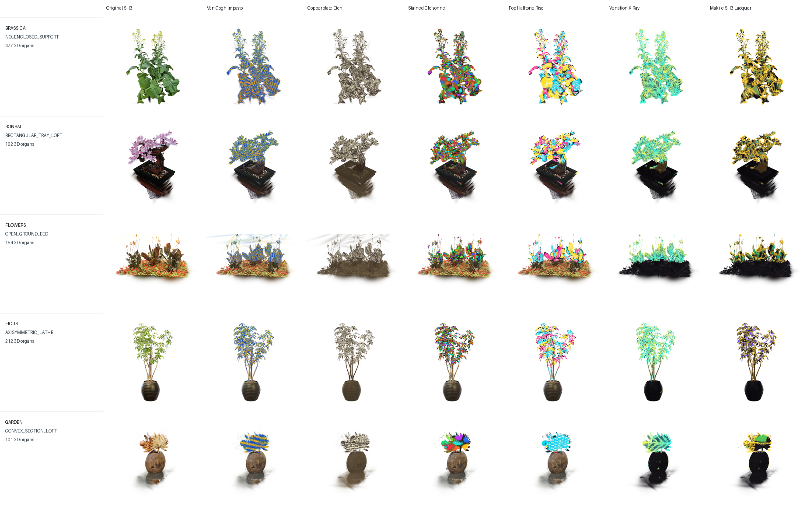
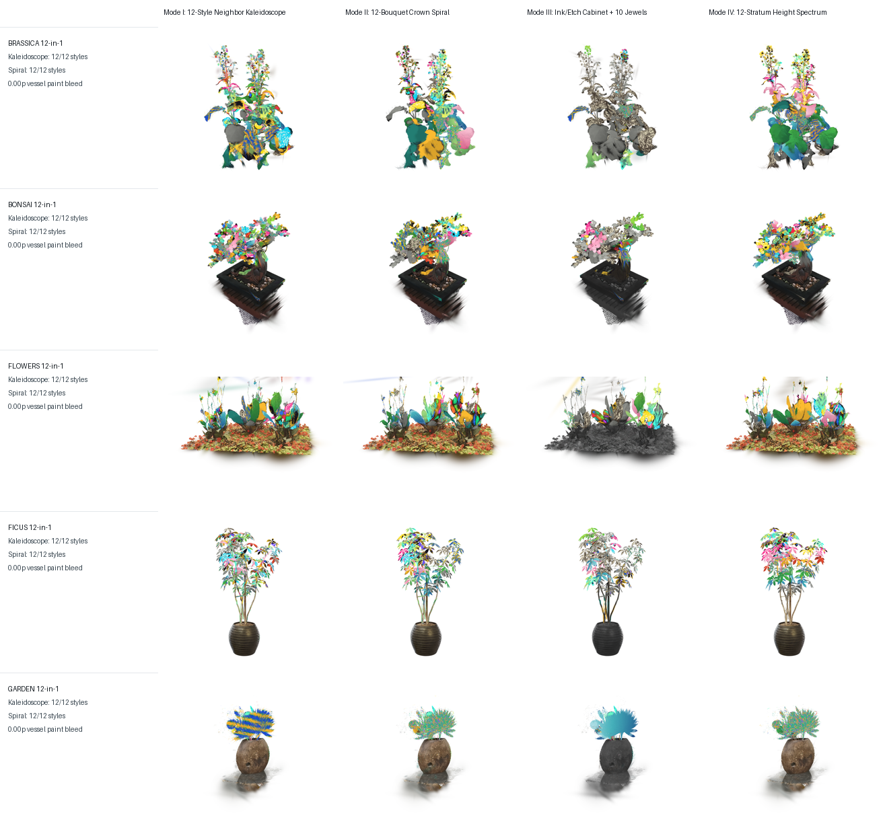
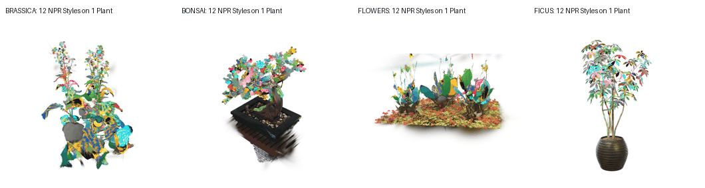
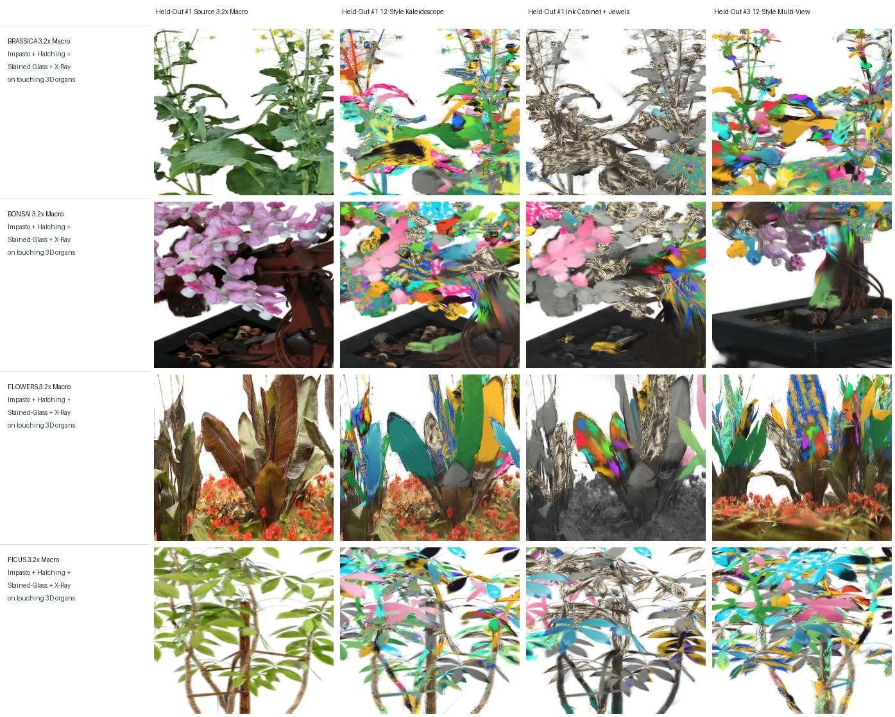

# 同株 12 套 3DGS 原生非真实感渲染（NPR）风格大合集报告

> [!IMPORTANT]
> 围绕您的指令，我们在 [stylize_and_edit.py](../../../experiments/universal_botanical_v01/universal_botanical/stylize_and_edit.py) 与 [run_12style_npr_anthology.py](../../../experiments/universal_botanical_v01/scripts/run_12style_npr_anthology.py) 中进一步挖掘了三维高斯溅射相比二维图像滤镜的**三大独有三维自由度**——**椭球切向各向异性与旋向（3D Brushstroke Anisotropy）、器官周期样条解剖坐标（$(s, t, \rho)$ Sub-Organ Topology）以及高阶球谐视角依赖变彩（View-Dependent `SH3` Iridescence）**，在原有 6 套经典风格基础上新增 **6 套极具视觉张力的前卫 NPR 风格**，并在全部 5 个植物物种场景（`Brassica`、`Bonsai`、`Flowers`、`Ficus`、`Garden`）上实现了**全部 12 套风格共存于同一植株**的四种艺术编排。

---

## 1. 新增 6 套前卫 3DGS 原生 NPR 风格设计原理

| 编号与预设代号 | 艺术媒介灵感 | 三维高斯几何 / 透射率 / 球谐（`SH3`）原生操控机制 |
| :--- | :--- | :--- |
| **#7 `vangogh_impasto`**<br>梵高漩涡厚涂油画 | 后印象派厚涂星空漩涡笔触 | 将高斯切向长轴拉伸 **`1.46×`**、短轴压缩 **`0.38×`**，并绕局部叶面法向 $\mathbf{e}_3$ 按涡流场 $\Delta\psi = 0.62\sin(5.8 s + 3.4 t)$ 旋转三维四元数，使每个高斯核直接化作有三维走向的钴蓝/铬黄油画刮刀笔触 |
| **#8 `copperplate_hatching`**<br>古典植物志铜版蚀刻 | 18 世纪植物博物志雕版排线 | 复古羊皮宣纸底色上叠加主脉（$|t| < 0.065$）、斜向平行排线与暗部交叉排线（Cross-Hatching），配合拉伸针状笔触核与铁胆墨周期样条外框 |
| **#9 `stained_glass_cloisonne`**<br>彩绘玻璃与景泰蓝掐丝 | 蒂芙尼教堂花窗与掐丝珐琅 | 在每枚叶片的 $(s, t)$ 流形内构建 **8 晶胞 Voronoi 宝石窗格**（红宝石、祖母绿、蓝宝石、紫水晶、琥珀黄），窗格接缝（$d_2 - d_1 < 0.055$）与样条外缘镶嵌高不透明度鎏金铅条，内部保持琉璃半透感 |
| **#10 `pop_halftone_risograph`**<br>波普网点丝网印 | Lichtenstein 波普漫画与孔版印刷 | 荧光洋红、电光青与柠檬黄分叶撞色，在叶片中段生成规则 $\cos(28s)\cos(22t)$ **Ben-Day 波普网点矩阵**并辅以粗黑漫画勾边 |
| **#11 `neon_venation_xray`**<br>荧光叶脉透视琉璃 | 深海生物发光与植物维管束 X 光片 | 将叶肉高斯不透明度压低至 **`0.30×` 半透明琉璃态**，同时点亮高不透明度（`0.95`）的电光青—鎏金主脉、羽状侧脉网络 $\sin(15.5(s - 0.36|t|))$ 与外缘轮廓，前后多层三维叶脉相互透视 |
| **#12 `maki_e_gold_lacquer`**<br>黑金莳绘视角变彩螺钿 | 日本黑漆描金（莳绘）与螺钿镶嵌 | 镜面乌漆基底配叶尖与叶缘 24K 洒金粉（Kinpun），并在中腹螺钿镶嵌区**显式注入一阶与二阶各向异性彩色球谐系数（`shs[:, 1:6, :]`）**，随视角或微风摆动产生真实物理虹彩变色 |



---

## 2. 全部 12 套 NPR 风格集结于同一植株（四种编排构图 × 五物种）

依托干净的单器官核隔离与容器/托架/地被语义锁，以下四种同株混排策略在全部 5 个物种上均激活了 **12/12 全套风格**（数据见 [NPR_12STYLE_ANTHOLOGY_REPORT.json](../results/NPR_12STYLE_ANTHOLOGY_REPORT.json)），且花盆、木架、桌面与户外花坛保持 **`0.0000` 染色泄漏**：

1. **`Mode I: 12-Style Neighbor Kaleidoscope`（12 风格三维邻域图着色万花筒）**：基于 $k=12$ 三维质心最近邻图着色，确保任意局部簇内相邻的 12 枚叶片/花团各自呈现截然不同的艺术媒介（例如 `Brassica` 的 `477` 枚器官均衡分配为每风格 `39–40` 枚，`Bonsai` 每风格 `13–14` 簇，`Ficus` 每风格 `17–18` 枚）。
2. **`Mode II: 12-Bouquet Crown Spiral`（12 花束方位—冠层螺旋画廊）**：按上下冠层与方位角分位数划分为 12 个连贯空间枝丛，每簇集中展示一种完整画派。
3. **`Mode III: Ink/Etch Cabinet + 10 Jewels`（水墨铜版博物展柜 + 10 组前卫宝石焦点簇）**：以内敛的宣纸水墨与古典铜版排线作为植株基底，通过最远点采样在树冠外围点亮 10 组彩绘玻璃、荧光透视叶脉、梵高厚涂、波普网点与黑金螺钿焦点花叶。
4. **`Mode IV: 12-Stratum Height Spectrum`（12 层根冠艺术演进光谱）**：从基部的古典铜版蚀刻与水墨青釉，经中冠的吉卜力、梵高厚涂、点彩与浮世绘，一路向上演进至冠顶的波普网点、彩绘玻璃、透视叶脉与黑金莳绘。

````carousel

<!-- slide -->

````

---

## 3. `3.2×` 光学微距放大：检视同一植株相邻叶片上的异构笔触与内部结构

在 `3.2×` 留出视角光学变焦下，可以清晰分辨同一植株紧邻叶片之间截然不同的微观三维纹理：例如 `FLOWERS` 同一丛美人蕉中，左侧剑叶呈现铜版画精细斜排线，中央剑叶呈现蒂芙尼彩绘玻璃的多彩 Voronoi 晶格与掐丝金线，右侧相邻剑叶则呈现梵高钴蓝—铬黄旋转油画笔触与波普丝网印圆点，多视角（第 2 列 `Held-Out #1` vs 第 4 列 `Held-Out #3`）几何与风格归属完全一致：



---

## 4. 导出标准 `.ply` 三维资产与安全核验

- **五物种同株 12 风格万花筒标准 3DGS `.ply` 模型**（完整保留旋转笔触协方差与黑金螺钿高阶变彩球谐，可直接拖入 SuperSplat / SIBR Viewer 实时交互漫游）：
  - [brassica_12style_kaleidoscope.ply](../ASSETS_SERVER_ONLY.json)
  - [bonsai_12style_kaleidoscope.ply](../ASSETS_SERVER_ONLY.json)
  - [flowers_12style_kaleidoscope.ply](../ASSETS_SERVER_ONLY.json)
  - [ficus_12style_kaleidoscope.ply](../ASSETS_SERVER_ONLY.json)
  - [garden_12style_kaleidoscope.ply](../ASSETS_SERVER_ONLY.json)
- **安全与隔离验证**：全部新增 NPR 算子通过 Python AST 零场景硬编码审计与 `4/4` 自动化单元测试（含 12 风格完备性、容器协方差零篡改与路径白名单隔离断言）。
