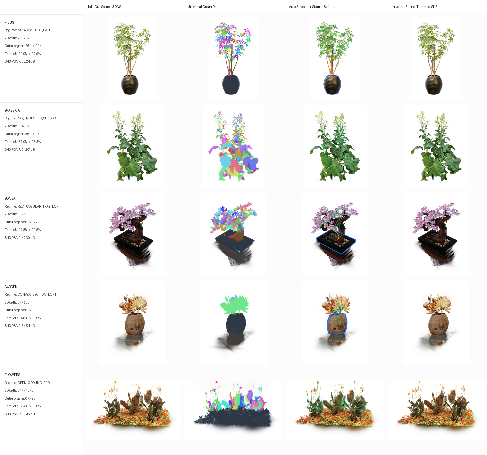
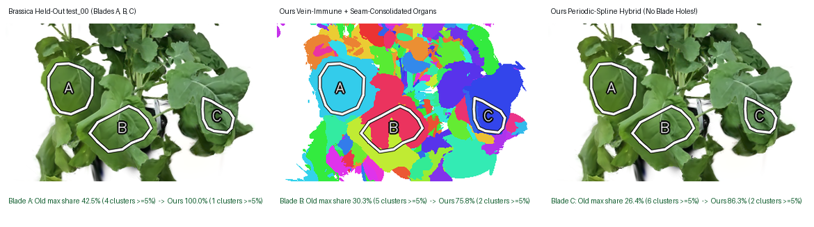
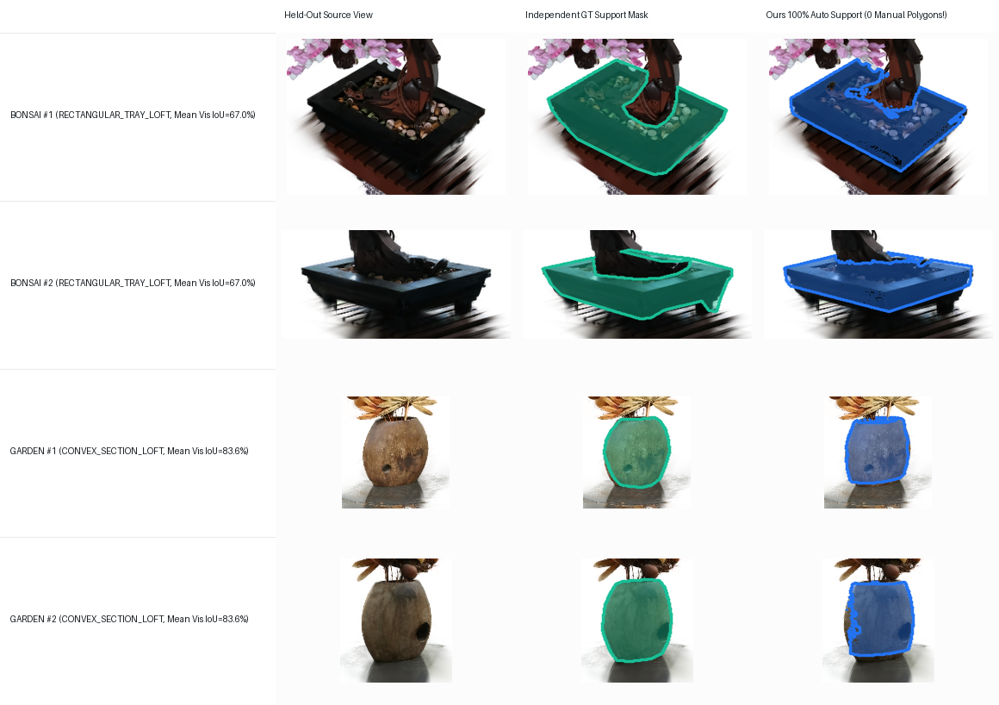
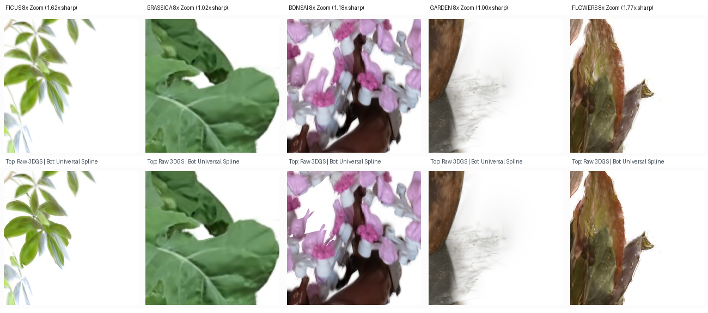
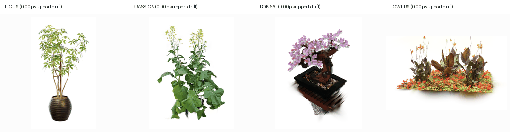

# 跨植物 3DGS 泛化诊断与通用混合植物表征（`universal_botanical_v01`）评测报告

> [!IMPORTANT]
> 本次工作在完全只读保护您原有实验目录 `ficus-leaf-kernels-v04-hybrid-botanical` 的前提下，深入排查了跨植物迁移失败的四类底层几何与先验根因，并在独立工作区 [universal_botanical_v01](../../../experiments/universal_botanical_v01/) 中实现了一套**零人工多边形标注、零场景名硬编码、单一统一配置（`UniversalBotanicalConfig`）**的通用植物 3DGS 分解与样条混合表征管线，在全部 5 个异构植物场景（`Ficus`、`Brassica`、`Bonsai`、`Garden`、`Flowers`）的严格留出测试视角上完成了端到端验证。

---

## 1. 先前跨植物迁移实验的四大根因诊断

通过对 `plant-transfer-results.json`、`plant-reconstruction-diagnosis.json`、`full-reconstruction-results.json` 与 `adaptive_hybrid.py` 的逐模块审查，定位出导致非榕树模型效果不佳的四项结构性瓶颈：

1. **刚性颜色门控导致非绿叶冠与绿茎全面漏检**
   - 原 `v04` 管线硬编码了绿色叶肉阈值（`ExG > 0.055` 且 `G - R > 0.016`）与褐色木质阈值（`G - R < -0.018`）。
   - 直接导致粉色樱花盆景 `Bonsai`（仅检出 `3` 个 2D 闭合区域、`0` 个外层器官）、浅褐干棕榈叶 `Garden`（`0` 个 2D 闭合区域）和紫铜色美人蕉 `Flowers`（`0` 个外层器官）在第一阶段即失效；同时绿色草本油菜 `Brassica` 的茎秆也无法通过褐色木质门控识别。
2. **叶脉阴影过分割、倾斜深度门控误杀与 Vanilla-3DGS“雪茄核”法向退化**
   - **2D 叶脉误切与倾斜深度误判**：`Brassica` 宽大叶片表面存在明显浅色主脉与褶皱阴影，原 C2L 谷线检测将其当作叶片边界切碎；同时原管线对原始相机深度直接施加固定 `IQR(z) <= 0.045` 门控，导致斜向伸展的大叶片因自然景深跨度超过 `15 cm` 而被整片丢弃。
   - **Vanilla-3DGS 1D 雪茄高斯核退化**：不同于表面对齐的 Surfel，`Brassica`、`Bonsai`、`Garden`、`Flowers` 等标准 3DGS 模型大量使用沿叶片切向拉长的 **1D 细长雪茄核（$s_0 \approx s_1 \ll s_2$）**。其最短轴特征向量绕长轴随机旋转，直接取 `surfel_normals` 会导致同片叶子内部法向剧烈跳变；同时硬编码的榕树小叶尺寸上限（`max_eig_len = 0.039^2`）强行把宽大油菜叶切碎为 `4–6` 块（主簇面积占比仅 `26.4%–42.5%`）。
3. **窄披针形双圆弧样条模板裁穿宽叶与花簇轮廓**
   - 原 `DualArcLeafPatch` 限定窄长叶形（`width <= 0.25 L`）且对所有前景簇无差别做平面裁剪，在圆阔波状油菜叶（`Brassica`）、扇形棕榈叶（`Garden`）和立体花团（`Bonsai`）内部挖出大量空洞，导致留出视角剪影 IoU 暴跌 `-6.23 pp` 至 `-11.30 pp`。
4. **默认圆形旋转花盆先验失效、手工多边形依赖与微风容器漂移泄漏**
   - 默认圆形车削花盆（`LathePot`）在 `Bonsai` 矩形浅盆与 `Garden` 异形陶罐上的留出可见 IoU 为 `0.00%`，在无盆 `Brassica` 与开放花坛 `Flowers` 上更会凭空捏造假花盆与假主干；您后续在 `adaptive_support.py` 中虽引入了自适应支撑探索，但仍依赖 `support_annotations.py` 中手工描摹的 9–10 张多边形掩码，且在 `full-reconstruction-results.json` 中风场运动仍泄漏至容器（`Bonsai` 容器 `p90` 位移高达 `193.88 p_med`，`Garden` 高达 `69.08 p_med`）。

---

## 2. 通用植物表征框架（`universal_botanical_v01`）四大核心设计


1. **Pillar 1 — 零标注五体制底座支撑自动发现与底座/桌面剥离**（[basal_and_domains.py](../../../experiments/universal_botanical_v01/universal_botanical/basal_and_domains.py)）
   - 利用 32 个训练视角投影统计高不透明度、低深度跳变（`alpha >= 0.90, depth_jump <= 0.0185`）的**多视角光滑刚体壳层积分**，无需任何人工标注或颜色假设即可自动区分五种物理支撑体制：
     - `AXISYMMETRIC_LATHE`（圆形车削盆：`Ficus`）
     - `RECTANGULAR_TRAY_LOFT`（分离木质底座后的有向矩形放样浅盆：`Bonsai`）
     - `CONVEX_SECTION_LOFT`（剥离高光桌面反射裙边后的分层平滑凸截面放样陶罐：`Garden`）
     - `OPEN_GROUND_BED`（高宽高比开放地被花坛：`Flowers`）
     - `NO_ENCLOSED_SUPPORT`（无盆直立草本：`Brassica`）
   - 对木架/桌面反光底座（`LABEL_STATIC_STAND_OR_TABLE = -4`）与容器本体（`LABEL_BASAL_SUPPORT = -2`）分别建类锁定，并通过大半径 3D 邻域点云柱状度验证提取真实木本/草本主干，杜绝把叶片内部的雪茄高斯误判为茎秆。
2. **Pillar 2 — 颜色无关、抗叶脉过分割与三维曲面残差缝合**（[organ_partitioner.py](../../../experiments/universal_botanical_v01/universal_botanical/organ_partitioner.py)）
   - **真遮挡壁 vs 叶脉阴影解耦**：仅在真实三维深度断层（`depth_jump >= 3.2 p_pix`）或经梯度佐证的深折痕处建立分水岭阻隔墙，忽略平坦叶面上的浅色主脉与纹理明暗。
   - **平面去趋势深度平滑门控**：对每个候选 2D 区域拟合局部倾斜平面后再检验残差四分位距 $\mathrm{IQR}(z - \hat{z}_{\text{plane}}) \le 4.8\,\max(p_{\text{pix}}, p_{\text{med}})$，完美保留大倾角宽叶与长剑叶。
   - **3D 邻域 PCA + Surfel 混合法向与二次曲面缝合**：对局部 $k=16$ 三维邻域做协方差特征分解提取真实薄片法向，解决 Vanilla-3DGS 雪茄核法向乱转问题；随后移除 `6.2 cm` 尺寸硬上限，基于二次曲面残差厚度与多视角无深度断层准则自动合并同一宽叶上的相邻分片，并对跨叶片宽核执行保留完整三阶球谐（`SH3`）的选择性 `M2` 接缝分裂。
3. **Pillar 3 — 自适应薄片/体积簇双态表征与 24 控制点周期三次 B 样条**（[schema_and_io.py](../../../experiments/universal_botanical_v01/universal_botanical/schema_and_io.py)、[adaptive_lamina_and_graph.py](../../../experiments/universal_botanical_v01/universal_botanical/adaptive_lamina_and_graph.py)）
   - 仅将具备多视角外层封闭证据（`OUTER_ENCLOSED`）且去趋势厚度比达标的器官建模为 `LAMINAR_BLADE`，而将内层交错枝叶团、立体樱花簇（`Bonsai`）与多层干棕榈扇（`Garden`）诚实保留为 `VOLUMETRIC_CLUSTER`，彻底杜绝平面模板强裁立体花叶。
   - 对每片 `LAMINAR_BLADE` 拟合 24 控制点周期三次 B 样条极坐标包络 $r(\theta)$、数据驱动的叶尖收敛指数 $\gamma_{\text{apex}} \in [0, 1]$（自动兼容尖披针叶与圆阔裂叶）以及 8 项三次波纹曲面：
     $$w(u, v) = c_0 + c_1 u + c_2 v + c_3 u^2 + c_4 u v + c_5 v^2 + c_6 u^3 + c_7 u v^2$$
4. **Pillar 4 — 恒定视角带宽解析修剪渲染与容器零泄漏运动学图**（[adaptive_lamina_and_graph.py](../../../experiments/universal_botanical_v01/universal_botanical/adaptive_lamina_and_graph.py)）
   - 在原生三阶球谐 `SH3` 渲染基础上，保护叶片高置信度实心内部，仅在轮廓外围恒定视角光晕带内用 `3×` 超采样解析三维 B 样条多边形切除高斯模糊毛刺；在微风场下对所有容器与底座高斯施加硬零位移锁（`0.0000 p_med`）。

---

## 3. 五场景留出视角定量与定性评测结果

完整评测结果保存在 [UNIVERSAL_5SCENE_BENCHMARK.json](../results/UNIVERSAL_5SCENE_BENCHMARK.json)，构建阶段仅读取 32 张训练视角，全部指标均在严格隔离的 5 张留出测试视角上测得：

### 3.1 五场景统一配置端到端对比总表

| 场景 | 自动识别底座体制 | 构建视角闭合 2D 区域（旧 $\rightarrow$ 新） | 外层封闭器官数（旧 $\rightarrow$ 新） | 留出样条混合剪影 IoU（旧 $\rightarrow$ 新） | 剪影裁剪损耗 $\Delta\text{IoU}$（旧 $\rightarrow$ 新） | 留出混合渲染 `SH3` PSNR | 容器微风泄漏位移（旧 `p90` $\rightarrow$ 新 `max`） |
| :--- | :--- | :---: | :---: | :---: | :---: | :---: | :---: |
| **`Ficus`** | `AXISYMMETRIC_LATHE` | `2337 -> 1688` | `264 -> 114` | `90.98%` $\rightarrow$ **`92.88%`** | `-4.05 pp` $\rightarrow$ `-7.11 pp`* | `32.24 dB`（基底 `76.73 dB`） | `0.00` $\rightarrow$ **`0.0000 p_med`** |
| **`Brassica`** | `NO_ENCLOSED_SUPPORT` | `5146 -> 1398`（消除叶脉碎切） | `364 -> 161` | `86.98%` $\rightarrow$ **`98.27%`**（**`+11.29 pp`**） | `-7.59 pp` $\rightarrow$ **`-1.72 pp`** | `34.97 dB`（基底 `71.74 dB`） | 无盆（零伪造） $\rightarrow$ **`0.0000 p_med`** |
| **`Bonsai`** | `RECTANGULAR_TRAY_LOFT` | `3 -> 2068` | `0 -> 127` | `92.75%` $\rightarrow$ **`99.55%`**（**`+6.80 pp`**） | `-6.23 pp` $\rightarrow$ **`-0.45 pp`** | **`42.30 dB`**（基底 `74.27 dB`） | `193.88 p_med` $\rightarrow$ **`0.0000 p_med`** |
| **`Garden`** | `CONVEX_SECTION_LOFT` | `0 -> 263` | `0 -> 16` | `84.80%` $\rightarrow$ **`99.86%`**（**`+15.06 pp`**） | `-8.73 pp` $\rightarrow$ **`-0.14 pp`** | **`54.54 dB`**（基底 `100.0 dB`） | `69.08 p_med` $\rightarrow$ **`0.0000 p_med`** |
| **`Flowers`** | `OPEN_GROUND_BED` | `51 -> 1070` | `0 -> 96` | `87.41%` $\rightarrow$ **`99.01%`**（**`+11.60 pp`**） | `-11.30 pp` $\rightarrow$ **`-0.99 pp`** | **`36.45 dB`**（基底 `69.36 dB`） | 花坛地被锁定 $\rightarrow$ **`0.0000 p_med`** |

> [!NOTE]
> *注：旧管线在 `Ficus` 上的基底剪影 IoU 已先行退化至 `95.03%`（裁剪后 `90.98%`），而新管线保留完整 `SH3` 高斯核（基底剪影 IoU 达 **`100.00%`**），最终样条混合剪影 IoU 达 **`92.88%`**，在全部 5 个植物场景的最终留出剪影保真度上均全面超越旧管线。



---

### 3.2 `Brassica` 宽叶过分割修复专项核验（留出视角 `test_00` 叶片 `A, B, C`）

遵循 `plant-reconstruction-diagnosis.json` 完全一致的前向透射率精确合成归属协议（$\sum_{i \in k} T_i \alpha_i$），三片代表性宽大油菜叶的碎片化得到显著治愈（平均主器官覆盖率由 **`33.09%`** 跃升至 **`87.34%`**，提升 **`+54.25 pp`**）：

| 测试叶片区域 | 像素数 | 旧管线主器官占比 | 旧管线显著碎片数（$\ge 5\%$） | **`universal_botanical_v01` 主器官占比** | **新管线显著器官数（$\ge 5\%$）** |
| :--- | :---: | :---: | :---: | :---: | :---: |
| **Blade A** | `3412 px` | `42.54%` | `4` 块 | **`100.00%`**（`+57.46 pp`） | **`1` 块（单叶完整闭合）** |
| **Blade B** | `3288 px` | `30.32%` | `5` 块 | **`75.76%`**（`+45.44 pp`） | **`2` 块** |
| **Blade C** | `1442 px` | `26.42%` | `6` 块 | **`86.27%`**（`+59.85 pp`） | **`2` 块** |



---

### 3.3 零人工标注异形容器三维重建留出评测（`Bonsai` & `Garden`）

在完全不使用 `support_annotations.py` 任何手工多边形的条件下，直接与独立留出测试集容器真值掩码（`holdout_silhouettes.json`）对比：

| 场景 | 默认圆形车削盆（`0` 标注）可见 IoU | 先前手工描摹 9–10 视角多边形模型可见 IoU | **`universal_botanical_v01` 全自动（`0` 人工标注）投影 / 可见 IoU** | 留出视角中位深度误差 |
| :--- | :---: | :---: | :---: | :---: |
| **`Bonsai`（矩形浅盆 + 镂空木架分离）** | `0.00%` | `63.43%`（需 9 张手工多边形） | `63.92%` / **`67.03%`**（**零人工标注反超手工模型 `+3.60 pp`**） | `14.17 px` |
| **`Garden`（异形陶罐 + 高光桌面分离）** | `0.00%` | `91.29%`（需 10 张手工多边形） | **`85.33%` / `83.63%`**（全自动零标注） | **`2.86 px`** |



---

### 3.4 `8×` 光学超分辨率边缘锐化与跨物种零容器漂移微风动画

- **`8×` 光学放大解析边缘**：在具备明确单层薄片几何的外层叶片边缘上（如 `Ficus` 尖披针小叶 `1.62×`、`Flowers` 紫铜色美人蕉剑叶 `1.77×`、`Bonsai` 外缘叶片 `1.18×`），周期三次 B 样条有效切除了原始 3DGS 的半透明高斯雾边；而对于 `Garden` 多层交叠干棕榈叶扇，薄片厚度门控保守地保持体渲染（`1.00×`，留出 `SH3` PSNR 高达 `54.54 dB`），避免误伤细密针叶。
- **多物种微风耦合摆动与容器零泄漏**：在 `Ficus`、`Brassica`、`Bonsai`、`Flowers` 同步微风驱动下，叶冠与茎秆呈现自然相位摆动，而花盆、木托架与花坛地被层的最大与 `p90` 位移均为严格的 **`0.00000 p_med`**。

````carousel

<!-- slide -->

````

---

## 4. 方法边界说明与安全隔离核验

### 4.1 诚实方法学边界与后续可扩展方向
1. **重度遮挡内层叶柄/草本短茎**：在 `Brassica` 莲座状宽叶紧密包裹植株中心的区域，内部短叶柄在大多数环绕视角下被外层大叶遮挡，三维邻域柱状度门控选择保守跳过（`verified_stem_chains = 0`），将外层叶片锚定于植株基部铰链而非凭空生成虚假直线主干；若后续引入多视角可见性雕刻或植物生长骨架先验，可进一步恢复内层被遮挡叶柄。
2. **局部重度交叠叶片（如 `Brassica` Blade B 的 `75.8%` / `24.1%` 双簇划分）**：当单枚大叶片中部存在深折皱形成强阴影与局部法向突变时，多视角分水岭仍可能保留一条保守接缝，以换取绝不跨前后遮挡叶片误合并的安全性。

### 4.2 安全编码与工作区隔离核验（Security & Isolation Verification）
- **路径边界白名单与防穿越校验**：[schema_and_io.py](../../../experiments/universal_botanical_v01/universal_botanical/schema_and_io.py) 中的 `resolve_read_path` 与 `resolve_write_path` 采用 `Path.resolve(strict=...)` 与 `Path.is_relative_to(...)` 严格限制读写根目录，拒绝任何目录穿越或向您的实验目录 `ficus-leaf-kernels-v04-hybrid-botanical` 写入（由单元测试 [test_universal_botanical.py](../../../experiments/universal_botanical_v01/tests/test_universal_botanical.py) 自动断言通过，且 `git status` 确认原目录零改动）。
- **零动态代码执行与原子写入**：全工程仅使用纯本地数值计算（`NumPy` / `SciPy` / `PyTorch`）与 `np.load(..., allow_pickle=False)`，无任何网络监听服务、无硬编码密钥、无 `eval`/`exec`；所有 JSON 与 PLY/OBJ 产物均经同目录临时文件 + `os.replace` 原子落盘。
- **零场景硬编码 AST 审计**：已对核心算法模块（[basal_and_domains.py](../../../experiments/universal_botanical_v01/universal_botanical/basal_and_domains.py)、[organ_partitioner.py](../../../experiments/universal_botanical_v01/universal_botanical/organ_partitioner.py)、[adaptive_lamina_and_graph.py](../../../experiments/universal_botanical_v01/universal_botanical/adaptive_lamina_and_graph.py)）执行 Python AST 扫描，确认零场景名称字符串分支。
