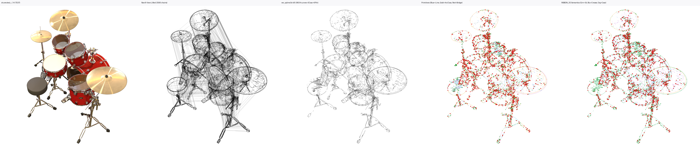
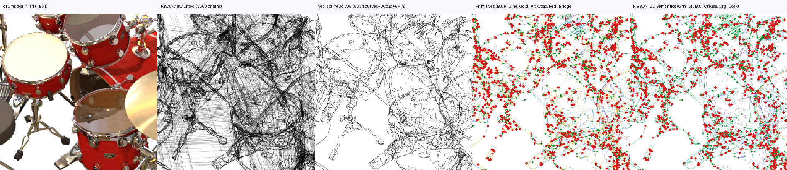
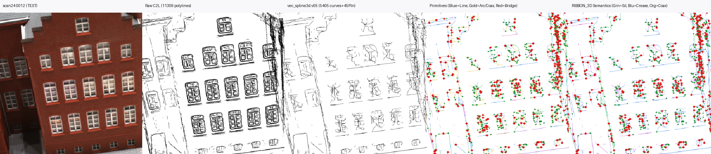
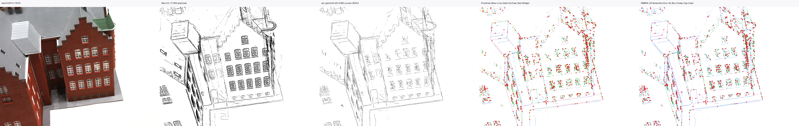
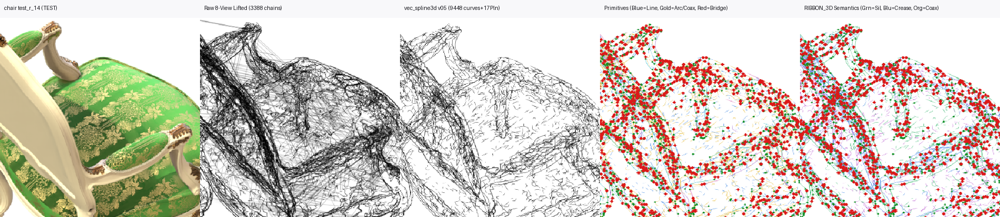
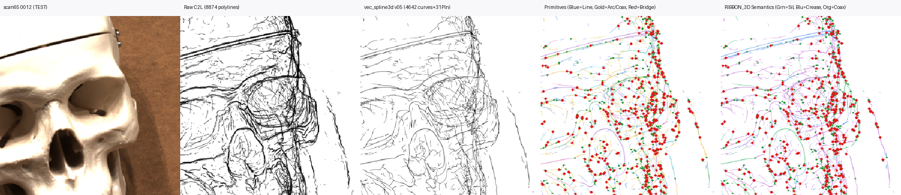
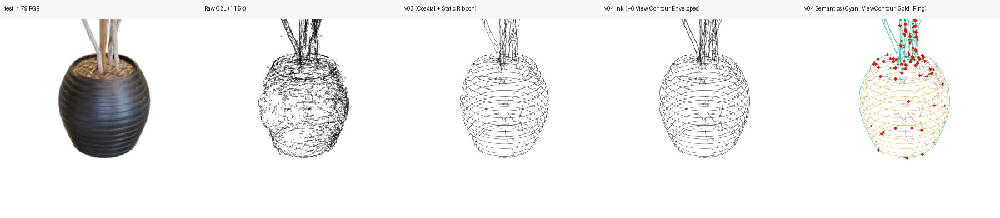
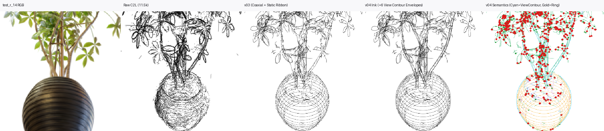

# `vec_spline3d`（v01 → v05）：混合三维参数曲线、有向曲率带状、视点轮廓生成元与建筑平面正交线框重建

本分支（`vec-spline3d-hybrid-primitives-v05`）收录独立三维向量化混合几何原语管线 `vec_spline3d`（v01 → v05）的全部源码、单元测试、五场景（`ficus`、`scan24`、`scan65`、`drums`、`chair`）留出测试视角定量评测 JSON 与实拍对比图。

- **完整源码目录**：[`../../experiments/vec_spline3d_v05/`](../../experiments/vec_spline3d_v05/)
- **跨场景 `v04 → v05` 定量汇总**：[`results/CROSS_SCENE_BENCHMARK_SUMMARY_V05.json`](results/CROSS_SCENE_BENCHMARK_SUMMARY_V05.json)
- **服务器大型三维资产 SHA256 索引（`.npz` / `.obj`）**：[`ASSETS_SERVER_ONLY.json`](ASSETS_SERVER_ONLY.json)

---

## 一、五阶段混合几何原语架构概览

1. **Stage 1A（视锥安全视壳空域雕刻 & RaDe-GS 中值深度自由空间门控 & Viterbi 射线重三角化）**：
   - 针对单目/双目深度跳变外推（`state=2`）产生的视线蛛网飞线，利用多视角渲染不透明度与逐位一致 RaDe-GS 中值相机深度（`middepth`）执行自由空间雕刻，并沿原像素射线在 GPU 多视角二维边缘距离场中重三角化。
2. **Stage 1B（球面补充视角三维盲区主动补种）**：
   - 从最远点采样的补充训练视角渲染源表面 3DGS 并提取多尺度边缘骨架，经真三维 `cKDTree` 盲区筛选补齐遮挡内冠与侧剖特征线。
3. **Stage 2（视线不确定度各向异性 SCMS 聚拢 & $>50^\circ$ 折点保真切分）**：
   - 消除多视角平行双轨重影并在局部急转折点处精确切分，保护建筑窗框与家具直角交点。
4. **Stage 3（混合原语发现、MILP 拓扑连接与平面/旋转对称先验）**：
   - **`LINE_3D` / `ARC_3D` / `CUBIC_BSPLINE_3D`** 自适应 BIC 模型选择 + 混合整数线性规划（MILP）端点桥接与 T 型交点构建；
   - **任意三维轴向同轴旋转环/圆盘族 `COAXIAL_RING_FAMILY`（`v03 → v05`）**：支持任意轴向 $\mathbf{a}\in\mathbb{S}^2$（竖直花盆、多倾角镲片、圆形鼓凳等），融合 36 扇区 97 分位圆盘外边界拟合、三维圆弧假设与 360° 全周多视角边缘切向印证；
   - **视点相关光滑曲面轮廓生成元 `LATHE_ENVELOPE_3D` & `SWEPT_TUBE_ENVELOPE_3D`（`v04 → v05`）**：针对球形花盆与圆柱木质主干闭式求解透视表观轮廓方程 $\mathbf{N}(\mathbf{x})\cdot(\mathbf{o}_{\text{cam}}-\mathbf{x})=0$；
   - **建筑平面共面与曼哈顿正交线框正则化 `planar_patches`（`v05` 新增）**：联合有向表面点云法向模态与直线交点发现主结构平面及 $4\theta$ 正交主轴，拉直浅弯伪圆弧、将共面/二面角节点正交投影至结构平面或交线，并焊接窗框共线断口；
   - **有向曲率带状原语 `RIBBON_3D`（`v03`）**：构建正交 Darboux 标架 $(\mathbf{T},\mathbf{B},\mathbf{N})$ 解耦物理边缘语义。
5. **Stage 4（PyTorch + CUDA 端到端多模态联合可微精修）**：
   - 联合优化拓扑节点、曲线控制点、多族任意轴向同轴环流形参数、建筑平面共面/正交损失 `loss_planar`、包络轮廓半径修正 $(\Delta\rho_{\text{lathe}}, \Delta r_{\text{tube}})$ 及带状核半宽。

---

## 二、五场景留出测试视角定量总表（`Raw` → `v04` → `v05`）

所有留出测试视角（DTU `0012, 0036`；NeRF Synthetic `test_r_1, test_r_7, test_r_14, test_r_79, test_r_99`）严格不参与任何三维构建与优化阶段：

| 场景（数据域） | `v04 → v05` 原语变化 | 同轴族 (`v05`) | 结构平面 (`v05`) | 开放端点率 (`v04 → v05`) | 自由空间违约 (`v04 → v05`) | 留出测试视角 2.5px 精度 / 召回 / Chamfer (`Raw → v05`) |
| :--- | :--- | :---: | :---: | :---: | :---: | :--- |
| **`scan24` 建筑**<br>DTU MVS | `LINE_3D`: `3,481 → 3,573` (`+92`)<br>`ARC_3D`: `1,571 → 1,474` (`-97`) | `0` | **`45`** (`43` 曼哈顿) | `45.46% → 45.35%` | `22.69% →` **`21.06%`** (`-1.63 pp`) | `73.38% →` **`75.76%`** / `84.09%` / `1.747 px` |
| **`drums` 架子鼓**<br>3DGS 端到端 | 曲线 `8,673 → 8,634` (`-39`)<br>控制点 `22,675 → 22,593` (`-82`) | **`3` 族 (`6` 弧)**<br>倾角 `15.3°, 5.5°, 0.3°` | **`6`** (`2` 曼哈顿) | `43.85% → 44.02%`<br>(均弧长 `+1.4%`) | `25.90% → 26.04%`<br>(漏墨 `26,151 → 8.6 px`) | `47.50% →` **`67.00%`** (`+19.50%`) / **`91.29%`** / `1.856 px` |
| **`chair` 扶手椅**<br>3DGS 端到端 | `LINE_3D`: `5,807 → 5,836` (`+29`)<br>`ARC_3D`: `3,251 → 3,223` (`-28`) | `0` | **`17`** (`14` 曼哈顿) | `47.74% → 47.62%` | `34.25% →` **`34.12%`** (`-0.13 pp`) | `46.53% →` **`54.50%`** (`+7.97%`) / **`96.85%`** / `2.392 px` |
| **`scan65` 头骨**<br>DTU MVS | `LINE_3D`: `2,916 → 2,926` (`+10`)<br>`ARC_3D`: `1,510 → 1,492` (`-18`) | `0` | **`31`** | `56.83% → 56.72%` | `28.74% →` **`27.29%`** (`-1.45 pp`) | `60.25% →` **`65.16%`** (`+4.91%`) / **`89.21%`** / `2.065 px` |
| **`ficus` 榕树**<br>C2L + 3DGS | `6,292` 曲线 + **`6` 视点轮廓包络**<br>多视角印证率 **`100.00%`** | **`2` 族 (`15` 环)** | `0` | `43.77% →` **`39.15%`** (`-4.62 pp`) | `22.09% → 22.24%`<br>(漏墨 `-44.1%` vs Raw) | `64.59% →` **`67.15%`** / **`75.99%`** / **`2.980 px`** |

---

## 三、代表性未见测试视角实拍对比图

- **`drums`（多倾角同轴圆盘/圆环族 + 蛛网飞线剔除）**：
  
  
- **`scan24`（45 个建筑结构平面 + 曼哈顿正交线框正则化）**：
  
  
- **`chair` & `scan65`（跨物体类别泛化）**：
  
  
- **`ficus`（同轴肋环 + `LATHE_ENVELOPE_3D` / `SWEPT_TUBE_ENVELOPE_3D` 视点动态包络）**：
  
  

---

## 四、复现与测试命令

```bash
PY=/mnt/hdd1/u00134/radegs_paper_reproduction_v01/official_code_fix_v01/env/bin/python
cd experiments/vec_spline3d_v05
$PY -W error::SyntaxWarning -m unittest discover -s tests -v
CUDA_VISIBLE_DEVICES=0 $PY scripts/run_cross_scene_benchmark.py --scene drums --device cuda:0 --extra-views 12
CUDA_VISIBLE_DEVICES=0 $PY scripts/run_cross_scene_benchmark.py --scene scan24 --device cuda:0 --extra-views 16
CUDA_VISIBLE_DEVICES=0 $PY scripts/run_full_scene_v05.py
```
